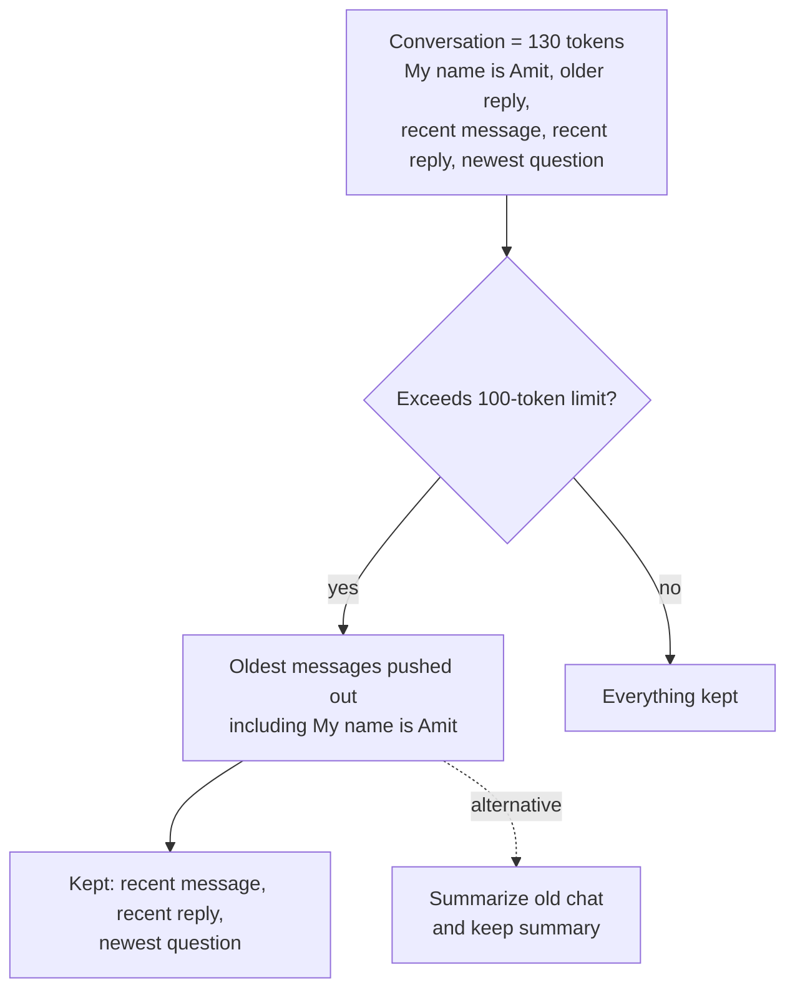
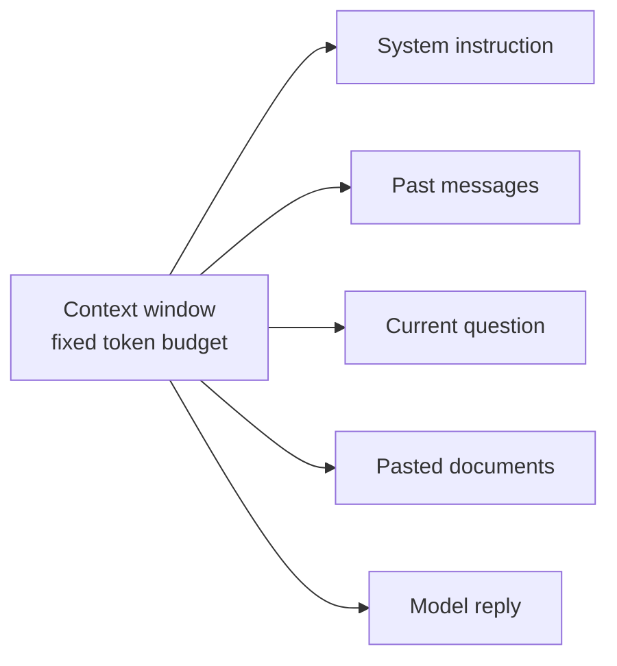

# How does the Context Window work?

> **Step 4: How LLMs Generate Text** · ⏱️ 12 min read · [Read original](https://outcomeschool.com/blog/context-window)

## TL;DR
The context window is the fixed-size space, measured in tokens, holding all text the model can read at once (the model's short-term memory). The model has no permanent memory: each turn the whole conversation is resent. When it overflows, oldest content falls out and the model "forgets" it.

## Key Concepts
- **Context** — everything needed to answer: question, earlier messages, pasted documents.
- **Context window** — fixed-size space of tokens the model reads before each next token; includes input and the reply.
- **Token** — piece of text (word, part of word, character). "I love learning" becomes ["I", " love", " learn", "ing"] (3 words, 4 tokens).
- **Rule of thumb (English)** — about 4 characters per token; 100 tokens about 75 words; 8,000 tokens about 6,000 words.

## How It Works
### Why it exists
Model starts fresh each message. To answer "What is my name?" after "My name is Amit", the whole conversation is packed and resent so both messages sit in the window. The model stays the same; the memory lives in the window we send.

### How the model reads it
- Reads all tokens together, relating each to earlier ones, predicts the next token, appends it, repeats until the answer is complete.
- Information inside the window is usable; outside it is invisible.

| Part | Contents |
|---|---|
| System instruction | Rules, e.g. "You are a helpful teacher" |
| Past messages | Earlier turns |
| Current question | New message |
| Pasted documents | Reference text |
| Model's reply | Answer being written |

All of these compete for the same space.

### Walkthrough (100-token window)
1. "My name is Amit." about 5 tokens; 95 left.
2. Reply "Nice to meet you, Amit." window about 12 tokens.
3. "What is my name?" full conversation sent; model finds the name, answers "Your name is Amit."
4. Window keeps growing toward 100. Each turn carries all older turns, which is why the model seems to remember without permanent memory (saved memories are a separate layer on top).

### When full
Hard limit. Conversation of 130 tokens in a 100-token window: the 30 oldest tokens drop, including "My name is Amit.", so later "What is my name?" fails. Some tools instead summarize old chat and keep the summary in the window.

### Managing the window
- Put important details near the question; do not waste room.
- Summarize old chat: 400 tokens of history becomes a ~30-token summary with key facts kept.
- Paste only relevant parts (a 50-page file when one page is needed wastes the window).
- Leave room for the reply; a nearly full window leaves little for the answer.

## Diagram(s)
### Overflow drops the oldest

### What fills the window

## Trade-offs & Pitfalls
1. Pasting a huge document and expecting it all to be read: overflow is cut off or request fails.
2. One endless chat for many topics: window fills with unrelated text and the model mixes things up; start a fresh chat for a new topic.
3. Burying the real question at the top with pages after it: it can get lost; keep it clear and near relevant context (see the lost-in-the-middle problem).

## FAQ
- Does the reply use the window? → Yes; leave space for it.
- Words in 8,000 tokens? → About 6,000 (input plus reply).
- Why does it forget? → Earlier text left the window.
- New topic, new chat? → Yes.

## Key Takeaways
- Context window = fixed token budget shared by system prompt, history, documents and reply.
- The model has no memory beyond what is resent in the window.
- Overflow drops oldest content (or it is summarized).
- Roughly 100 tokens = 75 words in English.
- Summarize, trim and keep key info near the question.
- Start a new chat per topic.
