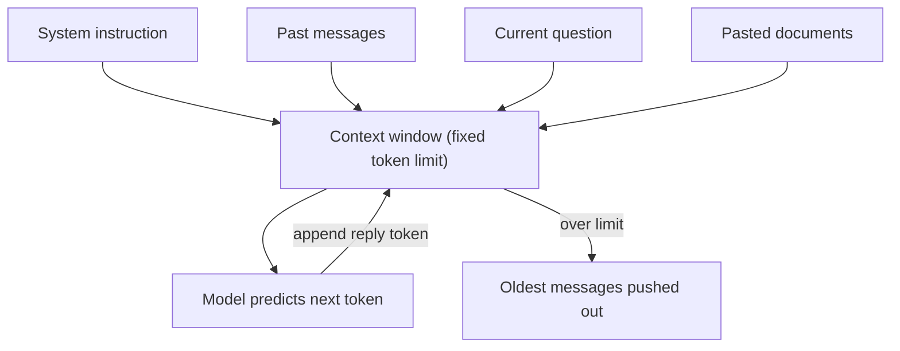

# How does the Context Window work?

> **Step 4: How LLMs Generate Text** · ⏱️ 12 min read · [Read original](https://outcomeschool.com/blog/context-window)

## TL;DR
The context window is the fixed amount of text (measured in tokens) a model can read at once, acting as its short-term memory. The model has no permanent memory of a chat; the whole conversation is re-sent every turn, and anything that falls outside the window is invisible to it.

## Key Concepts
- **Context window** — fixed-size space holding everything the model currently sees: instructions, past messages, question, pasted documents, and its own reply.
- **Token** — small piece of text (word, sub-word, character). Rough English rule: 1 token is about 4 characters; 100 tokens are about 75 words.
- **Window limit** — measured in tokens; an 8,000-token window holds about 6,000 words, shared by input and output.
- **Summarization** — replacing old messages with a short summary to save tokens.

## How It Works
### Why it exists
The model starts fresh on every request. To answer "What is my name?" after "My name is Amit.", the whole conversation is packed and sent again, so both messages sit in the window. The memory lives in the window we send, not in the model.

### How the model uses it
It reads all tokens in the window together, predicts the next token, appends it to the window, and repeats until the answer is done. Information inside the window can be used; information outside cannot be seen at all.

### What shares the window
| Part | Contents |
|---|---|
| System instruction | Rules like "You are a helpful teacher" |
| Past messages | Earlier turns |
| Current question | Newest message |
| Pasted documents | Reference text |
| Model's reply | Answer, token by token |

### When it fills up
Example with a 100-token window and a 130-token conversation: the oldest messages are pushed out, so early facts (like the user's name) are forgotten. Some tools summarize old chat instead of dropping it.

### Managing it
- Keep important details near the question.
- Summarize long chats (e.g. 400 tokens of history into a 30-token summary).
- Paste only the relevant part of large documents.
- Leave room for the reply.

### Common mistakes
1. Pasting a document larger than the window and expecting it all to be read.
2. Using one endless chat for many topics, which fills the window with unrelated text; start a fresh chat.
3. Burying the real question far from the relevant context (see the Lost in the Middle problem).

## Diagram

## Key Takeaways
- The model has no permanent chat memory; the context window carries the conversation.
- The window is measured in tokens and is shared by input and output.
- Anything outside the window is invisible, which is why long chats make the model "forget".
- Summarize old turns, paste only what is relevant, and reserve space for the reply.
- Start a new chat for a new topic.
