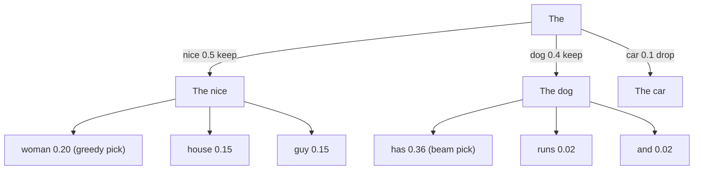
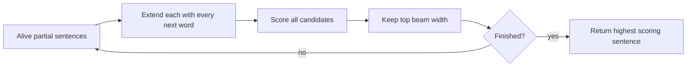

# How do Greedy Decoding and Beam Search differ?

> **Step 4: How LLMs Generate Text** · ⏱️ 19 min read · [Read original](https://outcomeschool.com/blog/greedy-decoding-vs-beam-search)

## TL;DR
Both are decoding rules that pick the next token from the LLM's probabilities. Greedy Decoding keeps one path and always takes the top word, never looking back. Beam Search keeps the top few partial sentences at each step and returns the best complete one, so it can recover from an early choice, at higher cost.

## Key Concepts
- **Token** — small piece of text; think of it as a word. LLM writes one token at a time (autoregressive), giving a probability to every known word given the text so far.
- **Decoding** — the rule that picks the next word from those probabilities until the text is complete.
- **Sentence score** — product of word probabilities, e.g. P(nice) x P(woman | "The nice"). Higher = LLM believes the whole sentence more.
- **Greedy Decoding** — always the highest-probability word. Like always taking the widest road without a map.
- **Beam Search** — keep top-k partial sentences per step; k = **beam width**. Name from a torch beam lighting only a narrow area.
- **Beam width 1 = Greedy Decoding** exactly.
- **Deterministic** — same output every time for same input (both rules; no randomness).

## How It Works

### Greedy on the example
Step 1 "The": nice 0.5, dog 0.4, car 0.1 -> pick nice. Step 2 "The nice": woman 0.4, house 0.3, guy 0.3 -> pick woman. Sentence "The nice woman" = 0.5 x 0.4 = 0.20. Simple and very fast.

### Greedy's problem
Had we picked "dog": next has 0.9, runs 0.05, and 0.05. "The dog has" = 0.4 x 0.9 = 0.36, almost double 0.20. Greedy misses it because dog was not top at step 1 and it never revises. A top word now can lead to a worse sentence; a second-best can lead to a better one. Checking all sentences is impossible (50,000 tokens, 10 long = 50,000^10), so we need something in the middle.

### Beam Search, width 2
1. Start "The"; keep top 2: nice 0.5, dog 0.4 (drop car 0.1).
2. Expand both: nice -> woman 0.20, house 0.15, guy 0.15; dog -> has 0.36, runs 0.02, and 0.02. Pool all 6, keep top 2: "The dog has" 0.36, "The nice woman" 0.20.
3. Best complete sentence: "The dog has" 0.36.

Real scale: beam 5 x 50,000 tokens = 250,000 candidates per step, but only the top 5 are kept, which stays practical.

| Rule | Sentence | Score |
|---|---|---|
| Greedy | The nice woman | 0.20 |
| Beam (width 2) | The dog has | 0.36 |

### Code
Toy model: dict mapping tuple of words so far to next-word probabilities.
```python
def greedy(start, steps):
    seq, score = start, 1.0
    for _ in range(steps):
        probs = next_word_probs[seq]
        word = max(probs, key=probs.get)
        seq, score = seq + (word,), score * probs[word]
    return seq, score

def beam_search(start, steps, beam_width):
    beams = [(start, 1.0)]
    for _ in range(steps):
        candidates = []
        for seq, score in beams:
            for word, p in next_word_probs[seq].items():
                candidates.append((seq + (word,), score * p))
        candidates.sort(key=lambda c: c[1], reverse=True)
        beams = candidates[:beam_width]
    return beams[0]
```
Prints Greedy: The nice woman 0.2; Beam: The dog has 0.36.

Hugging Face: `model.generate(**inputs, max_new_tokens=20, do_sample=False, num_beams=1)` is Greedy; `num_beams=5` is Beam width 5. `do_sample=False` means no random picking.

### Practical details of Beam Search
1. **Add log probabilities instead of multiplying** — products get tiny (0.1 multiplied 50 times) and lose precision; log turns multiplication into addition with the same ranking.
2. **Length normalization** — each word multiplies by a number below 1, so long sentences score lower and Beam Search prefers short ones / stops early. Divide total log prob by length (or length to a power) to compare average per-word score. Hugging Face: `length_penalty`.
3. A sentence is complete when the model emits an end-of-sequence token; completed ones are set aside while search continues.

## Diagram

### Beam Search (width 2) vs Greedy tree


### Beam Search loop


## Greedy vs Beam Search

| Feature | Greedy | Beam Search |
|---|---|---|
| Paths kept per step | 1 | Beam width (e.g. 2 to 10) |
| Picks | Top word each step | Top few partial sentences |
| Fixes early bad choice | No | Yes, partly |
| Total score | Lower | Usually higher |
| Speed / memory | Fastest / low | Slower / higher |
| Output | Same every time | Same every time |
| Typical use | Quick answers, short outputs, simple tasks | Translation, summarization, speech to text |
| Weakness | Short-sighted | Costly, generic and repetitive |

## Trade-offs & Pitfalls
- **More work** — width 5 means 5 sentences processed per step: more compute, memory, slower.
- **Boring, repetitive text** — most likely text is safe and generic; for stories or chat it is dull and may repeat phrases.
- **Bigger is not always better** — very large beams can give shorter, blander output; small widths common.
- Beam Search is not guaranteed to find the best sentence (may sit outside the beam); sometimes greedy is already best and the extra work is wasted.
- Greedy also repeats, since it always picks the safest word.

## When to Use Which
- **Greedy** — fastest/cheapest, one clear answer (extract a date, simple fact, short classification), small devices.
- **Beam Search** — one accurate output close to input (translation e.g. English to Hindi, summarization, speech to text), early mistakes spoil result, can afford compute.
- **Neither, use sampling** — creative, natural, varied text (stories, poems, friendly chat). Sampling picks randomly by probability; Temperature controls randomness.

## Key Takeaways
- Decoding is the rule choosing the next token from the LLM's probabilities.
- Greedy: one path, top word each step, fast, short-sighted.
- Beam Search: keep top-k partial sentences, choose best full score; width 1 equals greedy.
- Example: greedy 0.20 vs beam 0.36 ("The dog has").
- Use log probabilities and length normalization in practice.
- Both are deterministic; neither guarantees the global best.
- Chat/creative generation uses sampling instead.
