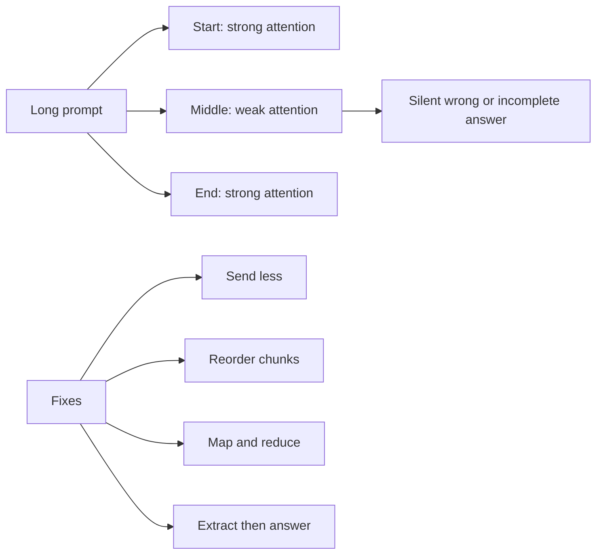

# What is the Lost in the Middle Problem in LLMs?

> **Step 4: How LLMs Generate Text** · ⏱️ 23 min read · [Read original](https://outcomeschool.com/blog/lost-in-the-middle-problem-in-llms)

## TL;DR
Even when text fits inside the context window, an LLM uses information at the start and end of a long input far better than information in the middle. The failure is silent (a confident wrong or incomplete answer), so you must design prompts and test models with this in mind.

## Key Concepts
- **Context window** — maximum text a model can look at in one go (its "working desk"); a capacity number, not a quality guarantee.
- **Lost in the Middle** — strong attention to the beginning and end of a long input, weak attention to the middle. Not truncation: everything reaches the model.
- **U-shaped curve** — accuracy is high when the fact is at the start, dips in the middle, and rises again at the end; the dip deepens with longer inputs.
- **Primacy and recency bias** — the human-like tendency to remember first and last items best.
- **Needle in a Haystack test** — plant a unique fact at varying depths in long filler text and check retrieval.
- **Reranker** — smaller model that scores retrieved chunks so only the best few are kept.

## How It Works
### Example
20 company documents plus "What is our refund policy?". Policy in Document 2: correct. In Document 10 (middle): "could not find it". In Document 19: correct again. Only position changed.

### Why it happens
1. **Attention spread thin** — attention is a fixed budget; with 100,000 tokens each gets a sliver (torch in a big room).
2. **Position handling** — distant tokens get weaker connections; the end is near the answer position, the start holds trained-in instructions, the middle is anchored by nothing.
3. **Human writing patterns** — documents state key points in the intro and conclusion; models learn to trust the edges.
4. **Training rarely uses full length** — long windows are added late; little practice with answers buried deep.

### Where it hurts
RAG (right chunk retrieved at rank 12 of 30 but ignored; the retriever gets blamed wrongly), long chats (rules drift), long document analysis, multi-document comparison, and long-running agents that drift from the original goal.

### Fixes
| Approach | Idea | Limitation |
|---|---|---|
| Stuff everything in | Rely on big window | Middle still lost; more cost and latency |
| Send less, better | Rerank, keep about 5 chunks | Sometimes many chunks are truly needed |
| Order smartly | Best chunks at start and end, weakest in middle (1 3 5 7 6 4 2); question at the end; repeat critical instructions at start and end | Reduces, not removes |
| Map and reduce | Process chunks in small separate calls, then combine | More calls, cost, time |
| Extract first | Step 1 quote relevant lines, step 2 answer from them (prompt chaining) | Extra step |
| Choose model by testing | Run Needle in a Haystack at your real length and content | Weak zones change per model/version |

## Diagram

## Key Takeaways
- A large context window means the model accepts the text, not that it uses all of it equally well.
- Accuracy follows a U-shape; longer inputs make the dip worse.
- Causes: diluted attention, positional bias, human writing patterns, short-biased training.
- Best fix: send less but better context; otherwise put key content and the question at the edges.
- Breaking work into small calls removes the weak middle entirely.
- Test your own model with a needle-in-a-haystack run instead of trusting advertised window size.
