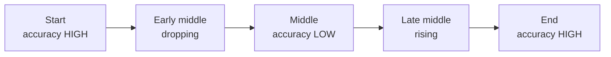
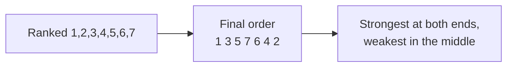
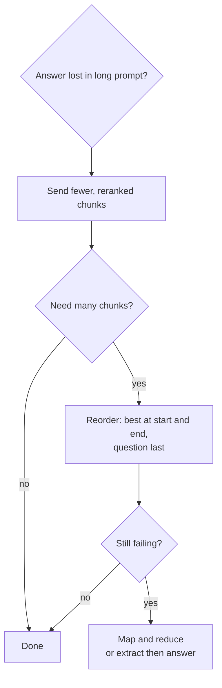

# What is the Lost in the Middle Problem in LLMs?

> **Step 4: How LLMs Generate Text** · ⏱️ 23 min read · [Read original](https://outcomeschool.com/blog/lost-in-the-middle-problem-in-llms)

## TL;DR
In a long input, LLMs use information at the beginning and end well but largely ignore the middle, giving a U-shaped accuracy curve. It fails silently (confident wrong answer, no error). Fix by sending less and better context, ordering smartly, splitting work, and testing your own model.

## Key Concepts
- **Context window** — max text the model can look at in one go (the "working desk"); outside it is invisible. 100,000 tokens about 75,000 words (token about three-fourths of a word).
- **Prompt** — everything sent in one request: instruction, documents, question.
- **Lost in the Middle** — strong attention to start and end, weak to middle; info is present but unused. Not truncation (nothing is removed).
- **U-shaped curve** — accuracy high at start, drops toward middle, rises at end; analogous to primacy bias and recency bias.
- **Attention** — decides how much importance each token gives others, from a fixed budget.
- **Positional encoding** — tags tokens with position.
- **Attention sinks** — first tokens used as a dumping ground for unneeded attention.
- **RAG / chunks / retriever / reranker** — retrieve relevant chunks, place in prompt; reranker is a smaller model scoring how well each chunk answers the question.
- **Needle in a Haystack** — test for the problem.

## How It Works
### Example
20 documents plus a question. Refund policy in Doc 2: correct. In Doc 10 (middle): "could not find the refund policy". In Doc 19: correct. Same content, model, question; only position changed. The dip deepens as input gets longer (invisible with short prompts).

### Why it happens (4 reasons)
1. **Attention spread thin** — fixed importance budget split over more tokens (torch light in a bigger room); loud tokens win, quiet middle ones are crushed.
2. **Position handling** — distance weakens connection. Last part is near where the answer is written; first part holds the instruction (trained to respect it) and gets attention-sink pull; the middle is far and unanchored.
3. **Human writing habits** — important points at intro and conclusion, details in the middle; model learns to trust ends.
4. **Training rarely uses full length** — long windows (e.g. 128,000) are added in a later stage; mostly short examples seen (student who read five-page chapters facing a 500-page book).

### Where it hurts
- **RAG** — stuffing 20 to 50 chunks; chunk at rank 12 of 30 sits in the middle and is effectively not retrieved. Retrieval was fine, generation failed; people wrongly blame the retriever.
- **Long chat** — an instruction given mid-conversation loses power, so a chatbot follows a rule then breaks it (see context compaction).
- **Long documents** — contract or logs: misses middle issues but output looks complete.
- **Multi-document comparison** — middle reports treated shallowly; summary skewed to first and last.
- **AI agents** — after ~30 steps the original goal and latest step are safe, in-between discoveries fade, so the agent drifts.

### Testing: Needle in a Haystack
1. Long irrelevant text (haystack).
2. Unique fact (needle), e.g. "The secret code for the Mumbai office is BLUE-4471."
3. Insert at a depth (e.g. 10%).
4. Ask a question answerable only from the needle.
5. Record found or not.
Repeat at 0%, 10% ... 100% and at different input lengths; grid shows weak zones. Run with your own model, prompt format and content; weak zone changes by model version.

### Solutions (6 approaches)
| # | Approach | Idea | Limitation |
|---|---|---|---|
| 1 | Put everything in | Naive | Window size is capacity, not quality; middle lost; pay for tokens and wait longer |
| 2 | Send less, better | 5 good chunks not 50; use a reranker, keep top few | Sometimes answer truly spans many documents |
| 3 | Order smartly | Rank 1 first, rank 2 last, fold inward: ranks 1..7 become 1 3 5 7 6 4 2; question at very end; repeat critical instructions at start and end | Reduces, doesn't remove; needed chunk may still be in middle |
| 4 | Map and reduce | One call per chunk, then combine short answers (30 docs = 30 small calls + 1 final); no weak middle. Recursive Language Models are a smarter version | Many calls: cost and time |
| 5 | Extract first | Step 1: list document number and exact relevant sentences, don't answer; Step 2: answer using only those (prompt chaining); copying is easier than reasoning | Two steps |
| 6 | Pick model carefully | Test at your real length and content; 1M-token window means it accepts, not understands equally | Per-model testing |

## Diagram(s)
### U-shaped accuracy by position

### Smart ordering of ranked chunks

### Choosing a fix

## Trade-offs & Pitfalls
- Silent failure: confident wrong/incomplete answer, no warning.
- Worse as input grows.
- Reordering only mitigates; map-reduce costs more calls.
- Don't trust advertised context size.

## FAQ
- Same as truncation? → No; nothing removed.
- Bigger window fixes it? → No.
- Where to put the question? → Very end; repeat critical instructions at start and end.
- Chatbot breaks rules later? → Rule drifted into the weak middle.
- Only RAG? → No: chats, documents, comparisons, agents.

## Key Takeaways
- Context window = capacity, not quality guarantee.
- Accuracy is U-shaped over position; deeper dip with longer input.
- Causes: thin attention, positional bias with attention sinks, human writing patterns, short training lengths.
- Best fix: less and better context.
- Put best content at ends, question last, repeat key instructions.
- Map-reduce or extract-then-answer removes the middle.
- Validate with Needle in a Haystack on your own setup.
