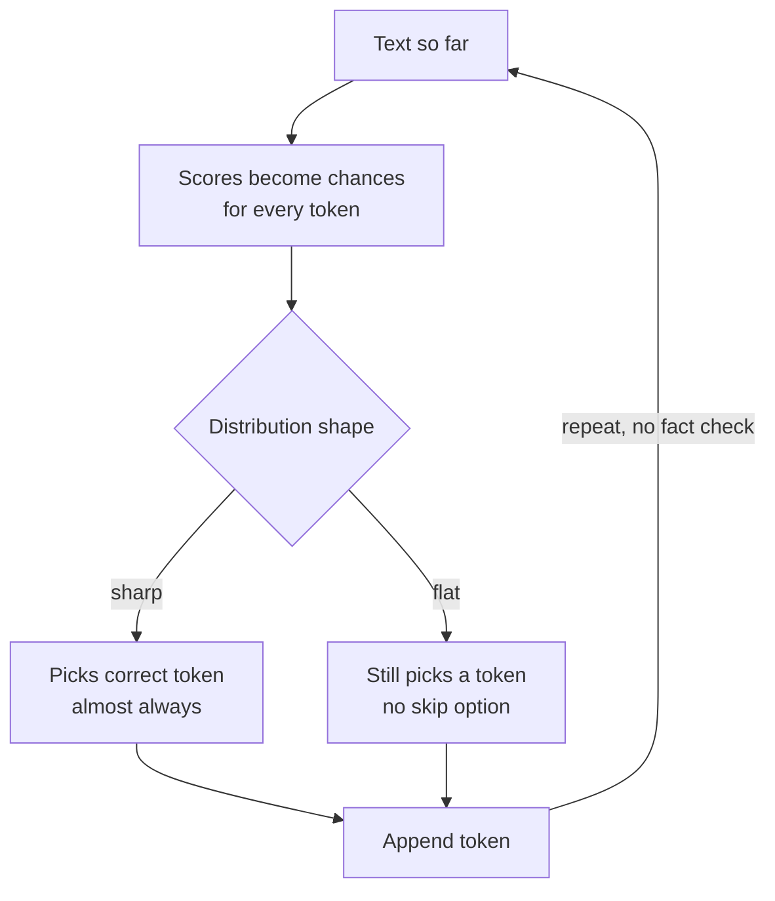
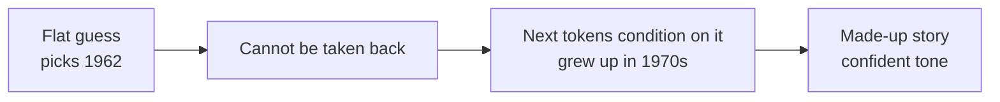

# Why Do LLMs Hallucinate? The Token-Level Explanation

> **Step 4: How LLMs Generate Text** · ⏱️ 20 min read · [Read original](https://outcomeschool.com/blog/why-do-llms-hallucinate-the-token-level-explanation)

## TL;DR
LLMs write one token at a time by picking a likely next token. Nothing in the loop checks truth, there is no "skip", and a picked token can't be undone, so when the model doesn't know a fact it still picks something and sounds confident. Reduce (never eliminate) with RAG, calibrated "I don't know", checking token probabilities, reasoning, low temperature, and verification.

## Key Concepts
- **Hallucination** — confident-sounding answer that is wrong or made up (not deliberate lying).
- **Token** — small text piece; "Meera Joshi was born in 1962" splits as "Me"|"era"|" Joshi"|" was"|" born"|" in"|" 19"|"62". (Blog treats a year as one token for simplicity.)
- **Easy tokens** — grammar/function words (" was", " born", " in"), almost always right.
- **Fact tokens** — carry the information (names, numbers, dates, references); few, but decide truth.
- **Sharp guess** — one token holds nearly all the chance: model knows.
- **Flat guess** — chances spread evenly: model doesn't know.
- **Temperature** — randomness knob.
- **RAG** — retrieve the right information first, give it with the question.

## How It Works
### The loop
1. Look at text so far. 2. Make a list of guesses with chances for the next token. 3. Pick one. 4. Append. 5. Repeat.
Example "The capital of France is": " Paris" 92%, " a" 3%, " the" 2%, " located" 1%, others 2%. No step "check if this is true"; only "pick a likely next token". The same loop is used for easy and fact tokens; no careful mode, so confident grammar makes a wrong fact look confident.

### Sharp vs flat
| Case | Prompt | Distribution | Meaning |
|---|---|---|---|
| Sharp | "Albert Einstein was born in the year" | 1879 95%, 1878 2%, 1880 1%, other 2% | Fact seen thousands of times |
| Flat | "Meera Joshi was born in the year" | 1962 14%, 1958 13%, 1971 13%, then 12% each (1965, 1960, 1968, 1955, 1974) | Never read about her; knows it's a year, not which |

Class analogy: 100 students all shout 1879 vs each shouts a different year. Code `random.choices(tokens, weights=chances)` always returns a token, never "I do not know"; sharp gives 1879 nearly always, flat keeps changing.

### Six reasons
1. **No skip option** — must fill every blank (fill-in-the-blank test with no blanks allowed empty). "I do not know" tokens get small chance: training has far more question-then-answer text than "I do not know", and many training/testing methods score a confident guess higher than honest uncertainty.
2. **Randomness on flat guess** — sharp guess wins regardless; flat guess is decided by chance: five runs give 1962, 1971, 1955, 1962, 1968, each confident but disagreeing (a sign of guessing). Temperature 0 gives always 1962 (14% chance), the same guess every time, not correct.
3. **No eraser** — "Is 3,827 a prime number?" first token "Yes" 52% vs "No" 48%; picks "Yes"; actually 3,827 = 43 x 89; can't revise.
4. **Errors snowball** — model conditions on its own tokens: "Yes, 3,827 is a prime number because it cannot be divided by any number other than 1 and itself." Author example: invented "grew up in the 1970s... first book in the late 1980s" all consistent with the wrong 1962.
5. **Likely tokens combine into something nonexistent** — fake reference "Sharma, A. and Patel, R. (2019). Using AI to Detect Crop Diseases. Journal of Agricultural AI." Each token plausible; nothing checks that the whole exists.
6. **Final text hides uncertainty** — 95%-chance " 1879" and 14%-chance " 1962" look identical in text; probability is discarded.

### Fixes (map to reasons)
| Fix | Idea | Addresses |
|---|---|---|
| 1. Give the model the fact | Paste doc / RAG, flat becomes sharp | Root cause |
| 2. Make "I do not know" likely | Train/score honesty above confident guesses | Reason 1 |
| 3. Look at token chances | Flag low-probability fact tokens; ask the question several times, changing facts = guessing | Reason 6 (and 2) |
| 4. Think before answering | Step-by-step reasoning (e.g. try dividing 3,827, find 43 x 89, then answer "No") | Reasons 3, 4 |
| 5. Low temperature for facts | Fewer random jumps, but same not correct; combine with others | Reason 2 |
| 6. Verify fact tokens | Check names, numbers, dates, references | All |

No fix removes hallucination completely.

## Diagram(s)
### Token loop with no truth check

### How one wrong token snowballs

## Trade-offs & Pitfalls
- Temperature 0 makes answers consistent, not true.
- Fake citations are a signature failure (plausible tokens, nonexistent whole).
- Reading the text alone can't separate sure from guessed parts.

## FAQ
- Is it lying? → No, it picks a likely token and must pick something.
- Which parts hallucinate most? → Fact tokens (names, numbers, dates, references).
- How tell guessing? → Low token chance; repeat question and compare.
- Temperature zero fixes? → No.
- Remove completely? → No.

## Key Takeaways
- The generation loop optimizes likelihood, not truth.
- Few fact tokens determine correctness; grammar tokens mask uncertainty.
- Sharp distribution = knows; flat = guessing but still outputs.
- No skip, no undo, and errors compound.
- Plausible tokens can compose nonexistent references.
- Best mitigations: RAG, honesty training, token-probability checks, reasoning, verification.
- Low temperature gives consistency, not correctness.
