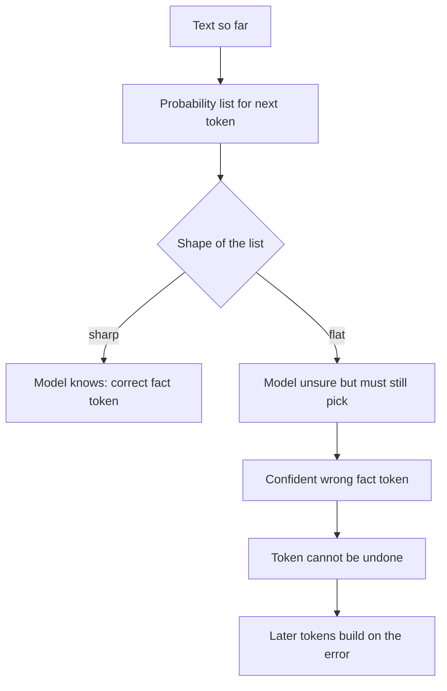

# Why Do LLMs Hallucinate? The Token-Level Explanation

> **Step 4: How LLMs Generate Text** · ⏱️ 20 min read · [Read original](https://outcomeschool.com/blog/why-do-llms-hallucinate-the-token-level-explanation)

## TL;DR
An LLM writes by repeatedly picking a likely next token; nothing in that loop checks truth. When the model does not know a fact, its probability list is flat, yet it must still pick a token and states it with the same confidence as a known fact.

## Key Concepts
- **Hallucination** — a confident-sounding answer that is wrong or made up (not deliberate lying).
- **Easy tokens** — grammar-following tokens (" was", " in") the model almost always gets right.
- **Fact tokens** — tokens carrying real information (names, dates, numbers, references); these decide truth.
- **Sharp guess** — one token holds almost all the probability (Einstein born " 1879" at 95%): the model knows.
- **Flat guess** — probabilities spread evenly (Meera Joshi's year, about 12 to 14% each): the model does not know.

## How It Works: six reasons
1. **No skip option** — every step must output a token. "I do not know" is rarely likely because training has far more question-then-answer text, and scoring often rewards confident guesses over honesty.
2. **Randomness decides on flat guesses** — sampling (temperature) lets five runs give five different confident years. Temperature 0 gives the same guess every time, not a correct one.
3. **Tokens cannot be taken back** — in "Is 3,827 prime?", a 52/48 pick of "Yes" is permanent (it is 43 x 89).
4. **Errors snowball** — the model conditions on its own earlier tokens, so a wrong year grows into a made-up biography.
5. **Likely tokens combine into nonexistent things** — a plausible citation (common authors, year, journal name) is built from individually likely tokens; nothing verifies the whole exists.
6. **Final text hides uncertainty** — only the token remains; the 14% behind " 1962" looks identical to the 95% behind " 1879".

### Fixes (and which reason each targets)
| Fix | Targets |
|---|---|
| Give the model the fact (RAG) so the flat guess becomes sharp | Missing knowledge |
| Train the model to say "I do not know" and reward it | Reason 1 |
| Inspect token probabilities; ask repeatedly and compare | Reasons 2 and 6 |
| Ask it to think step by step before answering | Reasons 3 and 4 |
| Low temperature for facts (consistent, not correct) | Reason 2 |
| Verify names, numbers, dates, references | All |

None of these eliminates hallucination completely.

## Diagram

## Key Takeaways
- The generation loop has a "pick a likely token" step but no "check if true" step.
- Fact tokens, not easy tokens, are where hallucinations appear.
- A flat probability list means the model is guessing; the output text does not reveal that.
- Temperature 0 makes answers consistent, not correct.
- One wrong token can snowball into a fabricated story or fake reference.
- Reduce with RAG, honest-abstention training, probability inspection, reasoning steps, and verification.
