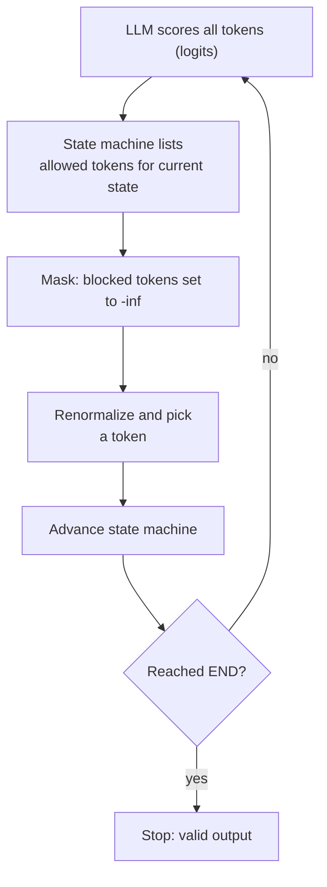
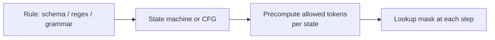

# How does Constrained Decoding work?

> **Step 4: How LLMs Generate Text** · ⏱️ 19 min read · [Read original](https://outcomeschool.com/blog/constrained-decoding)

## TL;DR
Constrained Decoding forces an LLM to produce only output that follows fixed rules (JSON schema, regex, label list, grammar). Right after the logits are computed and before a token is picked, a state machine decides which tokens keep the output valid and the rest are masked to minus infinity. This guarantees format (not truth) without retraining the model.

## Key Concepts
- **Token / vocabulary** — LLM writes one token at a time (word, subword, symbol) from a fixed vocabulary of tens of thousands.
- **Logits** — raw per-token scores; turned into probabilities, then one token is picked. **Decoding** = repeating this until the answer is complete.
- **Constrained Decoding** — at each step allow only tokens that keep output valid under the rules; the LLM still chooses, but only among valid options.
- **Rule types** — JSON Schema (fields and types), regex (e.g. 10 digits), fixed choices (positive/negative/neutral), grammar (SQL, programming language).
- **Mask** — allowed/blocked list; blocked tokens get score minus infinity, so probability exactly 0%.
- **Renormalizing** — rescale remaining allowed probabilities to sum to 100%.
- **State machine** — states plus allowed moves (like a metro map); tells which tokens are allowed now.
- **Context-free grammar** — state machine with a stack, for nested JSON/lists.
- **Structured outputs** — hosted-service feature: pass a schema, output follows it.

## How It Works

### The problem
- Prompt "Reply only in JSON with name and age" usually works, but sometimes returns "Sure! Here is the JSON..." with `"age": "thirty"`: extra text plus wrong type, crashing the parser. Randomly, once in many requests.
- Prompting only makes right tokens more likely, not wrong ones impossible.
- Analogy: a bank form's Age box accepts only digits; the child decides the number, the form decides the shape. LLM = child, rules = form.

### Core idea: masking
- After scores, before picking, for each token ask: can output still become valid if we add this? Yes = keep score; no = set to minus infinity.
- Example: rule "must start with {". Scores: "Sure" 5.1, "{" 4.8, "Here" 3.0. After mask: Sure and Here blocked, "{" picked even though LLM liked Sure most.
- Does not change or retrain the LLM; only filters at pick time.

### Step-by-step example (sentiment)
- Rule: output exactly positive or negative (assume one token each). Review: "The food was cold and the waiter was rude."
1. Probabilities: "The" 40%, "negative" 35%, "positive" 5%, "Negative" 10%, others 10%.
2. Mask: only positive and negative allowed.
3. Renormalize: negative 35/40 = 87.5%, positive 5/40 = 12.5%.
4. Pick negative.
5. Rule complete, so only the end token is allowed; LLM stops.
- Output is exactly "negative". The LLM still did the thinking; the mask removed only rule-breakers.

### Rules to state machine
- Each station = state, each line = move labeled with the allowed character.
- Regex example, phone `555-1234`: S0 start, S1-S3 digits, S4 dash, S5-S7 digits, END after 4 digits total in last part.
- Loop: LLM scores -> state machine gives allowed tokens -> block rest (-inf) -> pick -> advance state -> repeat until END.

### JSON
- Schema: object with `name` (string) and `age` (integer), both required. A library converts it to a state machine (assume fixed key order and spacing).
- Pattern: forced `{ "name": "` -> LLM free text (e.g. Amit) -> forced `", "age":` -> LLM free digits only (30) -> forced `}`.
- Forced steps have exactly one allowed token; some libraries skip running the LLM there and append directly (faster; SGLang uses this). Free parts are still limited (age cannot be "thirty").
- Nested objects/lists need a context-free grammar (stack of open brackets); masking idea is unchanged.

### Tokens are not characters
- State machine works on characters, LLM on multi-character tokens (`{"`, `name`, `": "`, `12`). Walk each token character by character: stays on the map = allowed (`{"` ok from start), else blocked (`Sure` blocked, S not allowed).
- Checking the whole vocabulary each step is slow, so **precompute** per state the list of allowed tokens; at decode time it is a lookup. Outlines popularized this for regex/JSON; XGrammar keeps per-step cost small for full grammars.
- Subtle issue: LLM may naturally write `30` as one token but rules allow only separate small tokens; valid text but split unusually, which can slightly lower quality. Good libraries handle token boundaries.

### In code (Outlines)
```python
from pydantic import BaseModel
class Person(BaseModel):
    name: str
    age: int

model = outlines.from_transformers(llm, tokenizer)
result = model("Extract the person: Amit is thirty years old.", Person)
# { "name": "Amit", "age": 30 }
```
- Person acts as the schema; library builds the state machine and masks each step. "thirty" in the prompt still yields 30 because age allows only digits. Output is a JSON string to load into Person. Function names vary by version.
- Core masking, library-free: for each token, keep score if in `allowed_tokens` else `-math.inf`; then normal picking on masked scores.
- Hosted services offer structured outputs so you need not touch logits.

### Prompt vs Constrained Decoding
| Point | Asking in prompt | Constrained Decoding |
|---|---|---|
| How | Makes right format more likely | Makes wrong format impossible |
| Valid format guaranteed | No | Yes |
| Retries on failure | Sometimes | No, for format errors |
| Changes LLM | No | No, only filters |
| Extra setup | None | Schema, regex or grammar |
| Speed | Normal | Small per-step cost, sometimes faster (forced tokens) |
| Content correct | Not guaranteed | Not guaranteed |

## Diagram(s)

### Per-step decoding loop with mask


### Rule to mask pipeline


## Trade-offs & Pitfalls
- **Works well**: JSON for APIs/forms/extraction, classification into fixed labels, tool-call arguments matching function shape, SQL/code via grammar, small models that follow formats poorly.
- **Valid shape, wrong content** — `"age": 25` when truth is 30; format guaranteed, truth not.
- **Too strict rules hurt quality** — forcing unnatural paths (tokens LLM disliked) can reduce reasoning on some tasks; fix: let LLM think freely first, constrain only the final answer.
- **Getting stuck** — rules allowing endless strings can loop; set a max length.
- **Needs logit access** — easy with own model; hosted services depend on support.
- Best practice: constrain for shape, still validate content in app code.

## FAQ
- Retrains or changes the LLM? → No; only sets blocked tokens' scores to -inf before picking.
- Guarantees correct answer? → No, only format.
- Slower? → Only a little (precomputed lookup); can be faster with forced tokens.
- Hosted services? → Yes if supported, via structured outputs.

## Key Takeaways
- Prompting makes the right format likely; Constrained Decoding makes the wrong format impossible.
- Mask = set invalid tokens' logits to -inf, giving 0% probability; then renormalize.
- Rules compile to a state machine (or CFG for nesting) that tracks allowed next tokens.
- Tokens span several characters, so allowed-token lists are precomputed per state.
- Forced tokens can skip LLM computation, saving time.
- Guarantees shape, never truth; validate content and set max lengths.
- Overly strict constraints can hurt reasoning quality.
