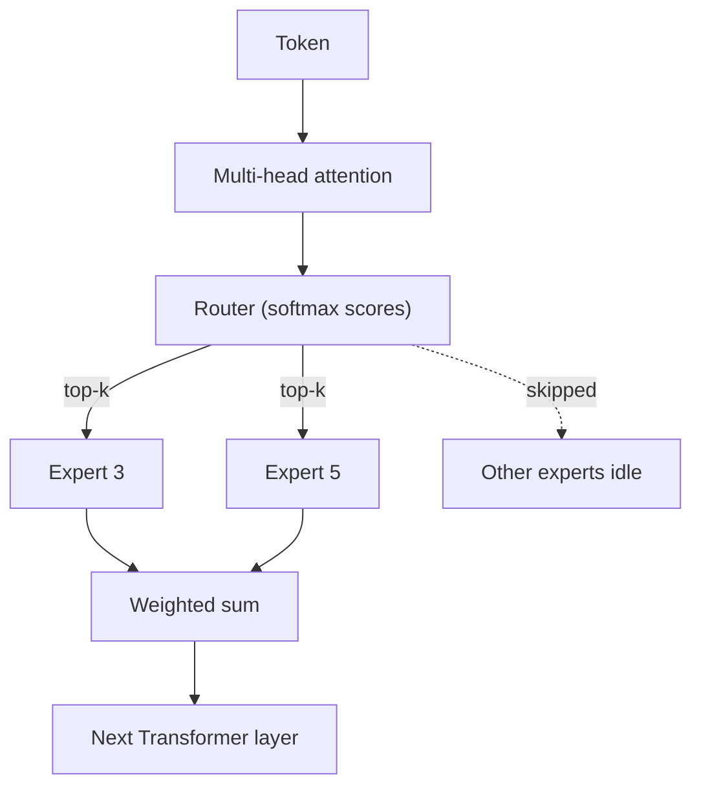

# What is Mixture of Experts (MoE)?

> **Step 5: Modern LLM Architecture** · ⏱️ 16 min read · [Read original](https://outcomeschool.com/blog/mixture-of-experts)

## TL;DR
MoE replaces a Transformer's single big feed-forward network with many small expert networks and a router that sends each token to only the top-k of them. This gives a model with a huge total parameter count but small per-token compute.

## Key Concepts
- **Dense model** — every token uses every parameter; costly and wasteful.
- **Expert** — a small feed-forward network (e.g. 8, 64, or 128 per layer). Not hand-assigned topics; experts tend to specialize on low-level patterns such as punctuation or token shapes.
- **Router** — usually a linear layer plus softmax: $\text{Router}(x) = \text{Softmax}(x W_{router})$. Picks top-k experts (commonly k = 2; Switch Transformer uses k = 1).
- **Sparse activation** — only picked experts run for a token; each MoE layer has its own router.
- **Total vs active parameters** — total = full model size; active = used per token.
- **Load balancing loss** — auxiliary training loss that spreads tokens evenly across experts.
- **Expert capacity** — fixed tokens per expert per batch; overflow is dropped or sent to the next-best expert.

## How It Works
1. The attention sub-layer stays unchanged; only the feed-forward sub-layer becomes an MoE block (some models alternate dense and MoE layers).
2. The router scores all experts for a token and picks the top-k.
3. Only those experts run.
4. Outputs are combined as a weighted sum using softmax weights over just the picked experts. Example: Expert 3 (0.7) and Expert 5 (0.3) give $0.7 \cdot Out_3 + 0.3 \cdot Out_5$.
5. The result goes to the next Transformer layer.

### Active vs total
8 experts of 10B each = 80B total, 20B active per token with top-2. Mixtral 8x7B is about 47B total (not 56B, since attention, embeddings, and norms are shared) with about 13B active.

### Pros and cons
| Advantages | Challenges |
|---|---|
| Huge scale at lower compute | All experts must sit in memory |
| Faster inference per token | Load balancing can collapse to a few experts |
| Natural specialization | Communication cost across GPUs |
| Better training scaling | Harder to fine-tune (router can shift) |

Used in Mixtral, DeepSeek-V2, and DeepSeek-V3.

## Diagram

## Key Takeaways
- MoE = many small experts plus a router that activates only a few per token.
- Only the feed-forward sub-layer is replaced; attention stays dense.
- It saves compute, not memory: all experts must be loaded.
- Load balancing loss prevents router collapse onto a few experts.
- Fast like the active parameter count, smart like the total parameter count.
