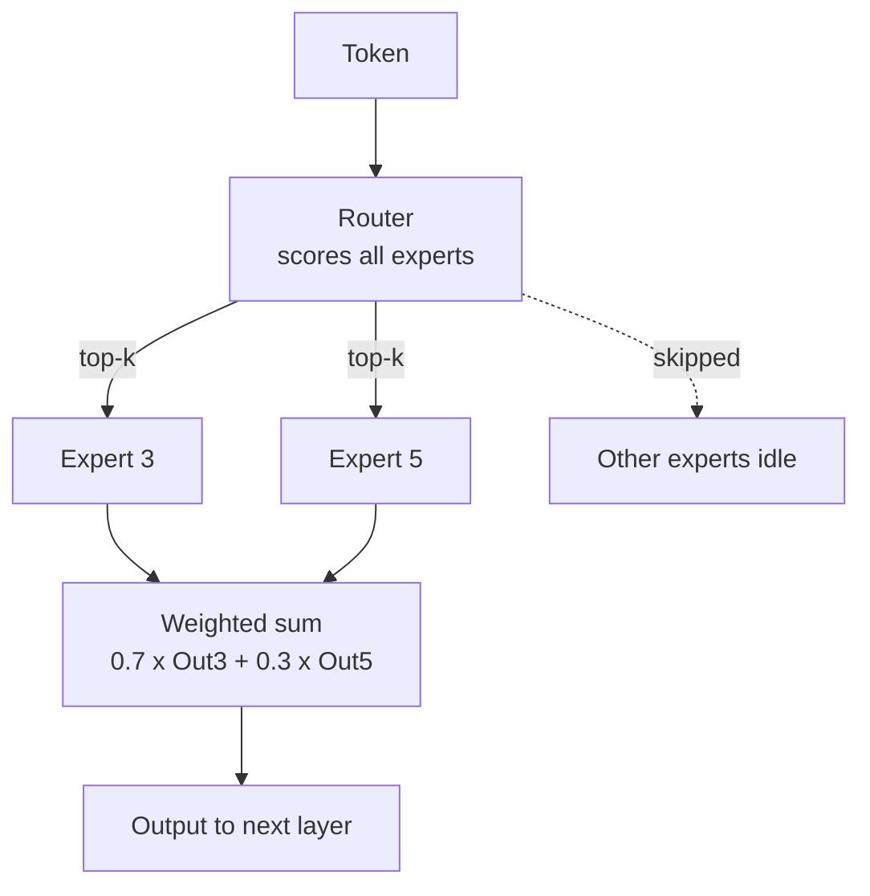
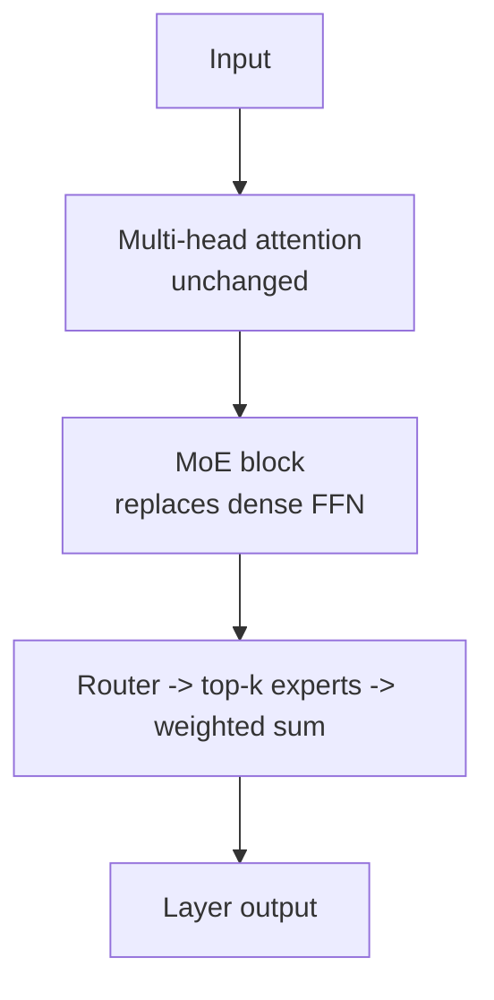

# What is Mixture of Experts (MoE)?

> **Step 5: Modern LLM Architecture** · ⏱️ 16 min read · [Read original](https://outcomeschool.com/blog/mixture-of-experts)

## TL;DR
MoE replaces a Transformer layer's single feed-forward network with many small expert networks plus a router that activates only the top-k (usually 2) per token. Total parameters are huge but compute per token stays small ("a big brain with a small bill"); the cost is memory, load balancing, and communication.

## Key Concepts
- **Dense model** — every token uses every parameter (100B params = all 100B per token).
- **Expert** — a small feed-forward network (FFN); layers may have 8, 64, 128 experts. Not manually specialized on topics; learned on its own, often specializing by low-level patterns (punctuation, word types, token shapes).
- **Router** — tiny network (usually a linear layer + softmax) scoring experts per token.
- **Top-k** — number of experts picked per token; usually k = 2, Switch Transformer uses k = 1.
- **Sparse activation** — only picked experts run.
- **Total vs active parameters** — full model size vs params used per token.
- **Load imbalance / load balancing loss** — router overusing a few experts; auxiliary loss (Switch Transformer, GShard) spreads tokens.
- **Expert capacity** — fixed number of tokens an expert can process per batch.

## How It Works
### Why MoE
Dense models: (1) compute cost grows with size (slower inference, higher GPU bills per token); (2) wasted capacity, since every input passes all parameters whether needed or not. MoE gives huge total parameters while using a small fraction per input. Hospital analogy: receptionist (router) sends patient to the right specialist (expert).

### Router
$$\text{Router}(x)=\text{Softmax}(x\,W_{\text{router}})$$
$x$ is the token vector, $W_{\text{router}}$ learned weights, softmax turns scores into probabilities summing to 1.
1. Score every expert (8 experts = 8 scores).
2. Pick top-k.
3. Send token only to those; others skipped.

### Placement in Transformer
Layer has multi-head attention + FFN. In MoE, only the **FFN is replaced** by the MoE block; attention unchanged. Not every layer must be MoE; some models alternate dense and MoE layers. Each MoE layer has its own router (32 MoE layers = 32 routers) and its own experts; picked experts differ per layer.

### Active vs total parameters
- Example: 8 experts x 10B = 80B total; top-2 means 20B active; behaves like 20B in compute, knowledge of 80B.
- Mixtral 8x7B: about 47B total, about 13B active. Not 8x7=56B because only FFN is replicated; attention, embeddings and normalization are shared.

### Load balancing
If router keeps picking the same 2 experts, others never learn (model collapses, dead weight). Auxiliary load-balancing loss added to the main loss spreads tokens (manager spreading work fairly). Expert capacity: overflow tokens are dropped or sent to next-best expert, making balancing critical in real systems.

### Combining outputs
Router also gives weights; softmax over only the picked experts' scores so weights sum to 1.
$$y = w_1\,E_1(x) + w_2\,E_2(x)$$
Example: Expert 3 score 0.7, Expert 5 score 0.3: output = 0.7 Out_3 + 0.3 Out_5, passed to the next layer (blended, smoother than one-expert answer).

### Advantages vs challenges
| Advantages | Challenges |
|---|---|
| Massive scale (hundreds of billions to trillions of params) at fraction of cost | Memory: all experts must be loaded (80B MoE still needs memory for 80B) |
| Faster inference, lower GPU cost | Load balancing tricky, needs tuned losses |
| Natural specialization learned by router | Communication cost when experts sit on different GPUs (serving engines like SGLang help) |
| Often reaches dense quality with less training compute | Harder to fine-tune (router behavior can shift) |

### Why modern LLMs use it
Mixtral, DeepSeek-V2, DeepSeek-V3 and other frontier models are MoE; rumors say many closed models too. Dense models hit a cost wall; MoE grows total size without growing per-token compute equally.

## Diagram(s)
### Token routed through experts

### MoE inside a Transformer layer

## Trade-offs & Pitfalls
- Saves compute, not memory.
- Router collapse without balancing loss.
- Expert capacity overflow drops tokens.
- Cross-GPU communication overhead.
- Fine-tuning instability.

## FAQ
- Reduces GPU memory? → No.
- Mixtral 47B not 56B? → Only FFN replicated.
- Experts topic-trained? → No, learned patterns.
- Shared router? → No, one per MoE layer.
- Too many tokens to one expert? → Capacity limit: dropped or rerouted.

## Key Takeaways
- MoE = many FFN experts + router; only top-k run per token.
- Only the FFN sub-layer is replaced; attention stays.
- Total params give knowledge; active params set compute.
- Output = router-weighted sum of chosen experts.
- Load-balancing loss prevents expert collapse.
- Benefit is compute savings; memory and comms cost remain.
- Powers Mixtral, DeepSeek and other frontier LLMs.
