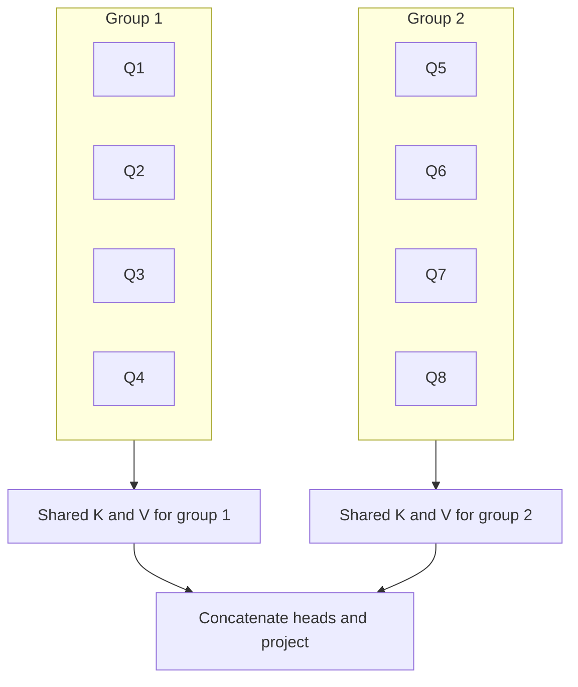

# What is Grouped Query Attention (GQA)?

> **Step 5: Modern LLM Architecture** · ⏱️ 19 min read · [Read original](https://outcomeschool.com/blog/grouped-query-attention)

## TL;DR
GQA keeps a separate Query per attention head but lets groups of heads share one Key and Value. This shrinks the KV Cache during inference while keeping quality close to Multi-Head Attention (MHA).

## Key Concepts
- **MHA** — every head has its own Q, K, V; best quality, biggest KV Cache.
- **KV Cache** — stored Keys and Values of all previous tokens so they are not recomputed; per layer, and it grows with heads, layers, and sequence length (e.g. 8 heads x 1,000 words = 16,000 vectors per layer).
- **MQA** — all heads share one K and V; smallest cache, but quality can drop and training can be unstable.
- **GQA** — heads split into groups; each group shares one K and V. Queries stay per head, preserving diverse attention patterns.
- **num_key_value_heads** — config name for the number of groups; `num_attention_heads` is the query head count.
- **Uptraining** — converting an MHA model into GQA cheaply.

## How It Works
1. Choose the number of groups before training (e.g. 8 heads, 2 groups).
2. Each head computes its own Query.
3. Each group computes one shared Key and Value.
4. Each head attends using its own Query with its group's K and V.
5. Head outputs are concatenated and projected, as in MHA.

With 8 heads and 2 groups the KV Cache is 4x smaller than MHA but keeps 2 distinct KV sets (versus 1 in MQA).

### GQA generalizes both
- groups = heads: exactly MHA.
- groups = 1: exactly MQA.
- in between: GQA.

Heads per group = `num_attention_heads / num_key_value_heads` (32 query heads and 8 KV heads: 8 groups of 4).

### Comparison (8 heads)
| | MHA | MQA | GQA (2 groups) |
|---|---|---|---|
| KV sets | 8 | 1 | 2 |
| KV Cache | Largest | Smallest | In between |
| Quality | Best | Can degrade | Close to MHA |
| Inference speed | Slowest | Fastest | Fast |

### Uptraining
Take a trained MHA model, average the K and V weight matrices of heads within each group, then fine-tune briefly. The paper found about 5% of original pre-training compute recovers near-MHA quality.

### Real models
LLaMA 2 34B and 70B (8 KV groups; 70B has 64 query heads so cache is 8x smaller; 7B and 13B still use MHA), LLaMA 3 (all sizes), Mistral 7B (32 query heads, 8 KV groups, plus Sliding Window Attention). Helps long conversations, serving many users per GPU, and edge deployment.

## Diagram

## Key Takeaways
- GQA targets the inference-time KV Cache problem, not training.
- Only K and V are shared; Queries stay separate to keep attention diversity.
- Number of groups is a dial: heads = MHA, 1 = MQA, in between = GQA.
- It gives MQA-like memory savings with near-MHA quality.
- Existing MHA models can be uptrained to GQA with a small fraction of compute.
