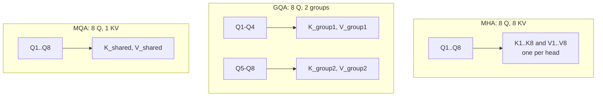
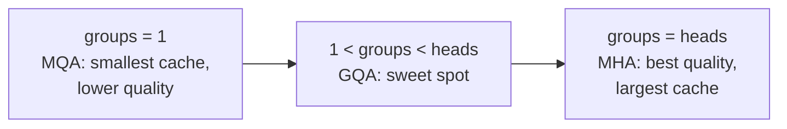

# What is Grouped Query Attention (GQA)?

> **Step 5: Modern LLM Architecture** · ⏱️ 19 min read · [Read original](https://outcomeschool.com/blog/grouped-query-attention)

## TL;DR
GQA divides attention heads into groups; heads in a group share one Key and Value while each keeps its own Query. This shrinks the KV Cache (the inference memory bottleneck) while keeping quality near Multi-Head Attention. It sits between MHA (one KV per head) and MQA (one KV for all), and generalizes both.

## Key Concepts
- **MHA** — each head has own Q, K, V; outputs concatenated and projected. Best quality, biggest cache.
- **KV Cache** — stored Keys and Values of all previous tokens so they aren't recomputed during generation.
- **MQA** — each head own Q, all share one K and V.
- **GQA** — heads split into groups, one K and V per group, own Q per head.
- **Uptraining** — cheaply converting a trained MHA model to GQA.
- **Config names** — `num_attention_heads` (query heads), `num_key_value_heads` (groups).

## How It Works
### MHA recap and the problem
8 heads: (Q1,K1,V1) ... (Q8,K8,V8). Detective analogy: each has own clues and questions. Great in training, but at inference each new word needs K, V of all previous words, so they're cached.
Example: 1,000 words, 8 heads = 8,000 Keys + 8,000 Values = 16,000 vectors per layer (multiply by number of layers). 64 heads and 100,000 tokens = huge GPU memory (64 notebooks of 100,000 pages). Slow, expensive inference especially for long sequences.

### MQA
All heads share K_shared and V_shared: cache 8x smaller (8 heads). Downside: less diversity of perspectives, quality can drop and training can be unstable.

### GQA
8 heads, 2 groups: heads 1 to 4 share K_group1/V_group1; 5 to 8 share K_group2/V_group2. Cache 4x smaller than MHA, but 2 KV sets vs MQA's 1. Only K and V shared; Q stays separate (preserves diverse attention patterns; and cache stores only K and V, not Q).

Steps:
1. Divide heads into groups (number set before training).
2. Each head computes its own Q.
3. Each group computes one shared K and V.
4. Each head attends with its own Q and its group's K, V.
5. Concatenate and final projection as in MHA.

### Generalization
- groups = heads: MHA.
- groups = 1: MQA.
- 1 < groups < heads: GQA.
Changing group count tunes the quality/memory trade-off.

$$
\text{Heads per group}=\frac{\text{num\_attention\_heads}}{\text{num\_key\_value\_heads}}
$$

Example: 32 query heads, 8 KV heads = 8 groups of 4.

### Comparison
| Feature | MHA | MQA | GQA |
|---|---|---|---|
| KV sets | One per head | One for all | One per group |
| KV cache | Largest | Smallest | In between |
| Quality | Best | Can degrade | Close to MHA |
| Inference memory | Highest | Lowest | In between |
| Speed | Slowest | Fastest | Fast |
| 8 heads, 2 groups | 8 KV | 1 KV | 2 KV |

### Real models
- LLaMA 2 34B and 70B: GQA with 8 KV groups (70B has 64 query heads, so cache 8x smaller than MHA); 34B described in paper but weights not released; 7B and 13B use MHA.
- LLaMA 3: GQA for all sizes.
- Mistral 7B: 32 query heads, 8 KV groups; also pairs with Sliding Window Attention.
- Useful for long conversations, serving many users per GPU (vLLM manages cache at serving time), edge deployment.

### Uptraining MHA to GQA
1. Take trained MHA model.
2. Per group, average the Key weight matrices of its heads; same for Values.
3. Fine-tune briefly: about 5% of original pre-training compute recovers near-MHA quality.
Reason GQA was adopted quickly: no need to train from scratch.

## Diagram(s)
### MHA vs GQA vs MQA

### Spectrum by number of groups

## Trade-offs & Pitfalls
- MQA saves most memory but loses quality/stability; MHA has the biggest cache; GQA balances.
- Benefit is at inference; training with MHA is fine.
- Cache grows with layers, heads, and sequence length.

## FAQ
- Why share K, V but not Q? → Q gives per-head perspective; cache holds only K and V.
- Reduces quality? → Only slightly.
- Training or inference benefit? → Inference.
- Find groups in config? → `num_key_value_heads`.
- All LLaMA 2 use GQA? → No, only 34B and 70B.

## Key Takeaways
- KV cache is the inference bottleneck of MHA.
- MQA: 1 shared KV; GQA: 1 per group; MHA: 1 per head.
- Only K and V are shared; Q stays per head.
- GQA is the generalization; groups = 1 is MQA, groups = heads is MHA.
- Cache shrinks by heads/groups (8 heads, 2 groups = 4x).
- Used in LLaMA 2 (34B, 70B), LLaMA 3, Mistral 7B.
- MHA checkpoints convert via mean-pooled K/V weights plus about 5% compute uptraining.
