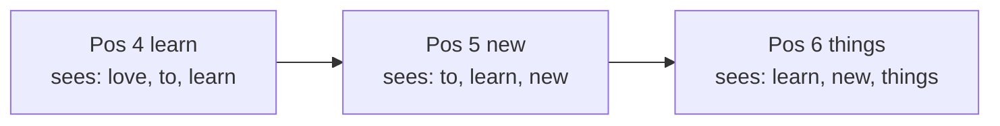
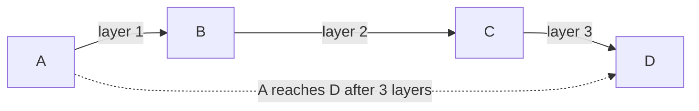

# How does Sliding Window Attention work?

> **Step 5: Modern LLM Architecture** · ⏱️ 14 min read · [Read original](https://outcomeschool.com/blog/how-does-sliding-window-attention-work)

## TL;DR
Sliding window attention lets each token attend only to a fixed number of nearby tokens (the window) instead of all tokens, turning quadratic cost into linear. Distant information still flows indirectly because stacked layers extend the reach.

## Key Concepts
- **Attention** — how a word looks back at earlier words and decides which matter (e.g. "it" refers to "cat" in "The cat sat on the mat because it was tired").
- **Full attention** — every word looks at every other word.
- **Window / window size** — fixed number of nearby words each word may see (e.g. 4, 512, 4096).
- **Sliding** — window moves with each word.
- **Layer** — one full round of attention; output feeds the next layer.
- **Causal (left-to-right)** — in chatbots a word sees only itself and past words (see causal masking).

## How It Works
### Problem: full attention cost
Connections = n x n: 100 words = 10,000; 1,000 words = 1,000,000. 10x longer text = 100x work (quadratic); double text = 4x work. Slow and memory-hungry for books or long documents. Classroom analogy: speaker looking at all 10,000 students versus the few neighbors.

$$
\text{Full attention cost} \propto n^2 \qquad \text{Sliding window cost} \propto n \cdot w
$$

$n$ = text length, $w$ = window size (fixed). Linear growth: 10x text = 10x work.

### Walkthrough
6 words "I love to learn new things", window = self + 2 previous (3 words):
| Position | Word | Looks at |
|---|---|---|
| 1 | I | I |
| 2 | love | I, love |
| 3 | to | I, love, to |
| 4 | learn | love, to, learn (I drops out) |
| 5 | new | to, learn, new |
| 6 | things | learn, new, things |
Window slides one step each time.

### Far-away information via layers
Word 100 can't see word 1 directly, but layers pass info along neighbors: layer 1 A tells B; layer 2 B (knowing A) tells C; layer 3 C tells D, so D indirectly learns of A. Reach: if window looks 4 back per layer, 1 layer = 4, 2 layers = about 8, 10 layers = about 40 words back.

$$
\text{reach} \approx \text{layers} \times \text{window}
$$

### Normal vs sliding
| Point | Normal | Sliding window |
|---|---|---|
| Looks at | Every word | Fixed nearby window |
| Cost growth | Square of length | Linear |
| Speed (long) | Slow | Fast |
| Memory (long) | Very high | Low |
| Distant links | Direct, one layer | Indirect, many layers |
| Best for | Short text | Long text |

### Where used
Models handling long inputs: chatbots with long conversations (also keeps conversation memory from growing unbounded, so it is a KV Cache compression technique), long legal documents or books. Related: KV Cache, Paged Attention, GQA, vLLM.

## Diagram(s)
### Window sliding over tokens

### Information hops across layers

## Trade-offs & Pitfalls
- Distant tokens connect only indirectly; need enough layers and a reasonable window size (very small window plus few layers misses long-range links).
- Little benefit on short text; full attention is already fast.
- If the window slides so far that the first tokens fall out, quality collapses, since those tokens are attention sinks absorbing leftover attention.

## FAQ
- Future words visible? → Not in chatbots (causal, left-to-right).
- How far back? → Depends on window and layers (4 per layer: 4, about 8, about 40).
- Reduces memory in long chats? → Yes; keeps memory bounded (KV Cache compression).
- First tokens slide out? → Quality can collapse (attention sinks lost).

## Key Takeaways
- Each token attends to a fixed local window; cost becomes linear in length.
- Full attention is quadratic: 10x text = 100x work.
- Layers stack to give indirect long-range reach (about layers x window).
- Good for long documents and long chats; little gain for short text.
- Dropping initial tokens breaks the model because of attention sinks.
- Window size and depth must be chosen for the use case.
