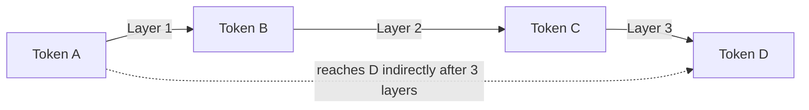

# How does Sliding Window Attention work?

> **Step 5: Modern LLM Architecture** · ⏱️ 14 min read · [Read original](https://outcomeschool.com/blog/how-does-sliding-window-attention-work)

## TL;DR
Sliding window attention lets each token attend only to a fixed number of nearby tokens instead of all tokens. Cost then grows linearly with text length rather than quadratically, and stacked layers still carry information across long distances.

## Key Concepts
- **Attention** — how a token gathers information from other tokens (e.g. "it" looking back to "cat").
- **Full attention** — every token looks at every other; cost grows with the square of length (10x longer text means 100x work).
- **Window size** — fixed count of nearby tokens each token may see (e.g. 4, 512, 4096).
- **Causal (backward) window** — in a chatbot a token sees itself and the previous tokens only.
- **Attention sinks** — the very first tokens soak up leftover attention; if they slide out of the window, quality can collapse.

## How It Works
Example: "I love to learn new things" with a window of itself plus 2 previous words.
| Position | Word | Attends to |
|---|---|---|
| 1 | I | I |
| 2 | love | I, love |
| 3 | to | I, love, to |
| 4 | learn | love, to, learn |
| 5 | new | to, learn, new |
| 6 | things | learn, new, things |

The window slides one step per token, so work grows in a straight line with length.

### How far information travels
Each layer connects only neighbors directly, but layers are stacked: if a layer reaches 4 tokens back, 2 layers reach about 8 and 10 layers about 40. Distant tokens connect indirectly, like a whisper chain.

### Normal vs sliding window
| | Normal attention | Sliding window |
|---|---|---|
| Looks at | Every token | Nearby tokens only |
| Cost growth | Quadratic | Linear |
| Memory on long text | Very high | Low |
| Far connections | Direct, one layer | Indirect, many layers |
| Best for | Short text | Long text |

### Use and trade-offs
Used for long inputs such as long chats and legal documents, and counted as a KV Cache compression technique because memory stops growing without limit. Trade-offs: needs enough layers and a reasonable window for distant information; too small a window with few layers misses long-range links; little benefit for short text; watch the attention sink issue.

## Diagram

## Key Takeaways
- Full attention cost is quadratic; sliding window makes it linear.
- Each token sees only a fixed neighborhood, and the window moves with it.
- Depth gives reach: roughly window size times number of layers.
- It cuts compute and memory for long inputs and acts as KV Cache compression.
- Dropping the earliest tokens can break quality because they act as attention sinks.
