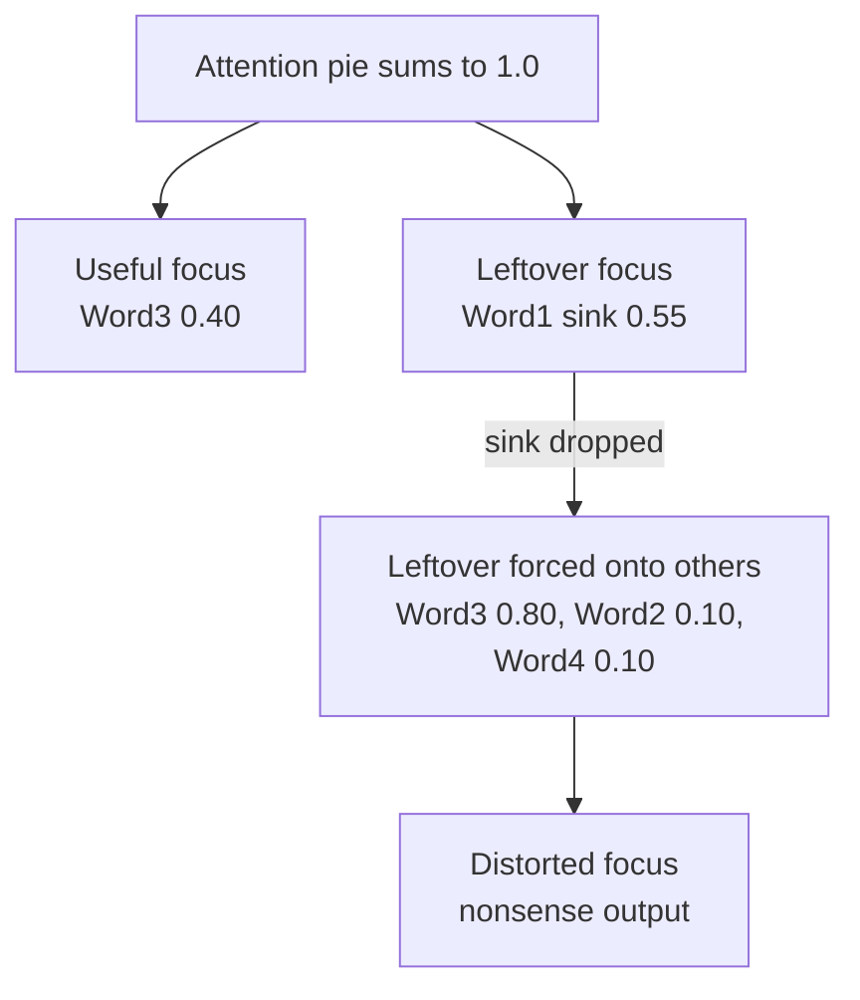
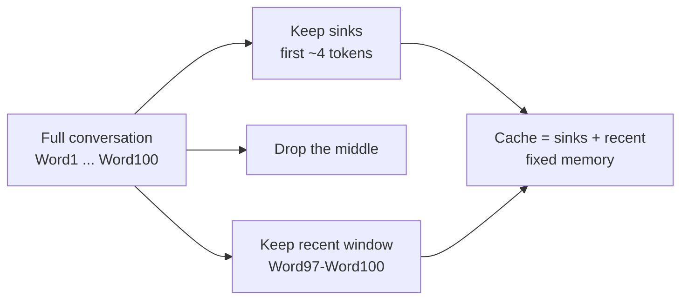

# How do Attention Sinks work?

> **Step 5: Modern LLM Architecture** · ⏱️ 16 min read · [Read original](https://outcomeschool.com/blog/how-do-attention-sinks-work)

## TL;DR
Attention sinks are the first few tokens that soak up a large, meaningless share of attention because attention scores must sum to 1. Evicting them (naive sliding window) wrecks the model. Keeping a few sink tokens plus a recent window (StreamingLLM) lets models run indefinitely with fixed memory.

## Key Concepts
- **LLM** — predicts the next token repeatedly; tokens are pieces of words.
- **Attention** — scores over earlier tokens saying how much to focus on each; **scores sum to 1** (a full pie must always be shared out).
- **Context window** — limit of tokens held in memory (e.g. 4000); beyond it old tokens must go (KV cache grows with each token).
- **Sliding window** — keep only the latest N tokens.
- **Attention sink** — token used as a dump for attention that is not needed elsewhere (a drain).
- **StreamingLLM** — keep sink tokens + recent window.
- **Learnable attention sink** — dedicated token trained to be the drain; used e.g. in DeepSeek-V4.

## How It Works
### Problem and naive fix
Chatbot used for hours exceeds the context window; must drop old tokens. Naive: sliding window dropping the oldest (window of 4: Word5 arrives, drop Word1; Word6 arrives, drop Word2). Surprise: once the first tokens are dropped, output becomes nonsense, even though they were irrelevant chit-chat.

### Why first tokens become sinks
- Softmax forces scores to sum to 1, even when the current token needs no past context.
- The model needs a safe drain that doesn't change meaning. The first token is always visible to every later token (causal masking), so it is the common drain. The model learns "when in doubt, dump attention on the first token".
- Sink is a token the model uses as dumping ground; meaning of the token is irrelevant.

### Numeric walkthrough (4 words, processing Word4)
With sink: Word1 (sink) 0.55, Word2 0.02, Word3 0.40, Word4 0.03 = 1.00.
Drop Word1: the 0.55 is forced onto the rest: Word2 0.10, Word3 0.80, Word4 0.10 = 1.00. Word3 inflated 0.40 to 0.80, everything distorted, so the next guess is nonsense. "The drain is gone and dirty water spills everywhere."

### Fix: keep sinks + recent
```python
def streaming_window(tokens, num_sinks, window_size):
    sinks = tokens[:num_sinks]
    recent = tokens[-window_size:]
    return sinks + recent
```
Naive version `tokens[-window_size:]` loses sinks. Only the middle is discarded. Just the first 4 tokens as sinks is usually enough.

### StreamingLLM and modern use
- StreamingLLM: a few sink tokens + sliding recent window; handles millions of words in small fixed memory without crashing or nonsense; a form of token eviction (KV Cache compression).
- Newer models add a dedicated learnable sink token, a private drain with no meaning, cleaner than borrowing a real word. Sinks moved from discovery to designed feature.

### Importance
Enable long chats without slowdown or breakage; fixed memory for endless chats; explain a confusing behavior; turn a quirk into a design tool.

## Diagram(s)
### Attention budget with and without the sink


### StreamingLLM cache layout


## Trade-offs & Pitfalls
- Plain sliding-window eviction breaks the model when sinks leave.
- Middle context is discarded in StreamingLLM; it keeps stability, not full memory.
- Sink token content doesn't matter; do not assume it carries meaning.

## FAQ
- Do sinks carry meaning? → No; just always visible.
- Why not give less attention? → Scores must sum to 1.
- How many sinks? → About 4.
- Memory grows in StreamingLLM? → No, fixed.
- First-token sink vs learnable sink? → Learnable is a dedicated meaningless token trained for the role.

## Key Takeaways
- Attention weights sum to 1, so unused attention needs a drain.
- The first tokens become the drain because every token can see them.
- Evicting them redistributes mass and breaks the model.
- Fix: keep about 4 sink tokens + recent window, drop the middle.
- StreamingLLM runs indefinitely in fixed memory.
- Modern models add learnable sink tokens on purpose.
