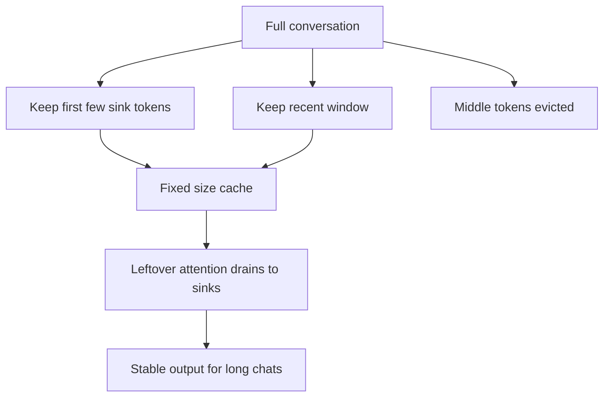

# How do Attention Sinks work?

> **Step 5: Modern LLM Architecture** · ⏱️ 16 min read · [Read original](https://outcomeschool.com/blog/how-do-attention-sinks-work)

## TL;DR
Because attention scores must sum to 1, models dump leftover attention on the first few tokens, which therefore act as "attention sinks". A naive sliding window that evicts them breaks the model, so streaming setups keep a few sink tokens plus a recent window.

## Key Concepts
- **Attention** — a set of scores saying how much each earlier token matters for the current one; scores sum to 1 (a pie that must be fully shared).
- **Context window / KV cache limit** — memory cap forces old tokens to be dropped in long conversations.
- **Naive sliding window** — keep only the latest N tokens; when the first tokens fall off, output turns to nonsense.
- **Attention sink** — token (usually among the first few) that absorbs attention the model does not need elsewhere.
- **StreamingLLM** — keeps sink tokens plus a recent window; fixed memory, works for millions of words. A form of token eviction / KV cache compression.
- **Learnable attention sink** — dedicated sink token trained into the model (DeepSeek-V4 uses learnable sinks).

## How It Works
### Why the first token
The current token often needs no past context, but must still distribute a full 1.0 of attention. The first token is visible to every later token (due to causal masking), so it becomes the safe common drain.

### Numeric example (4 tokens)
Scores with the sink: Word1 0.55, Word2 0.02, Word3 0.40, Word4 0.03 (sum 1.0).
Drop Word1 and the model must renormalize: Word2 0.10, Word3 0.80, Word4 0.10. Word3 is wrongly doubled, focus is distorted, and the next guess becomes nonsense.

### The fix
```python
def streaming_window(tokens, num_sinks, window_size):
    return tokens[:num_sinks] + tokens[-window_size:]
```
Keep the first few tokens (about 4 is usually enough) and the recent window; discard only the middle.

### Comparison
| | Naive window | Sinks plus window |
|---|---|---|
| Keeps | Latest N | First few plus latest N |
| Memory | Fixed | Fixed |
| Outcome | Breaks when start is dropped | Stable on endless chats |

## Diagram


## Key Takeaways
- Softmax-style attention must sum to 1, so unused attention needs somewhere to go.
- The first tokens become that drain, regardless of their meaning.
- Evicting them redistributes attention wrongly and quality collapses.
- StreamingLLM keeps sinks plus a recent window to run indefinitely with fixed memory.
- Newer models add a learnable sink token on purpose instead of borrowing a real word.
