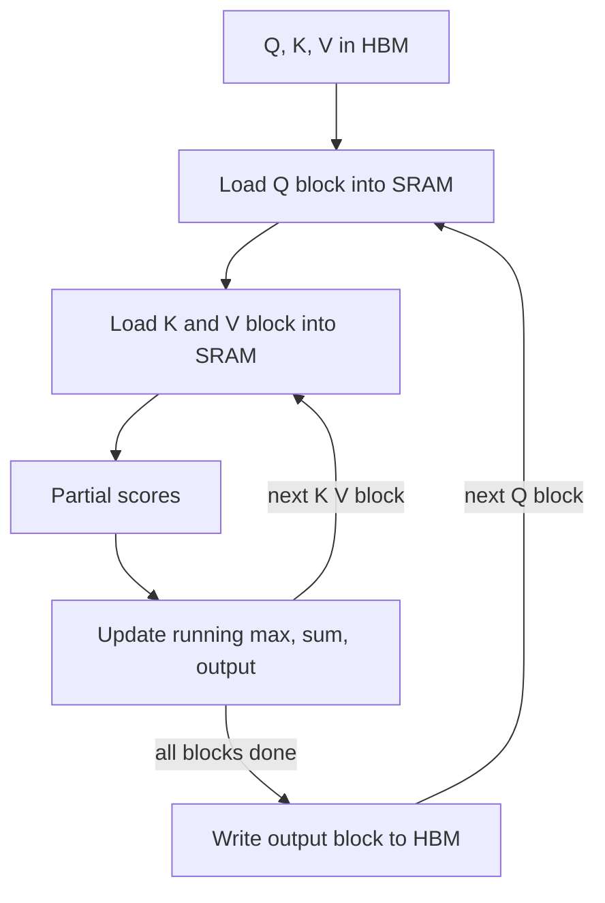

# What is Flash Attention and Why Is It So Fast?

> **Step 5: Modern LLM Architecture** · ⏱️ 25 min read · [Read original](https://outcomeschool.com/blog/decoding-flash-attention)

## TL;DR
Flash Attention computes exactly the same attention as the standard method but reorganizes it on the GPU so the giant N x N score matrix is never written to slow memory. It is faster because it moves far less data, not because it does less math, and it uses O(N) instead of O(N^2) memory.

## Key Concepts
- **Standard attention** — $\text{softmax}(QK^T/\sqrt{d_k})V$; builds an N x N matrix (4,000 tokens = 16M entries; 100,000 = 10 billion).
- **HBM** — large but slow GPU memory. **SRAM** — tiny (hundreds of KB) on-chip memory, roughly 10 to 20x faster.
- **Bottleneck** — memory traffic, not math: the N x N matrix is written and read about four times.
- **Tiling** — split Q, K, V into blocks (e.g. 256 tokens) that fit in SRAM.
- **Online softmax** — compute softmax block by block with a running max, running sum, and running output.
- **Recomputation** — in the backward pass, recompute scores in SRAM using saved per-row softmax stats (max and sum, O(N) memory).

## How It Works
1. Outer loop over Q blocks, inner loop over K and V blocks, all loaded into SRAM.
2. Compute partial scores for the block pair.
3. Update running max; if it grew, rescale the old running sum and output by $e^{\text{old max} - \text{new max}}$.
4. Add the new block's contribution.
5. Write only the final output block to HBM.

Online softmax example: row [2, 4, 6] in blocks [2, 4] then [6]. After block 1: max 4, sum about 1.135. After block 2: rescale by $e^{-2} \approx 0.135$ giving about 0.153, add 1, total about 1.153, identical to full softmax.

### Data movement example (N = 4,000, d = 128, block 256)
| | Entries moved |
|---|---|
| Standard (S write/read, P write/read) | about 64M |
| Flash (K and V re-read per Q block, plus output) | about 17M |

Roughly 4x less, with the gap growing with length. The extra recompute is a good trade because GPUs have far more compute than memory bandwidth.

### Versions
- **FA2** — fewer non-matmul ops (rescaling is slow versus tensor cores), also parallelizes across Q blocks along the sequence, better work split inside workers. About 2x faster than FA1; most widely used.
- **FA3** — for Hopper GPUs (H100, H200); asynchronous copy via TMA overlaps data movement with compute.

## Diagram

## Key Takeaways
- Same math and exact same output: not an approximation.
- Speed comes from cutting HBM-SRAM traffic via tiling and online softmax.
- Memory drops from O(N^2) to O(N), which enables long context windows.
- Backward pass recomputes scores instead of storing them.
- Typically 2x to 4x faster on long sequences; drop-in replacement for standard attention.
- FA2 is the common choice; FA3 targets Hopper GPUs.
