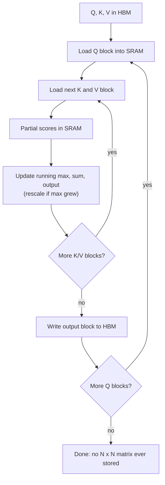
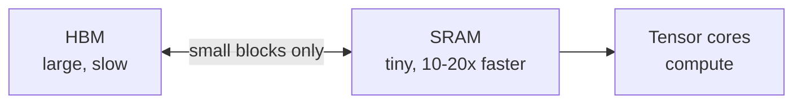

# What is Flash Attention and Why Is It So Fast?

> **Step 5: Modern LLM Architecture** · ⏱️ 25 min read · [Read original](https://outcomeschool.com/blog/decoding-flash-attention)

## TL;DR
Flash Attention computes exactly the same attention as standard attention (no approximation) but far faster and with O(N) memory. It never writes the giant N×N matrix to slow GPU memory (HBM); it works in small blocks inside fast SRAM (tiling) and uses online softmax to combine blocks. Speed comes from moving less data, not doing less math.

## Key Concepts
- **Standard attention** — $\text{softmax}(QK^\top/\sqrt{d_k})V$; builds an N×N score matrix.
- **HBM** — large (tens of GB) but slow GPU memory.
- **SRAM** — tiny (a few hundred KB) on-chip memory, ~10-20x faster than HBM.
- **S / P** — S = $QK^\top$ (scores), P = softmax(S) (probabilities), O = $PV$ (output).
- **Tiling** — split Q, K, V into small blocks (e.g. 256 tokens) that fit in SRAM.
- **Online softmax** — compute softmax block by block with running max, running sum, running output.
- **Recomputation** — in backward pass, rebuild attention scores in SRAM instead of storing them.
- **Block size / d** — tokens per block (256) / per-token vector length (head dim, commonly 64 or 128).

## How It Works

### Why standard attention is slow
- Score matrix is N×N: 4K tokens = 16M entries; 10K = 100M; 100K = 10B. Memory grows quadratically (double length = 4x memory).
- The N×N matrix is moved through HBM repeatedly: write S, read S for softmax, write P, read P for multiply with V, then write the small output.
- GPU is not slow at math; cores sit waiting for data from slow memory. Data movement is the bottleneck.
- (Sliding window attention attacks cost differently: tokens see only neighbours, so cost is linear. Flash Attention is not that; it is still full attention.)

### Core idea
Never store the N×N matrix in HBM. Compute in blocks inside SRAM, write only the final output to HBM. Two challenges: how to block (tiling) and how to do softmax with partial rows (online softmax).

### Tiling
For each Q block, loop over K/V blocks: load into SRAM, compute partial scores, multiply by matching V block, update running output. Analogy: bring one chapter to a small desk instead of spreading the whole book on a huge table.

### Softmax problem and online softmax
Softmax needs the whole row: subtract max (avoid exp overflow/NaN), then $\exp(s_i-\max)/\sum_j \exp(s_j-\max)$. Tiles only show part of the row.

Online softmax keeps running max, running sum of $\exp(s-\text{running\_max})$, and running output. When a new block has a larger max, rescale old sum and output by $\exp(\text{old\_max}-\text{new\_max})$.

Example, row [2, 4, 6] in blocks [2,4] then [6]:
1. Block 1: max 4, sum = e^-2 + e^0 ≈ 0.135 + 1 = 1.135.
2. Block 2: new max 6; rescale old sum by e^(4-6) ≈ 0.135 → 0.153; add e^0 = 1 → 1.153.
3. Full-row softmax: e^-4 + e^-2 + e^0 ≈ 0.018 + 0.135 + 1 = 1.153. Identical.

### Algorithm
```
for each Q block (in SRAM):
  init running_max, running_sum, running_output
  for each K,V block (in SRAM):
    scores = Q_blk x K_blk^T
    update running_max; rescale running_sum/output; add V_blk contribution
  write output block to HBM
```

### Data-movement comparison (N=4000, block 256, d=128)
| | Standard | Flash |
|---|---|---|
| N×N matrix traffic | 4 x 16M (write S, read S, write P, read P) = ~64M | none |
| Blocks | - | 4000/256 = 16 per Q/K/V; block = 256x128 ≈ 32K entries |
| Per Q block | - | 32K (Q) + 16x32K (K) + 16x32K (V) ≈ 1M |
| Total | ~64M | 16 x 1M + 0.5M output (N x d = 512K) ≈ ~17M |

About 4x less data moved, and the gap grows with sequence length, even though K and V are re-read once per Q block. Simplifications: ignores multi-head (d is really head dim), kernel fusion, caching; exact numbers depend on GPU/block size/implementation.

### Recomputation in backward pass
Backward pass normally needs the attention matrix, which was never stored. Forward pass saves only per-row softmax stats (running max and sum, O(N) extra memory); backward rebuilds scores in SRAM from Q, K, V plus stats. Extra compute but less memory traffic; worthwhile since GPUs have far more compute than memory bandwidth.

### Flash Attention 2 (~2x faster than FA1, same output)
1. Fewer non-matmul ops: delay output rescaling to once at the end of each Q block (non-matmul ops are slow; tensor cores excel at matmul).
2. More parallelism: FA1 parallelised over batch x heads; FA2 also over Q blocks along the sequence (no sharing between blocks), good for long sequences with small batches.
3. Better work split among threads inside each worker, fewer shared-memory reads/writes.

FA1 cuts trips to HBM; FA2 keeps the GPU busy. The pseudocode above is FA2 style (Q outer, K/V inner).

### Flash Attention 3
Built for NVIDIA Hopper (H100, H200). Uses asynchronous copy via the Tensor Memory Accelerator (TMA), which moves data in the background while tensor cores compute, so the GPU almost never waits. FA2 remains the most widely used (A100, RTX 3090/4090 users).

## Diagrams

### Flash Attention flow


### Memory hierarchy


## Trade-offs & Pitfalls
- Extra compute in backward pass (recomputation) in exchange for far less memory traffic.
- K/V blocks are re-read per Q block, still far cheaper than the N×N matrix.
- FA3 needs Hopper GPUs; otherwise use FA2.
- Not an approximation, not "less math", and not the same as sliding window attention.

## Key Takeaways
- Flash Attention = same exact attention, smarter GPU memory use.
- Bottleneck is HBM-SRAM data movement, not arithmetic.
- Tiling + online softmax means the N×N matrix is never materialised; memory drops O(N²) to O(N).
- Typically 2x-4x faster for long sequences; enables long context windows.
- Backward pass recomputes scores in SRAM using saved row max/sum.
- FA2: fewer non-matmul ops, parallel over Q blocks (~2x vs FA1). FA3: async TMA copy on H100/H200.
- Drop-in replacement with the same Q, K, V interface; used in vLLM and TensorRT-LLM-style engines.
