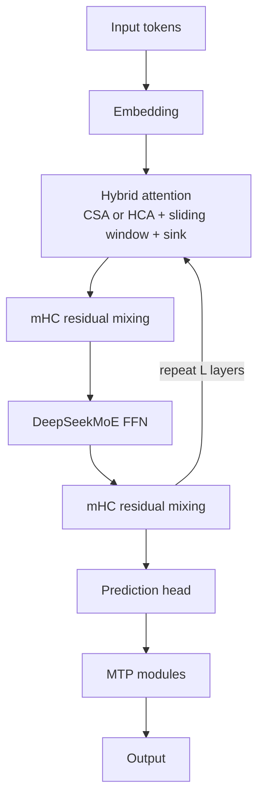
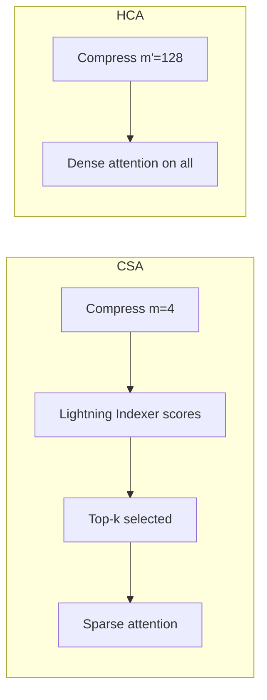
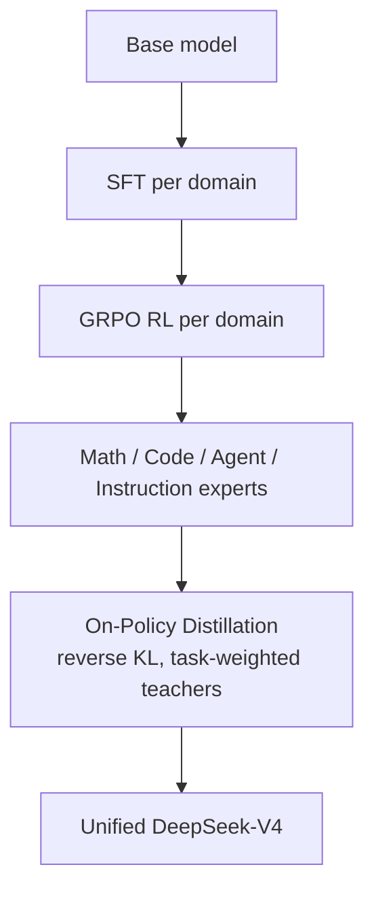

# What is DeepSeek-V4 and How Does It Work? Architecture Explained

> **Step 5: Modern LLM Architecture** · ⏱️ 21 min read · [Read original](https://outcomeschool.com/blog/decoding-deepseek-v4)

## TL;DR
DeepSeek-V4 is a family of open Mixture-of-Experts models with native 1M-token context at roughly a tenth of DeepSeek-V3.2's cost. It redesigns attention (hybrid CSA + HCA), residuals (mHC), the optimizer (Muon), precision (FP4 QAT), and post-training (specialists merged via on-policy distillation).

## Key Concepts
- **MoE** — feed-forward split into many experts; a router picks a few per token, so activated params << total.
- **CSA (Compressed Sparse Attention)** — compress every m tokens into one KV entry, then select top-k with a Lightning Indexer.
- **HCA (Heavily Compressed Attention)** — compress every m' = 128 tokens into one entry, keep attention dense.
- **Sliding window branch** — extra uncompressed recent KV entries (window 128).
- **Attention sink** — learnable sink logits in the softmax denominator so scores can sum to < 1.
- **mHC** — Manifold-Constrained Hyper-Connections.
- **Muon** — optimizer that orthogonalizes the full gradient matrix update.
- **QAT** — Quantization-Aware Training; train while simulating low precision.
- **OPD** — On-Policy Distillation.
- **MTP** — Multi-Token Prediction modules.

## How It Works

### Big picture and numbers
Goal: make ultra-long context cheap. DeepSeek-V4 = V3 + Hybrid Compressed Attention + better residuals + Muon + OPD. At 1M tokens vs V3.2:
| Model | Per-token compute | KV cache |
|---|---|---|
| V4-Pro | 27% | 10% |
| V4-Flash | 10% | 7% |

### Two models
| Model | Total params | Activated | Layers | Context | Pre-train tokens |
|---|---|---|---|---|---|
| V4-Flash | 284B | 13B | 43 | 1M | 32T |
| V4-Pro | 1.6T | 49B | 61 | 1M | 33T |
Pro = larger/more capable; Flash = smaller, faster, cheaper.

### Hybrid attention
Problem: standard attention costs N×N (1M tokens = a trillion comparisons) and KV cache grows linearly with N.
- **CSA**: (1) compress every m tokens (e.g. m = 4) into one entry via learned softmax weights, shrinking KV by m (library: 1M pages become 250K summary cards); (2) Lightning Indexer (FP4) scores each compressed entry vs the query, pick top-k only.
- **HCA**: m' = 128 per entry (~7,800 cards), so dense attention over all is cheap.
- Layer layout: Flash = first 2 layers pure sliding-window attention, then alternate CSA/HCA. Pro = first 2 layers HCA, then alternate CSA/HCA. CSA gives fine-grained selection, HCA broad coverage.
- **Sliding window branch** keeps last 128 tokens uncompressed so local detail is not lost.
- **Attention sink**: learnable sink logits let a head spend less attention when nothing is relevant. RMSNorm on queries and compressed KV before core attention keeps logits stable.
- Net: less memory and compute with no major quality loss.

### mHC
Normal residual stream is a single shared signal. Hyper-Connections widen it to n_hc = 4 parallel streams mixed by three learned matrices (A, B, C), but get unstable when deep (signal blows up or collapses). mHC constrains the residual mapping matrix to the Birkhoff polytope (doubly stochastic: rows and columns sum to 1), bounding the spectral norm at 1, so deep stacks train stably while keeping expressivity.

### Muon optimizer
Instead of per-weight AdamW, Muon uses the full gradient matrix and orthogonalizes the update with Newton-Schulz iterations (hybrid, carefully chosen coefficients), pushing singular values near 1 so no direction dominates: faster, more stable convergence. AdamW is kept for embeddings, prediction head, all RMSNorm modules, and static parts of mHC.

### FP4 QAT
FP4 = 4 bits per number (less memory/bandwidth). QAT trains while simulating low precision so weights adapt. Applied to MoE expert weights (most GPU memory) and the QK path of the CSA indexer. FP8 (E4M3) has 2 more exponent bits than FP4 (E2M1), so FP4 block scales are absorbed into FP8 on dequantization: lossless, existing FP8 pipeline reused. Result: 2x speedup on top-k selector, 99.7% KV-entry recall.

### Pre-training
- 32T+ tokens: math, code, web, long documents, papers, multilingual; emphasis on long-doc curation.
- Sequence length schedule 4K, 16K, 64K, 1M. Dense attention warm-up for first 1T tokens; sparse attention introduced at 64K and kept on.
- Instability (loss spikes; rollbacks do not prevent the next one): **Anticipatory Routing** (router at step t uses older params θ_{t-Δt} while backbone uses θ_t, breaking the bad-routing/outlier feedback loop) and **SwiGLU clamping** (clamp activation output to a fixed range).

### Post-training
1. **Specialist training**: per domain (math, coding, agents, instruction following...), SFT on domain data then RL with GRPO using domain rewards; one expert per domain, for varying reasoning efforts.
2. **On-Policy Distillation**: student generates its own trajectories; teacher gives full-vocabulary distribution per token; student pulled via reverse KL (mode-seeking, sharper outputs). Teachers weighted by task (math expert for math). Fixes the train/inference gap of regular distillation. Replaces V3.2's mixed RL stage; more stable and faithful than weight merging or mixed RL.

### Reasoning modes
| Mode | Use | How |
|---|---|---|
| Non-think | Routine, quick | No think block |
| Think High | Complex problems, planning | Think block |
| Think Max | Push to limit | Long think block with injected "absolute maximum effort, no shortcuts, stress-test edge cases" instruction |

### End to end
Token, embedding, many blocks (CSA/HCA attention + DeepSeekMoE FFN, each wrapped with pre-mix, post-mix and residual mixing via mHC), prediction head, MTP modules. MTP predicts multiple tokens in training (data efficiency) and can act as built-in drafter for speculative decoding.

## Diagrams

### One DeepSeek-V4 block

### CSA vs HCA

### Post-training pipeline

## Trade-offs & Pitfalls
- Plain Hyper-Connections are unstable in deep stacks (fixed by mHC).
- Trillion-parameter MoE loss spikes are not fixed by rollbacks (use anticipatory routing, SwiGLU clamping).
- Compression can blur recent detail (fixed by sliding window branch).
- FP4 cost is controlled by QAT and lossless FP4-to-FP8 dequantization.

## Key Takeaways
- V4-Pro: 1.6T total / 49B active; V4-Flash: 284B / 13B; both 1M context.
- At 1M tokens V4-Pro uses 27% FLOPs and 10% KV cache of V3.2; Flash 10% and 7%.
- CSA = mild compression + sparse top-k; HCA = heavy compression (128) + dense attention; interleaved with a 128-token sliding window and attention sinks.
- mHC constrains residual mixing to doubly stochastic matrices for spectral norm 1.
- Muon (Newton-Schulz orthogonalization) for most params; AdamW for embeddings, head, RMSNorm, static mHC.
- FP4 QAT on experts and indexer: 2x top-k speedup, 99.7% recall.
- OPD merges specialists via student-sampled outputs and reverse KL, replacing mixed RL.
- Three reasoning modes trade cost vs depth.
