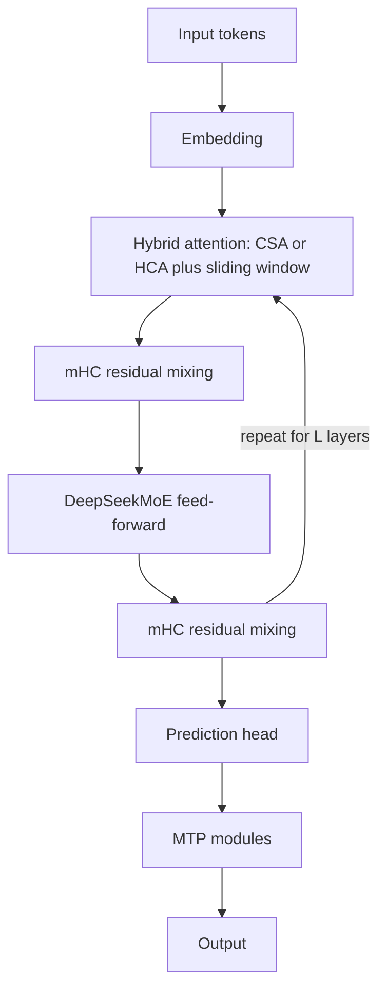

# What is DeepSeek-V4 and How Does It Work? Architecture Explained

> **Step 5: Modern LLM Architecture** · ⏱️ 21 min read · [Read original](https://outcomeschool.com/blog/decoding-deepseek-v4)

## TL;DR
DeepSeek-V4 is a family of open MoE models built to make one-million-token context cheap. It combines hybrid compressed attention (CSA plus HCA), mHC residual connections, the Muon optimizer, FP4 quantization-aware training, and a two-stage post-training pipeline ending in on-policy distillation.

## Key Concepts
- **Two models** — V4-Pro (1.6T total, 49B active, 61 layers, 33T tokens) and V4-Flash (284B total, 13B active, 43 layers, 32T tokens); both natively 1M context and MoE.
- **Efficiency at 1M tokens** — Pro uses 27% of the per-token compute and 10% of the KV cache of V3.2; Flash uses 10% compute and 7% KV cache.
- **CSA (Compressed Sparse Attention)** — compress every m tokens (e.g. 4) into one KV entry, then a Lightning Indexer (FP4) scores entries and keeps only top-k.
- **HCA (Heavily Compressed Attention)** — compress much harder (m' = 128), then run dense attention on the tiny sequence.
- **Sliding window branch** — 128 recent tokens kept uncompressed so local detail is not lost.
- **Attention sink** — learnable sink logits in the softmax denominator let a head's scores sum to less than 1; RMSNorm on queries and compressed KV keeps logits stable.
- **mHC (Manifold-Constrained Hyper-Connections)** — widens the residual stream (n_hc = 4) and constrains the mixing matrix to doubly stochastic matrices (Birkhoff polytope), bounding the spectral norm for stable deep training.
- **Muon** — orthogonalizes the gradient update via Newton-Schulz iterations; used for most parameters, AdamW remains for embeddings, head, RMSNorm, and static mHC parts.
- **FP4 QAT** — applied to MoE expert weights and the indexer QK path; FP4-to-FP8 dequantization is lossless, giving a 2x top-k selector speedup with 99.7% KV recall.

## How It Works
**Layers** interleave CSA and HCA (Flash starts with two sliding-window layers, Pro with two HCA layers), covering both fine-grained and global context.

**Pre-training** on 32T+ tokens, with sequence length scaled 4K, 16K, 64K, 1M; dense attention warm-up, then sparse. Stability tricks: Anticipatory Routing (router uses slightly older parameters to break the bad-routing feedback loop) and SwiGLU clamping.

**Post-training**
1. Specialist training: per domain (math, code, agents, instruction following), SFT then GRPO RL.
2. On-Policy Distillation: the student samples its own outputs and is pulled toward the right teacher's full distribution via reverse KL, weighted by task. This replaces V3.2's mixed RL stage.

**Reasoning modes**
| Mode | Use |
|---|---|
| Non-think | Quick, routine answers, no think block |
| Think High | Complex problems, planning |
| Think Max | Maximum effort with an injected "no shortcuts" instruction |

The output side has a prediction head plus MTP (multi-token prediction) modules, which can also draft for speculative decoding.

## Diagram

## Key Takeaways
- The core goal is cheap ultra-long context: attention compression cuts both compute and KV cache.
- CSA = mild compression plus sparse top-k; HCA = heavy compression plus dense attention.
- mHC constrains residual mixing to stay stable across many layers.
- Muon plus FP4 QAT improve training and inference efficiency without major quality loss.
- On-policy distillation merges domain specialists into one student more stably than mixed RL or weight merging.
