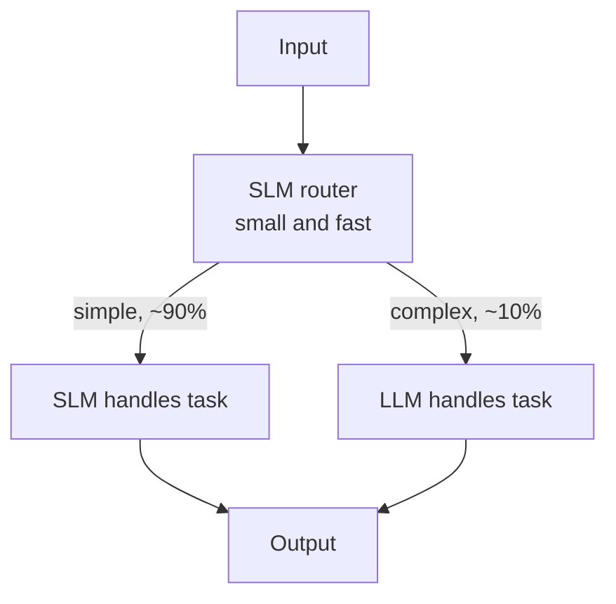
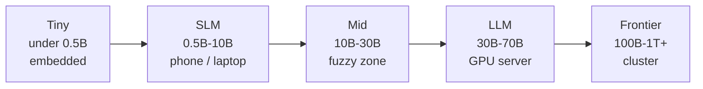

# What are Small Language Models (SLMs)?

> **Step 6: Types of Language Models** · ⏱️ 20 min read · [Read original](https://outcomeschool.com/blog/small-language-models-slms)

## TL;DR
An SLM is a language model with typically under 10B parameters. It trades general knowledge and heavy reasoning for low cost, low latency, privacy, and on-device deployment. Modern SLMs are strong thanks to better data, training, and architecture; the best setups often combine an SLM router with an LLM for hard steps.

## Key Concepts
- **Language model** — neural network that predicts the next token from previous tokens; knowledge lives in its parameters.
- **Token** — small chunk of text ("I love AI" = 3 tokens).
- **Parameter** — a learned number; 1B model = 1,000,000,000; 70B = 70x capacity.
- **SLM** — typically < 10B params (0.5B to ~9B); **LLM** — typically 30B+ (70B, 400B...). 10B-30B is fuzzy. "Small" is relative and moving.
- **Effective params (Gemma 4 E2B/E4B)** — Per-Layer Embeddings make inference-time count smaller than total.
- **GGUF / llama.cpp** — single-file format and engine for running on-device models.

## How It Works

### Popular SLMs
| Model | Size | Developer | Notes |
|---|---|---|---|
| Phi-4-mini | 3.8B | Microsoft | Strong reasoning, 128K |
| Gemma 4 E2B | 2B eff. | Google | Phones; 128K; text, image, audio |
| Gemma 4 E4B | 4B eff. | Google | Edge; 128K; audio input |
| Llama 3.2 1B / 3B | 1B / 3B | Meta | Mobile/edge, 128K |
| Qwen 3.5 0.8B / 2B / 4B / 9B | 0.8-9B | Alibaba | 256K; 2B+ multimodal; 2B has thinking toggle; 9B rivals older 30B models |
| SmolLM3 | 3B | Hugging Face | Open instruct + reasoning, 128K |

Smaller ones run on phones, larger on a laptop with a decent GPU; a 70B LLM needs a GPU server.

### Why small models are now capable
1. **Better data** — filtered, high-quality 1-15T tokens; quality beats quantity.
2. **Better training** — knowledge distillation (student learns from teacher), better optimizers, longer runs.
3. **Smarter architecture** — Grouped-Query Attention, RoPE, etc.
A modern 3B is far stronger than a 3B from a few years ago.

### Why SLMs matter
1. **Cost** — frontier LLM ~USD 25 per 1M output tokens vs 3B SLM ~USD 0.10-0.20: 100-200x cheaper. At 100M tokens/day: ~USD 2,500/day vs ~USD 15/day.
2. **Latency** — time to first token: 70B ~2 s vs 3B ~100 ms (20x); matters for chat/voice.
3. **Privacy** — runs locally (medical, financial, internal docs); e.g. via Ollama.
4. **On-device/edge** — 3B on phone, 1B on laptop CPU, 0.5B on tiny edge; offline keyboards, note summarizers, translators.
5. **Easy fine-tuning** — 3B on a single consumer GPU in hours; 70B needs a small data center.
6. **Reliability/control** — no rate limits, outages, or price changes.

### SLM vs LLM
| Aspect | SLM | LLM |
|---|---|---|
| Parameters | 0.5B to ~10B | 30B to 400B+ |
| Memory | 1-18 GB | 60-800+ GB |
| Hardware | Phone, laptop, one GPU | Multi-GPU server |
| First-token latency | ~50-200 ms | ~500 ms-3 s |
| Cost / 1M output tokens | ~USD 0.10-1 | ~USD 5-30 |
| General knowledge | Decent, limited | Very broad |
| Complex reasoning | Weak to medium | Strong |
| Long-context quality | Decent at 128K | Strong at 1M+ |
| Privacy | Easy | Hard (cloud) |
| Fine-tuning | Easy, cheap | Hard, expensive |

Summarize-a-paragraph example: 1B SLM ~100 ms, ~2 GB, nearly free; 70B LLM ~2 s, ~140 GB, ~USD 0.0002/call. At 1M calls/day SLM saves thousands. (Round numbers.)

### Size spectrum
Tiny < 0.5B (embedded) | Small/SLM 0.5-10B (phone/laptop/single GPU) | Mid 10-30B (single server GPU, fuzzy) | Large 30-70B (serious GPU server) | Frontier 100B-1T+ (cluster). SLM is the sweet spot for production tasks without deep reasoning.

### Use cases
1. On-device assistants (1B ~2 GB, ~30 tokens/s on a modern phone).
2. Classification (0.5B fine-tuned handles thousands/sec on one CPU; System One models like Jev are a newer option).
3. Structured extraction (with constrained decoding for valid JSON).
4. Agent task heads: routing, tool selection, formatting; LLM only for hard reasoning.
5. Fine-tuned domain models: 3B on 10,000 domain examples often beats generic 70B on that task.
6. High-volume pipelines: 10M reviews/day sentiment: ~USD 10,000/day via LLM API vs ~USD 100/day self-hosted SLM.

### When to pick which
- **SLM**: narrow task, huge volume, latency < 200 ms, sensitive data, offline, have fine-tune data.
- **LLM**: deep multi-step reasoning, broad knowledge, very long context, low volume, max quality.
- **Hybrid**: SLM routes; simple (say 90%) handled by SLM, complex (10%) sent to LLM, so LLM cost only on 10% (LLM routing).

## Diagrams

### Hybrid SLM + LLM routing

### Size spectrum

## Trade-offs & Pitfalls
- Less general knowledge (1B has 70x fewer params than 70B).
- Weaker complex multi-step reasoning, may be confidently wrong.
- Long context: supports 128K+ but uses it worse (needle-in-haystack at 100K vs 200B+ LLM); RLMs sidestep this.
- More sensitive to prompt wording; needs careful prompting or fine-tuning.
- Less polished long-form writing.
- Gap keeps shrinking: a 3B today often matches/beats a 13B of two years ago.

## Key Takeaways
- SLM = language model with typically < 10B parameters; relative, moving definition.
- Strong because of data quality, distillation, and architecture choices.
- Wins on cost (100-200x), latency (~20x), privacy, on-device use, easy fine-tuning, control.
- Best for narrow, high-volume, latency/privacy-sensitive tasks; fine-tuned SLM can beat a generic 70B.
- Loses on broad knowledge, deep reasoning, long-context use, prompt robustness.
- Hybrid SLM-router + LLM is the best-of-both pattern; start with an SLM when the task allows.
