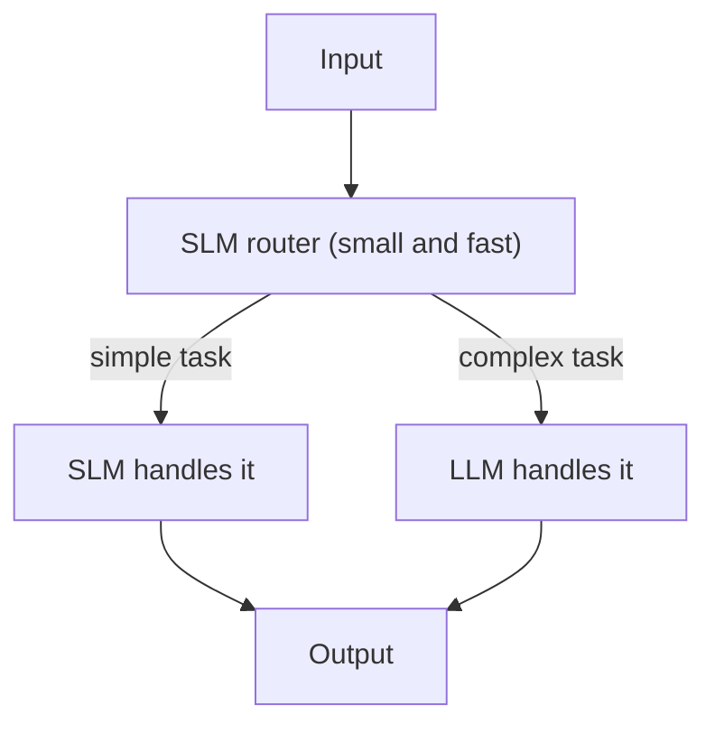

# What are Small Language Models (SLMs)?

> **Step 6: Types of Language Models** · ⏱️ 20 min read · [Read original](https://outcomeschool.com/blog/small-language-models-slms)

## TL;DR
An SLM is a language model with few parameters (typically under 10B) that is cheap, fast, and able to run on a laptop or phone, trading some knowledge and reasoning depth for cost, latency, privacy, and control. A common best practice is a hybrid: SLM for routine steps, LLM for the few hard ones.

## Key Concepts
- **Language model** — neural network that predicts the next token; its knowledge lives in learned parameters.
- **SLM vs LLM** — SLM roughly 0.5B to 10B parameters; LLM roughly 30B and above; 10B to 30B is fuzzy. "Small" is relative and moves over time.
- **Examples** — Phi-4-mini (3.8B), Gemma 4 E2B/E4B (effective params), Llama 3.2 1B/3B, Qwen 3.5 0.8B to 9B, SmolLM3 3B.
- **Why capable** — higher-quality filtered data, knowledge distillation from a larger teacher, better optimizers and longer training, smarter architecture (GQA, RoPE).

## How It Works
### Why SLMs matter
1. **Cost** — roughly $25 per million output tokens for a frontier LLM API vs about $0.10 to $0.20 for a 3B SLM self-hosted (blog's illustrative figures; 100x to 200x cheaper).
2. **Latency** — first token about 100 ms (3B) vs about 2 s (70B on one GPU).
3. **Privacy** — runs locally; no data leaves the device.
4. **On-device/offline** — 3B on phones, 1B on laptop CPUs, 0.5B on edge devices.
5. **Easy fine-tuning** — a 3B fits on one consumer GPU.
6. **Control** — no rate limits, outages, or surprise pricing.

### SLM vs LLM
| | SLM | LLM |
|---|---|---|
| Parameters | 0.5B to about 10B | 30B to 400B+ |
| Memory | 1 to 18 GB | 60 to 800+ GB |
| Hardware | Phone, laptop, single GPU | Multi-GPU server |
| General knowledge / reasoning | Limited / weak to medium | Broad / strong |
| Long-context use | Decent | Strong at 1M+ |
| Privacy and fine-tuning | Easy | Hard |

### Where SLMs shine
On-device assistants, classification, structured extraction (with constrained decoding to valid JSON), agent task heads (routing, tool selection), fine-tuned domain models (a 3B tuned on 10,000 domain examples can beat a generic 70B on that task), and high-volume pipelines.

### Trade-offs
Less world knowledge, weaker multi-step reasoning, weaker use of long context even when 128K is supported, sensitivity to prompt wording, and less polished long-form writing. The gap shrinks each generation.

### When to pick which
- SLM: narrow task, high volume, under 200 ms latency, sensitive data, offline, data available to fine-tune.
- LLM: deep reasoning, broad knowledge, very long context, low volume, top quality needed.
- Hybrid: SLM routes and handles simple work; LLM only for hard cases (a form of LLM routing).

## Diagram

## Key Takeaways
- SLM means fewer than about 10B parameters, a deliberate trade of breadth for speed, cost, and deployability.
- Quality data, distillation, and modern architecture make today's small models far stronger than older ones.
- SLMs win on cost, latency, privacy, on-device use, and easy fine-tuning.
- Fine-tuned SLMs can beat big LLMs on narrow tasks.
- Start with an SLM when the task allows; route to an LLM only for hard reasoning.
