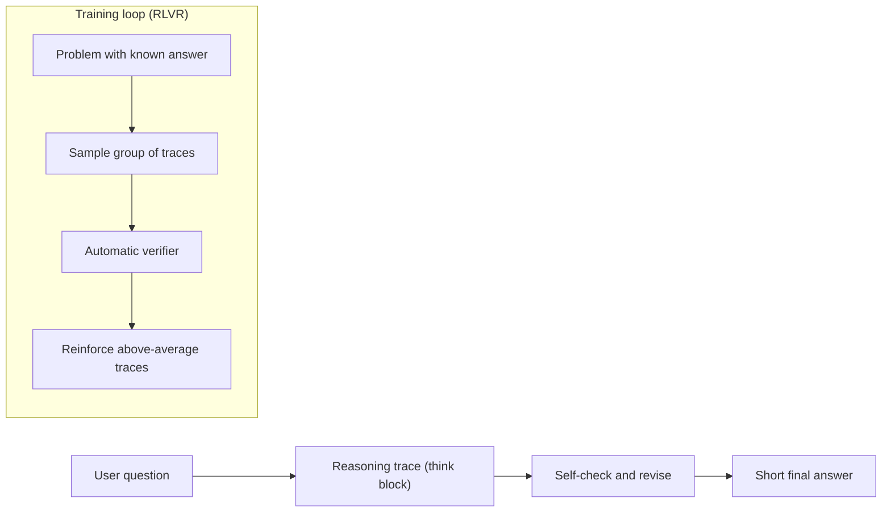

# What are Large Reasoning Models (LRMs)?

> **Step 6: Types of Language Models** · ⏱️ 21 min read · [Read original](https://outcomeschool.com/blog/large-reasoning-models)

## TL;DR
A Large Reasoning Model is an LLM trained to think first and answer later: it writes a long hidden scratchpad (reasoning trace) before the final reply. This spends more tokens at answer time (test-time compute) for much higher accuracy on hard, multi-step problems, at higher cost and latency.

## Key Concepts
- **LRM** — still a next-token-predicting neural network; "thinking" is just more generated text, no new component. Also called reasoning or thinking models.
- **Reasoning trace** — the internal `<think>` scratchpad; hidden in some products (GPT-5.5 Thinking shows a summary), visible in others (DeepSeek R1).
- **Test-time compute** — a second scaling knob beyond train-time compute: think longer to get smarter. Published AIME 2024 figures: GPT-4o about 12%, o1 about 74%, o1 with majority vote over 64 attempts about 83%, o1 re-ranking 1,000 attempts about 93%.
- **Thinking budget** — cap on reasoning tokens (e.g. 1,024, 8,192, 32,768); adaptive thinking lets the model choose.
- **RLVR** — Reinforcement Learning with Verifiable Rewards; reward from an automatic checker, not human opinion.
- **GRPO** — group-relative scoring used for DeepSeek R1: score each trace against its group's average.

## How It Works
### LLM vs LRM
| | Standard LLM | LRM |
|---|---|---|
| Style | Direct, one shot | Thinks, then answers |
| Tokens | About 100 to 500 | About 5,000 to 50,000 |
| Latency | 1 to 3 s | 10 to 120 s |
| Cost | Low | 10x to 30x higher |
| Best at | Chat, summaries, drafts | Math, code, logic, planning |

Example problem: pens at 2 for 5 rupees, notebooks at 3 for 12 rupees, buy 6 pens and 9 notebooks. The LRM works out unit costs (15 + 36), verifies via packs, and answers 51.

### Training
After pre-training and instruction tuning, add RL on reasoning tasks:
1. Give a problem with a known answer.
2. Sample a group of traces (e.g. 16 to 64).
3. Auto-check final answers (math match, unit tests, puzzle solution).
4. Reinforce traces above the group average, penalize below.
5. The model picks up habits: decompose, check, backtrack.

### Input and output
- LLM training: text prefix in, next token out, loss vs actual token.
- LRM training: hard problem in, full trace plus answer out, reward by correctness.
- LLM inference: prompt in, direct answer out.
- LRM inference: prompt in, trace then short answer out.

### Use which
Use an LLM for short, latency- or cost-sensitive tasks. Use an LRM for costly-if-wrong multi-step work when waiting 30 s or more and higher cost are acceptable.

### Common mistakes
Using an LRM for everything; ignoring hidden reasoning token cost; adding "think step by step" (it already does); no thinking budget in production; showing the raw trace instead of just the final answer.

## Diagram

## Key Takeaways
- LRM = LLM trained with RL to think before answering.
- Test-time compute is a second scaling axis: more thinking tokens, higher accuracy, higher cost.
- RLVR uses automatic checkers (answers, unit tests), so no humans are needed in the loop.
- Reasoning tokens are billed even when hidden; set a thinking budget for production.
- Route only hard tasks to LRMs; easy tasks go to plain LLMs.
