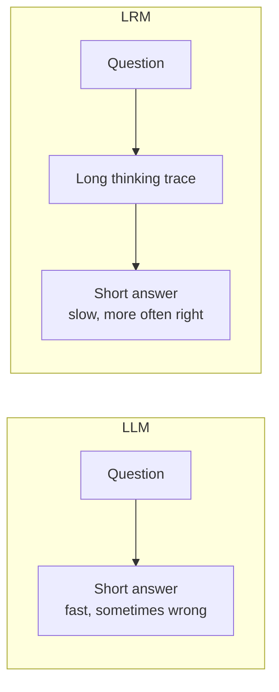
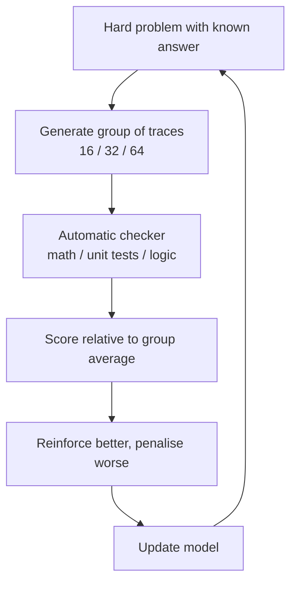

# What are Large Reasoning Models (LRMs)?

> **Step 6: Types of Language Models** · ⏱️ 21 min read · [Read original](https://outcomeschool.com/blog/large-reasoning-models)

## TL;DR
An LRM is an LLM trained to think first and answer later: it writes a long reasoning trace (more tokens) before the short final answer. It gets smarter by spending test-time compute, and is trained with RL using verifiable rewards (RLVR). It is more accurate on hard multi-step problems but slower and 10-30x costlier.

## Key Concepts
- **LRM** — Large + Reasoning + Model; a 7B-700B+ next-token predictor specially trained to spend extra tokens thinking. Also "reasoning/thinking models".
- **Reasoning trace** — long internal scratchpad in `<think>...</think>`; no new component, just more text. Hidden in some products (GPT-5.5 Thinking shows a summary), visible in others (DeepSeek R1).
- **Train-time compute** — bigger model, more data. **Test-time compute** — think longer at answer time.
- **RLVR** — RL with Verifiable Rewards; reward from an automatic checker (math answer, unit tests, puzzle solution), not humans.
- **GRPO** — Group Relative Policy Optimization; scores each trace relative to its group (used for DeepSeek R1).
- **Thinking budget / adaptive thinking** — cap on reasoning tokens (1,024 / 8,192 / 32,768) / model decides how much to think.

## How It Works

### LLM vs LRM
Running problem: pens 2 for 5 rupees, notebooks 3 for 12; buy 6 pens, 9 notebooks. An LLM guesses in one shot (may be wrong); an LRM works out 2.5/pen → 15, 4/notebook → 36, total 51, then verifies via packs (3x5, 3x12). Answer: 51 rupees.

| Aspect | LLM | LRM |
|---|---|---|
| Style | Direct, one shot | Thinks first |
| Tokens | 100-500 | 5,000-50,000 |
| Latency | 1-3 s | 10-120 s |
| Cost/query | Low | 10-30x higher |
| Strength | Chat, summaries, drafting | Math, code, logic, planning |
| Weakness | Hard multi-step | Slow/expensive on easy tasks |

The trace shows the model decomposing the problem, computing intermediates, and self-checking (like a student's rough sheet).

### Test-time compute
OpenAI AIME 2024 numbers: GPT-4o ~12%; o1 single attempt ~74%; o1 majority vote of 64 attempts ~83%; o1 re-ranking 1,000 attempts ~93%. Same model, only test-time compute changes. Alternative from outside: regular LLM trying many paths (Tree of Thoughts). Not free: doubling thinking tokens roughly doubles output cost, usually most of the bill. Hardware speed of tokens matters (LPU).

### Training
Pretraining, instruction tuning, then extra RL on reasoning tasks:
1. Give a hard problem with known answer.
2. Sample a group of 16/32/64 traces.
3. Auto-check final answers.
4. Score relative to group average; reinforce above-average, penalise below.
5. Update model toward good reasoning patterns.
Learned habits: decompose first, check units, backtrack on mistakes. Automatic reward means millions of loops without humans.

### Input and output by phase
| Phase | LLM | LRM |
|---|---|---|
| Training | Text with next token hidden → predicted token; loss vs actual (Paris vs London) | Hard problem → many full traces; e.g. 6 of 16 get 51 (reinforced), 10 wrong (48, 54; penalised) |
| Prediction | Prompt → direct answer (haiku) | Prompt → think trace → short final answer (user often sees only the answer) |

### When to use which
- **LLM**: short/direct tasks, quick chat, latency matters, millions of cheap calls.
- **LRM**: multi-step careful thought, costly wrong answers (math, hard coding, science, planning, analysis, debugging), can wait 30 s+ and pay more.
- Decision outputs (category, safe/unsafe): a third option, System One models like Jev.

### Popular LRMs
GPT-5.5 Thinking (trace hidden); DeepSeek R1 / R1-Zero (open, full trace, RLVR; R1-Zero uses only rule-based rewards, no SFT; V3.1/V4 merge thinking and non-thinking); Qwen3 (unified modes, thinking budget); Gemini 3 Deep Think (tens of seconds to minutes); Claude Opus 4.7 extended thinking; Grok 4.1 Think (with DeepSearch).

## Diagrams

### LLM vs LRM flow

### RLVR training loop

## Trade-offs & Pitfalls
1. Using an LRM for everything (10-30x cost, 30 s for a 1 s task); route only hard tasks.
2. Ignoring hidden reasoning tokens: a 200-token reply may use 15,000 reasoning tokens; check billing.
3. Adding "think step by step": unnecessary, can confuse; keep prompt clean.
4. No thinking budget in production: cost swings; use e.g. 8,192 for most paths, 32,768 for hard ones; adaptive thinking helps but a hard cap is safer.
5. Treating the trace as the answer: it is a draft with wrong steps; show only final answer.

## Key Takeaways
- LRM = LLM trained to think first, answer later; same architecture, just more text.
- Test-time compute is a second scaling knob (AIME: 12% → 74% → 83% → 93%).
- Trained by RLVR with group-relative scoring (GRPO) and automatic checkers.
- Costs 10-30x more and 10-120 s latency; use for hard multi-step tasks only.
- Traces may be hidden but still billed; set thinking budgets in production.
- Some models unify thinking and non-thinking modes (Qwen3, DeepSeek V3.1/V4).
