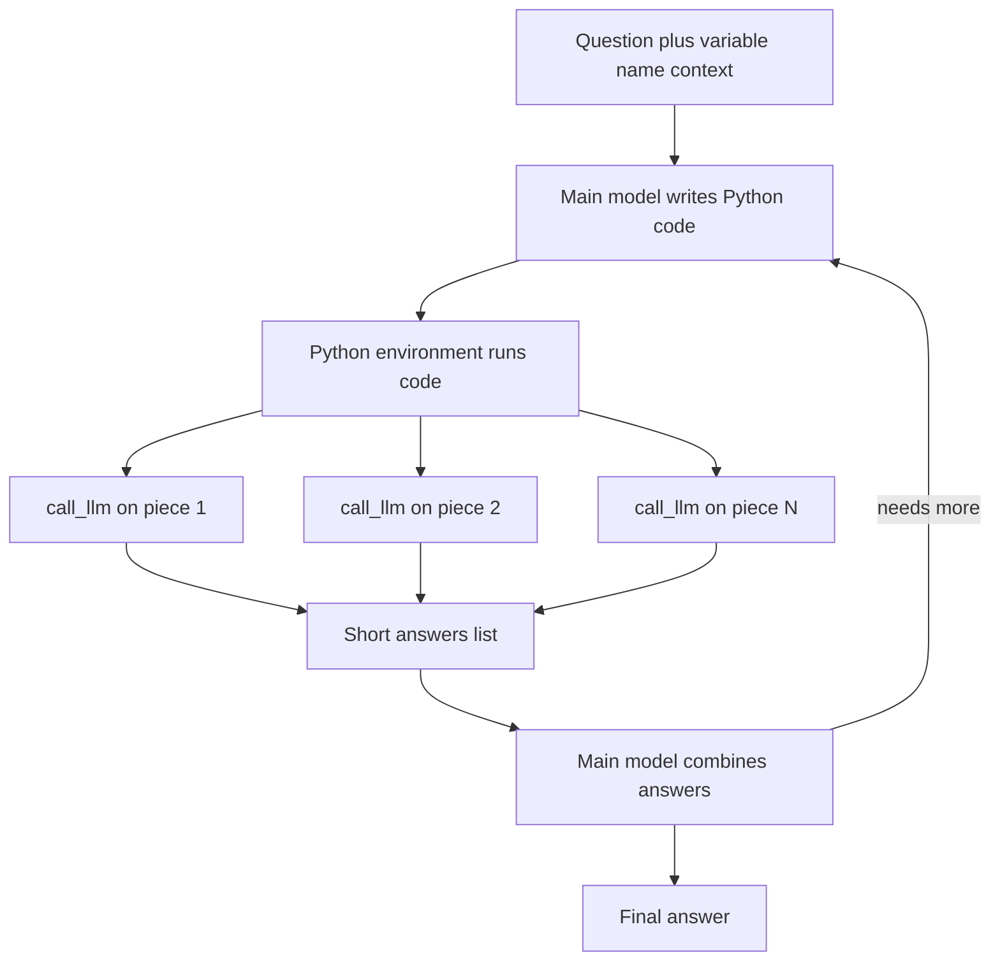

# What are Recursive Language Models (RLMs)?

> **Step 6: Types of Language Models** · ⏱️ 13 min read · [Read original](https://outcomeschool.com/blog/recursive-language-models)

## TL;DR
An RLM is a way of using a language model so that it never reads a huge input directly. The input lives as a variable in a Python environment, and the model writes code that splits it and calls other (or the same) language models on small pieces, then combines their short answers.

## Key Concepts
- **RLM** — Recursive + Language Model: the model can call itself or another model on smaller parts of the problem.
- **Context rot** — answer quality drops as context grows; the model misses details, especially in the middle. A bigger window alone does not fix this (it also raises cost and latency).
- **Python environment** — holds the `context` variable and a `call_llm(prompt)` helper; runs the code the model writes.
- **Agentic loop** — the repeated model-writes-code, environment-runs-it, results-return cycle.
- **Recursion** — a sub-call that still has too much can act as an RLM and split again, forming a tree; the model decides depth.

## How It Works
Example: a long meeting transcript, question "What were the action items?"
1. The main model gets only a short prompt naming `context` and `call_llm`; the transcript itself is never sent.
2. The model writes code such as splitting `context` by turn and calling `call_llm` on each turn.
3. The environment runs it; each sub-call returns a short answer, collected in a list.
4. The list goes back to the main model, which sees only short answers.
5. The model returns the final answer, or writes more code and loops.

The model only generates text (which happens to be Python); `call_llm` is just an API call.

### RLM vs simple chunking
Chunking uses fixed, predetermined splits and steps. In an RLM the model chooses how to split and what to ask per piece, adapting to the question like a human who skims and jumps.

### RLM vs RAG
| | RAG | RLM |
|---|---|---|
| Picks data | Search step first | Model explores itself |
| Flexibility | Depends on retrieval | High |
| Code execution | None | Model writes and runs code |
| Best for | QA on a fixed knowledge base | Complex tasks on long inputs |
| Complexity | Easier | Harder |

### Pros and cons
Pros: handles inputs beyond the window, better accuracy per small call, can be cheaper, modular, flexible. Cons: complex setup, many calls (slow), errors can stack up, hard to debug.

Use cases: long documents, large codebase analysis (for example loop over files, ask a sub-model for security issues per file, merge a final report), long transcripts, comparing many files. Not needed for short inputs.

## Diagram

## Key Takeaways
- RLMs keep the main model's context small by hiding the full input inside a code environment.
- The model decides the splitting strategy and recursion depth, unlike fixed chunking.
- They target long-context problems like context rot and the lost-in-the-middle effect.
- Trade-off: more calls and complexity in exchange for better handling of huge inputs.
- Choose RAG for simple QA on a knowledge base, RLM for complex analysis over long inputs.
