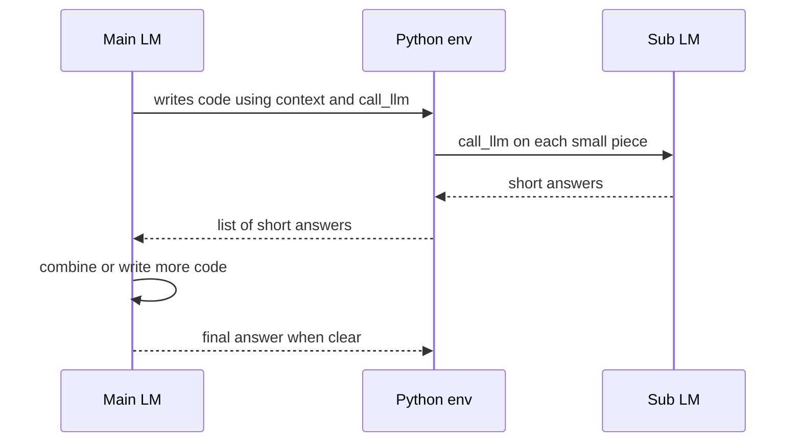
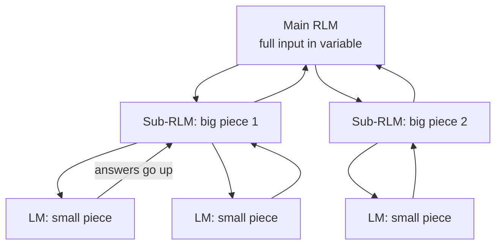

# What are Recursive Language Models (RLMs)?

> **Step 6: Types of Language Models** · ⏱️ 13 min read · [Read original](https://outcomeschool.com/blog/recursive-language-models)

## TL;DR
An RLM is a way of using an LLM where the model keeps the huge input in a Python variable, writes code to read pieces of it, and calls another LM (or itself) on those small pieces, then combines the short answers. This avoids context-window limits and context rot while keeping the main model's context small.

## Key Concepts
- **RLM** — Recursive + Language Model; the model calls itself or another model on smaller parts of the input.
- **Context rot** — answer quality drops as context grows; model misses details in the middle.
- **`context` variable** — holds the full input inside the Python environment.
- **`call_llm(prompt)`** — function in that environment that calls another LM (just an API call).
- **Agentic loop** — back-and-forth between model-written code and the environment.
- **Simple chunking** — fixed chunk size and fixed steps decided up front.

## How It Works

### Why needed
For a 1M-token document: context window limit; quality falls with length (context rot, lost in the middle); cost rises; speed drops. A bigger window alone does not fix this.

### The loop (meeting transcript, "What were the action items?")
The model only generates text, so it is wrapped by a Python environment. The prompt contains only the question and the names `context` and `call_llm`, never the transcript itself.
1. Model writes code, e.g. split `context` by turns and run `call_llm("Find action items in: ...")` per turn, collecting results.
2. Environment runs it; each `call_llm` sends one turn to another LM and returns a short answer.
3. The list of short answers is returned to the main model (it never sees the full transcript).
4. Model reads them and gives the final action items; if unclear, writes more code and loops.

Why better: each sub-call has a small input so it focuses well; main model sees only small answers, so its context stays clean (no context rot).

### Recursion
If a piece is still too long, the sub-call acts as an RLM and splits further. Structure is a tree: root handles the whole problem, leaves handle tiny pieces, answers pass upward. The model decides depth based on input size and question.

### RLM vs simple chunking
Chunking: fixed split, same steps always. RLM: model decides how to split and what to ask per piece, adapting strategy to the question, like a human who skims, jumps, and reads carefully.

### RLM vs RAG
| Feature | RAG | RLM |
|---|---|---|
| Data selection | Search step picks relevant parts first | Model explores data itself |
| Flexibility | Less, depends on retrieval | More, model decides |
| Code execution | None | Model writes and runs code |
| Best for | QA over fixed knowledge base | Complex tasks on long inputs |
| Complexity | Easier | Harder |

### Real use case: security issues in a large codebase
Store codebase as a variable; ask for all security issues; RLM loops over files, calls a smaller LM per file, gets short issue lists, combines into a final report. Main model sees only per-file summaries.

### When to use
Long documents with questions, large codebases, long meeting summaries, comparing many files, tasks splittable into independent sub-tasks. Not needed for short inputs.

## Diagrams

### RLM agentic loop

### Recursion tree

## Trade-offs & Pitfalls
- Advantages: handles inputs beyond the window, better long-context accuracy, sometimes lower cost (only small pieces sent), modular, flexible.
- Limitations: more complex to build (code environment, tool calls); many model calls so can be slow; errors can stack up from wrong sub-answers; hard to debug since the model writes its own code.

## Key Takeaways
- RLM keeps the full input outside the model, in a Python variable; only the variable name is in the prompt.
- Model writes code; environment executes it; `call_llm` is just an API call.
- Recursion forms a tree of sub-calls whose depth the model decides.
- Smarter than fixed chunking and more flexible than RAG, but costlier and harder to build/debug.
- Use for very long inputs and decomposable tasks; skip for short inputs.
- Bigger context windows alone do not solve context rot.
