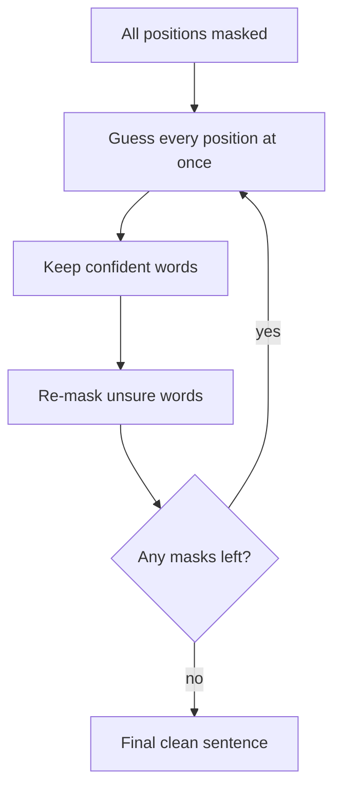

# How do Diffusion Language Models (DLMs) work?

> **Step 6: Types of Language Models** · ⏱️ 19 min read · [Read original](https://outcomeschool.com/blog/how-do-diffusion-language-models-dlms-work)

## TL;DR
A Diffusion Language Model writes text by starting from a fully masked (gibberish) sentence and refining the whole thing over a few rounds, instead of generating one token at a time left to right. Because many tokens are decided in parallel, generation can be much faster, and earlier choices can be corrected.

## Key Concepts
- **Autoregressive generation** — predicts the next token from all previous ones; each word waits for the one before it, so N words need N steps.
- **Diffusion** — borrowed from images: add noise step by step, then train a model to reverse it.
- **Noise for text** — hiding words with a mask `[?]`; more masks means more noise, all masks means pure noise.
- **Forward phase** — training only; progressively masks a clean sentence (no intelligence needed, it just creates practice questions).
- **Reverse phase** — what the model learns: fill in the masked words to recover clean text.
- **Confidence threshold** — only guesses the model is sure about are kept each round.

## How It Works
### Training
Take clean sentences, mask varying amounts of words, and train the model to guess the hidden words. It is like solving fill-in-the-blank exercises on millions of sentences.

### Generation
1. Start with every position masked.
2. Guess all positions at once in a single pass (no left-to-right order).
3. Keep the confident guesses, re-mask the unsure ones.
4. Repeat; the kept words act as anchors/context for the rest.
5. Stop when no masks remain.

Example: for "capital of France" with 4 slots, round 1 yields `The is capital Paris`; "Paris" and "The" are kept, the others re-masked; round 2 fills `The capital is Paris`.

```python
sentence = ["[?]"] * 4
for r in range(num_rounds):
    guesses, conf = model.predict_all(sentence)
    for i in range(len(sentence)):
        sentence[i] = guesses[i] if conf[i] > threshold else "[?]"
    if "[?]" not in sentence: break
```

### Autoregressive vs Diffusion
| Feature | Autoregressive | Diffusion LM |
|---|---|---|
| Writing order | Left to right, one word at a time | Whole sentence, refined in rounds |
| Parallel work | No | Yes, many words together |
| Steps | Equal to word count | Small number of rounds, not tied to length |
| Revise earlier words | No | Yes, can re-mask and fix |

DLMs often still use a Transformer internally; the difference is how text is written, not the "brain".

### Pros and Cons
- **Pros:** speed via parallelism, self-correction, whole-sentence view, natural fit for infilling.
- **Cons:** choosing the number of rounds is tricky, often needs a fixed output length, less mature tooling, top autoregressive models still ahead on quality for some tasks.

### Current state
Real models exist (Mercury from Inception Labs, Google's DiffusionGemma, open LLaDA), some reason about math/code, and many are hybrids: start from a trained normal model and continue training with the diffusion idea.

## Diagram


## Key Takeaways
- DLMs generate by iterative denoising of a masked sentence, not by next-token prediction.
- For text, "noise" means masking words.
- Parallel decoding gives speed and the ability to revise earlier words.
- Trade-offs: fixed length, choosing round count, younger ecosystem.
- Practical DLMs are often Transformer hybrids adapted from existing models.
