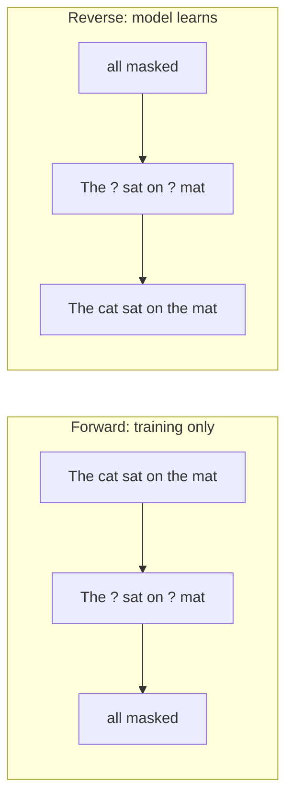
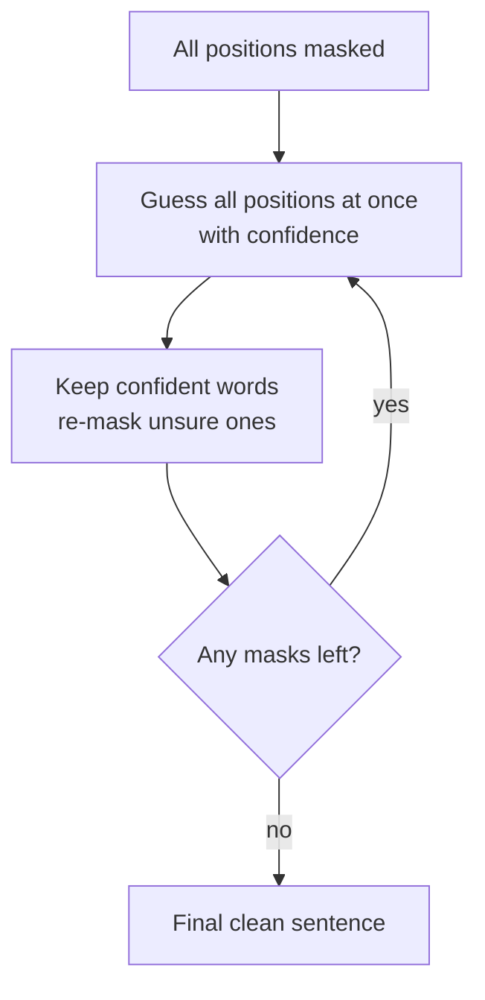

# How do Diffusion Language Models (DLMs) work?

> **Step 6: Types of Language Models** · ⏱️ 19 min read · [Read original](https://outcomeschool.com/blog/how-do-diffusion-language-models-dlms-work)

## TL;DR
A DLM writes text by starting from an all-masked sentence and refining the whole thing over a few rounds: guess every blank at once, keep confident words, re-mask the rest, repeat. Unlike autoregressive LLMs (one word at a time, left to right), it decides many words in parallel and can revise earlier words, giving big speed potential.

## Key Concepts
- **Autoregressive generation** — predict next word from all previous words; strictly sequential, cannot undo.
- **Diffusion** — borrowed from images: add noise until static, train a model to reverse it. Like ink spreading in water.
- **Noise for text** — masking: hide words with `[?]`; more masks = more noise; all masked = pure noise.
- **Forward phase** — training only; progressively mask a clean sentence (no intelligence needed; makes practice questions).
- **Reverse phase** — what the model learns: fill masked words, repeatedly. Like fill-in-the-blanks practice on millions of sentences.
- **Confidence threshold** — bar (e.g. 90% sure) for keeping a guess.

## How It Works

### Autoregressive limits
"The sky is" → blue → and → clear: 100 words = 100 sequential turns; no jumping ahead, no fixing earlier words. Idea: work on the whole sentence at once.

### Generation steps
1. Start with all positions masked.
2. Guess all words at once in a single pass (not left to right).
3. Keep confident words, turn unsure ones back to `[?]`.
4. Repeat; confident words serve as context hints for harder ones.
5. Stop when no masks remain.

Example: "The ... is ..." first (easy words "The", "is"), then "food", "here", "good".

### Tiny end-to-end example: "What is the capital of France?" (4 slots)
- Round 1 guess: "The is capital Paris"; very confident on "Paris", fairly on "The"; keep those → "The [?] [?] Paris".
- Round 2 with anchors: "The capital is Paris". Done in two rounds.

### Code-style loop
```python
sentence = ["[?]"]*4
for r in range(num_rounds):
    guesses, conf = model.predict_all(sentence)   # all positions at once
    for i in range(len(sentence)):
        sentence[i] = guesses[i] if conf[i] > threshold else "[?]"
    if "[?]" not in sentence: break
```
No left-to-right loop; each round considers the whole sentence.

### DLM vs autoregressive
| Feature | Autoregressive | DLM |
|---|---|---|
| Order | Left to right, one word at a time | Whole sentence, refined in rounds |
| Parallel | No | Yes |
| Steps | Equal to word count | Small number of rounds, not tied to length |
| Revise earlier words | No | Yes (re-mask and fix) |

DLMs often use a Transformer internally; the difference is how text is written, not the brain.

### Current state (2026)
- Real models exist; selling point is speed in tokens/second. Mercury (Inception Labs) >1,000 tokens/s on one chip, several times faster; Google DiffusionGemma (open) similar speed; LLaDA (open).
- Newer diffusion models can reason (hard math and coding).
- Many are hybrids: Transformer base plus diffusion refinement; often start from a normal trained model and continue training with the diffusion objective instead of from scratch.

## Diagrams

### Forward and reverse phases


### Generation loop


## Trade-offs & Pitfalls
- Advantages: speed from parallel work; self-correction; whole-sentence view (late words influence early ones); good control for infilling/partial completion.
- Limitations: choosing number of rounds is tricky (too few = messy, too many = slow); fixed output length often needed in advance; less mature tooling; best autoregressive models may still lead on some tasks (gap shrinking); still active research.

## Key Takeaways
- DLM = start from masks, refine the whole sentence in rounds.
- Noise for text means masking; forward phase masks, reverse phase learns to unmask.
- Keep confident guesses, re-mask the rest; easy words anchor harder ones.
- Parallel and revisable versus autoregressive's sequential and irreversible.
- Often Transformer-based and can be built by continuing training of an existing model.
- Weaknesses: round count, length known ahead, immature ecosystem.
