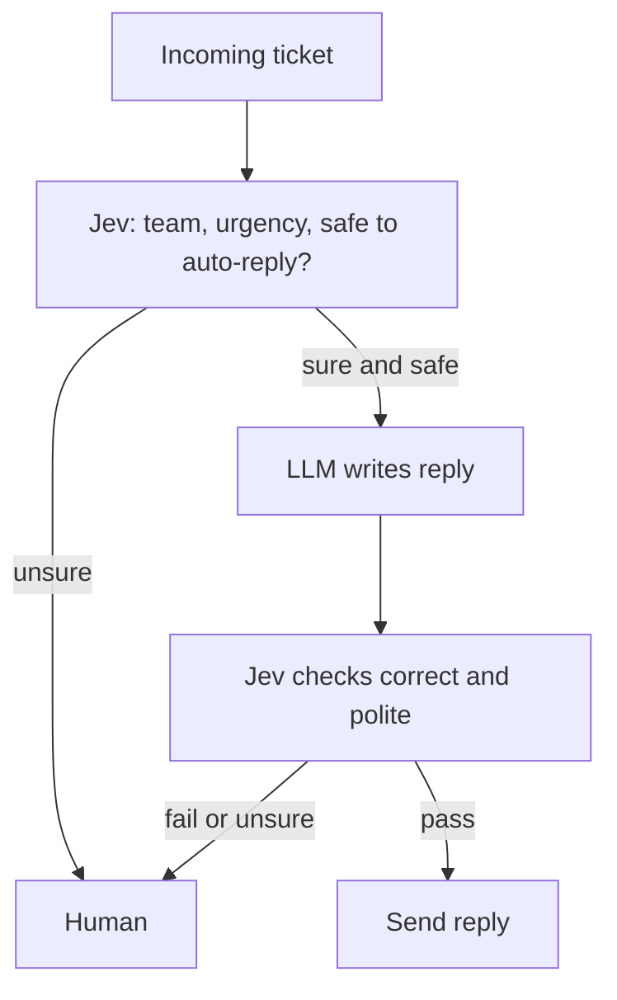
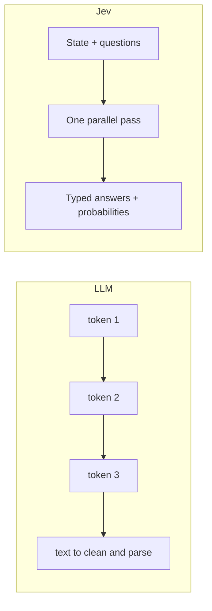

# Jev and System One Models Explained

> **Step 6: Types of Language Models** · ⏱️ 20 min read · [Read original](https://outcomeschool.com/blog/jev-and-system-one-models-explained)

## TL;DR
Jev (by TypeSafe AI) is the first System One Model: it generates no text, only typed decisions (choice, score, yes/no) with calibrated probabilities, answering many questions in one parallel pass in ~70-500 ms. Because it only scores allowed options, it cannot make type errors, and the honest probabilities let software route uncertain cases to humans.

## Key Concepts
- **System One Model** — AI model that returns a decision from a fixed list of answers plus a probability, not text.
- **Kahneman System 1 / System 2** — fast, automatic, effortless / slow, careful, effortful. Reasoning LLMs do System 2 style work.
- **State** — all information about the situation, always text (string, list, JSON).
- **Typed answers** — Choice (up to 255 options), Score (number in a range), Yes/No.
- **Calibration** — predicted probabilities match reality (of answers at 90%, about 90% are right).
- **RLCD** — Reinforcement Learning for Calibrated Decisions; reward for being right and honest about confidence.
- **Type error vs wrong answer** — invalid kind of answer vs valid-but-incorrect answer.

## How It Works

### Why not an LLM for decisions
Example: route tickets with an LLM prompt. Problems:
1. Writes tokens one at a time ("bill" then "ing"); every step is a full model pass.
2. Output format untrustworthy ("The category is billing.", "Billing.", "refund" not in list), needs cleaning code that breaks.
3. No honest confidence (99% or 51%?).
4. Slow and costly at millions of tickets/day.

### How Jev works
Input: State + questions with allowed answers. Output: a typed answer plus probability per question.
```python
result = jev.decide(state={"message": "My card was charged twice.",
   "recent_transactions": ["$49 on Sep 10", "$49 on Sep 10"]},
  questions={"team": ["billing","technical","account"],
             "is_urgent": "yes_no", "frustration": {"min":0,"max":2}})
# team billing 0.97, is_urgent true 0.88, frustration 1 at 0.74
```
- Three questions in one call, every answer within allowed set, each with a probability.
- Single parallel pass: reads the whole state once and ticks all boxes (like a checkbox form), versus LLM writing an essay word by word.
- Speed: 70-500 ms vs 3 s to minutes for a frontier LLM; TypeSafe claims 40-200x faster than comparable-intelligence LLMs, up to 193x faster than Claude Sonnet 5 on decision tasks.
- Cost: USD 0.042 per million input tokens, output free.
- Built by TypeSafe AI (founder Diogo Almeida, ChatGPT co-creator), announced Sept 15, 2026, about two years of work.

### Typed answers
Type safety as in programming (a boolean cannot be "maybe"). Jev scores options rather than writing text: for a 3-option choice it produces 3 probabilities summing to 1, takes the max; no fourth slot exists. Unlike "reply in JSON" from an LLM (still token by token, hope valid), the shape is fixed before the model runs.

### Calibration and RLCD
Weather analogy: "70% rain" on 100 days should mean rain on about 70. LLMs are trained to write text humans like, so "I am confident" is just words. RLCD rewards:
- 99% and right: big reward; 99% and wrong: big penalty
- 55% and right: small reward; 55% and wrong: small penalty
So the model learns to be high only when truly likely right. Usage:
```python
if result["team"]["probability"] > 0.9: route_to(result["team"]["answer"])
else: send_to_human()
```
Caveat: a 90% answer is still wrong 10% of the time; calibration only makes the number honest.

### Why "cannot hallucinate"
Type error impossible (mathematical guarantee: only allowed options are scored; TypeSafe says one counterexample would disprove it). Wrong answers still possible but usually have lower probability and can be caught. For decision tasks a System One Model can be more reliable than the slower alternative.

### Jev vs LLM
| Aspect | Jev | LLM |
|---|---|---|
| Output | Typed decisions + probabilities | Free text |
| Answering | All in one parallel pass | One token at a time |
| Writes text/code | No | Yes |
| Step-by-step reasoning | No | Yes |
| Format guarantee | Always valid | Must be cleaned |
| Confidence | Calibrated | Missing or dishonest |
| Speed | 70-500 ms | Seconds to minutes |
| Cost | USD 0.042 / 1M input, output free | Much higher |
| Input | Text, JSON, lists | Text, images, audio... |
| Best for | Classify, route, score, check, decide | Chat, write, code, reason |

### Where it works / fails
Works: routing (team, model, workflow), classification, scoring (1-5), guardrails (check LLM output before user sees it), real-time decisions, huge datasets.
Fails: writing anything, open-ended multi-step reasoning, explanations, images/audio (text only for now), very large option lists (max 255).

### When to use which
Decision → Jev; text → LLM; combine. Support system: Jev picks team, urgency, whether safe to auto-reply → LLM writes reply (System 2) → Jev checks correctness/politeness before sending (System 1). See AI orchestration.

## Diagrams

### Support flow combining Jev and LLM


### LLM vs Jev answering


## Trade-offs & Pitfalls
- No text generation, no reasoning, no explanations, text input only, max 255 options.
- Valid does not mean correct; always use probability thresholds and human fallback.
- Calibration does not mean always right.

## Key Takeaways
- System One Model = fast decisions, not text; Jev is the first (TypeSafe AI).
- All questions answered in one parallel pass, 70-500 ms, USD 0.042 per million input tokens, free output.
- Typed answers (choice up to 255, score, yes/no) make invalid formats impossible by design.
- RLCD makes probabilities honest, enabling confidence-based routing to humans.
- "Cannot hallucinate" means no type errors, not no wrong answers.
- Rule: decision → Jev, text → LLM, and combine them.
