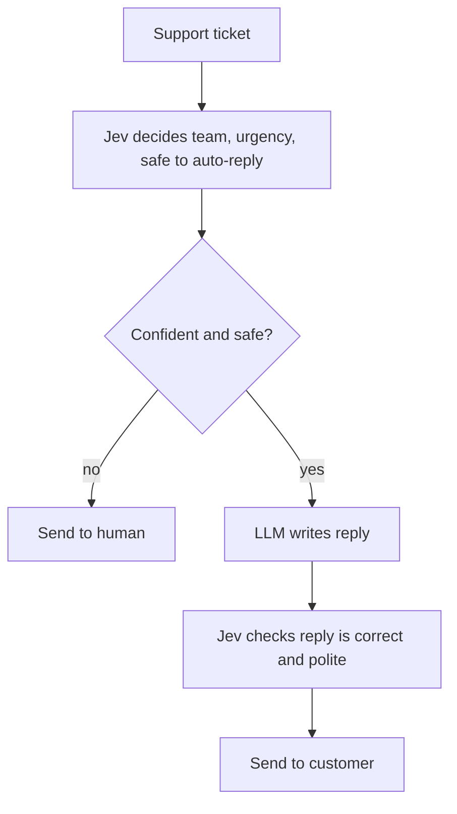

# Jev and System One Models Explained

> **Step 6: Types of Language Models** · ⏱️ 20 min read · [Read original](https://outcomeschool.com/blog/jev-and-system-one-models-explained)

## TL;DR
Jev, built by TypeSafe AI, is presented as the first "System One Model": it does not generate text, but returns typed decisions (a choice, score, or yes/no) with calibrated probabilities, answering many questions in one parallel pass. It targets the many small, repeated decisions in software where a text-writing LLM is slow, costly, and unreliable.

## Key Concepts
- **System 1 vs System 2 (Kahneman)** — fast, automatic thinking vs slow, effortful thinking; LLMs and reasoning models behave like System 2.
- **System One Model** — an AI model that takes a situation plus allowed answers and returns a decision, not text.
- **State** — all the text/JSON the model needs about the situation.
- **Typed answers** — Choice (pick from a fixed list, up to 255 options), Score (number in a range), Yes/No.
- **Calibration** — a "90% sure" answer is correct about 90% of the time.
- **RLCD** — Reinforcement Learning for Calibrated Decisions: rewards being right and honest about confidence.

## How It Works
### Why not use an LLM for decisions?
1. Writes the answer one token at a time (even a one-word label takes many passes).
2. Output format is untrustworthy ("The category is billing." or an out-of-list label), so cleanup code is needed.
3. No honest confidence number.
4. Slow and costly at millions of calls per day.

### Jev's mechanism
- Input: state plus questions with allowed answers. Output: one typed answer per question, with a probability.
- It scores only the allowed options (probabilities sum to 1; the highest wins), so no fourth option can exist. This differs from asking an LLM for JSON, which is still written token by token.
- Answers all questions in a single parallel pass, like ticking checkboxes on a form rather than writing an essay.
- Reported figures: about 70 to 500 ms per decision, 40 to 200 times faster than comparable LLMs, $0.042 per million input tokens with free output.

### RLCD reward idea
Confident and right: big reward. Confident and wrong: big penalty. Unsure and right/wrong: small reward/penalty. The only way to score well is honest probabilities, which enables:

```python
if result["team"]["probability"] > 0.9:
    route_to(result["team"]["answer"])
else:
    send_to_human()
```

### "Cannot hallucinate"
Means no type errors (invalid answers) by construction. Wrong-but-valid answers can still happen, but low probability flags them. Calibration does not mean always correct.

### Jev vs LLM
| Aspect | Jev | LLM |
|---|---|---|
| Output | Typed decisions + probabilities | Free-form text |
| Answering | One parallel pass | Token by token |
| Writes text/reasons | No | Yes |
| Format guarantee | Always valid | Must be checked |
| Confidence | Calibrated | Not available or honest |
| Input | Text/JSON only | Text, images, audio |

### Use cases and limits
Good for routing, classification, scoring, guardrails, real-time and bulk decisions. Fails at writing, open-ended reasoning, explanations, images/audio, and very large option lists. Rule: decision means Jev, text means LLM; real systems combine both.

## Diagram


## Key Takeaways
- Decisions are System 1 work; text and reasoning are System 2 work.
- Typed answers make invalid output impossible by design, not by hope.
- Calibrated probabilities let code decide when to trust the model or escalate.
- Parallel single-pass decisions give large speed and cost gains over token-by-token generation.
- Use Jev for deciding and checking, an LLM for writing; combine them.
