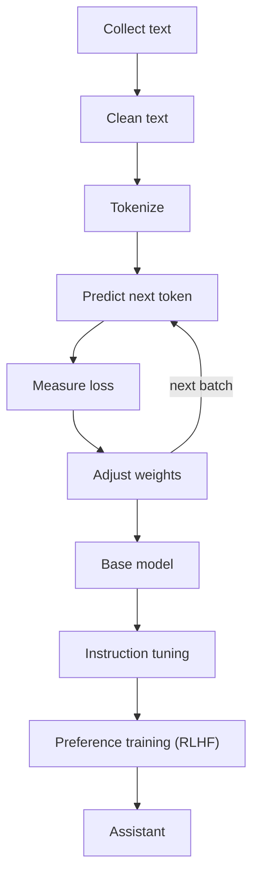

# How does Pretraining work?

> **Step 7: Training, Fine-Tuning, and Alignment** · ⏱️ 16 min read · [Read original](https://outcomeschool.com/blog/llm-pretraining)

## TL;DR
Pretraining is the first and biggest stage of building an LLM: starting from random weights, the model reads trillions of tokens of text and repeatedly predicts the next token. This self-supervised game teaches it language, facts, and reasoning patterns, producing a base model that later stages turn into an assistant.

## Key Concepts
- **Weights** — billions of numbers that store the model's knowledge; random at the start.
- **Next-token prediction** — the one simple game played at huge scale.
- **Self-supervised learning** — the text itself supplies the correct answers, so no human labels are needed.
- **Token / vocabulary** — a small piece of text with an ID from the model's fixed list.
- **Loss** — a score of how wrong the guess was; lower is better.
- **Backpropagation / gradient descent** — find which weights to change, then nudge them to reduce loss.
- **Base model** — the result of pretraining: knowledgeable text completer, not a helpful assistant.

## How It Works
### Practice questions from raw text
Every prefix of a sentence is an input and the next token is its answer: "The cat sat on the" gives "mat". One sentence yields many examples for free.

### Pipeline
1. **Collect text** — web (e.g. Common Crawl), books, Wikipedia, code, papers, many languages. Llama 3 was pretrained on over 15 trillion tokens.
2. **Clean text** — remove duplicates (prevents memorizing), low-quality, harmful, and private data; balance the mix. Quality matters as much as quantity.
3. **Tokenize** — split into tokens and map to IDs (see BPE).
4. **Training loop** — repeated over batches of text:
   - take a chunk of text
   - model outputs a probability for every vocabulary token
   - compute loss from the probability given to the true next token
   - adjust weights (backprop plus gradient descent)
   - repeat

### Learning from a mistake
P("mat") rises over rounds (0.01, 0.05, 0.20, ... 0.60) while loss and adjustments shrink. It never reaches 1.0, which is right since "floor" or "sofa" are valid. Shared weights mean each update also helps millions of other sentences, so it generalizes rather than memorizes.

### Why so much compute
Language is huge, the model is huge, and every token costs computation for guessing and weight updates. Thousands of GPUs run for weeks or months, so only a few labs do it.

### Base model behavior
Asked "What is the capital of France?", a base model may continue with more quiz questions, because that is how such text appears online. It has knowledge but not assistant behavior.

### Pretraining vs Fine-tuning
| Point | Pretraining | Fine-tuning |
|---|---|---|
| Start | Random weights | Already trained model |
| Data | Trillions of general tokens | Thousands to millions of focused examples |
| Labels | None needed | Usually prepared examples |
| Goal | Language and world knowledge | A behavior or special skill |
| Cost | Weeks/months on thousands of GPUs | Hours to days |
| Who | A few large labs | Many companies and developers |

## Diagram

## Key Takeaways
- Pretraining = self-supervised next-token prediction on trillions of tokens.
- The data provides its own labels, so scale is limited only by text and compute.
- Data quality and deduplication matter as much as volume.
- The output is a base model that completes text; later stages shape behavior.
- Almost nobody pretrains from scratch; most fine-tune or prompt an existing model.
