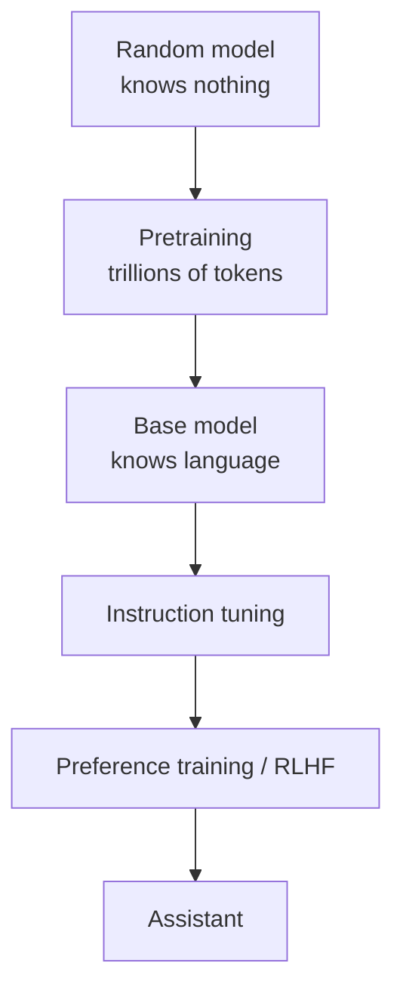
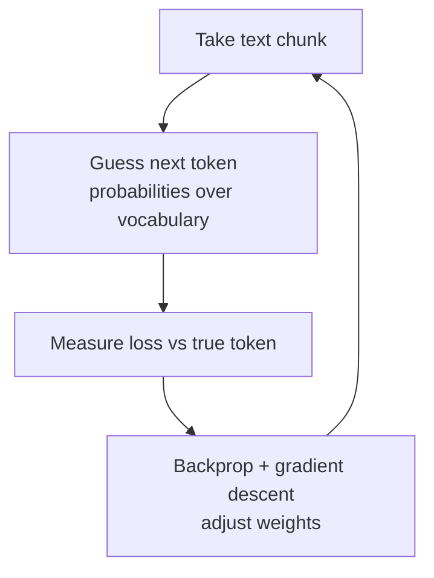

# How does Pretraining work?

> **Step 7: Training, Fine-Tuning, and Alignment** · ⏱️ 16 min read · [Read original](https://outcomeschool.com/blog/llm-pretraining)

## TL;DR
Pretraining is the first and biggest stage of building an LLM: starting from random weights, the model reads trillions of tokens of cleaned text and repeatedly predicts the next token, adjusting its weights from its mistakes. It needs no human labels (self-supervised) and yields a knowledgeable but unhelpful base model.

## Key Concepts
- **Weights** — billions of numbers storing the model's knowledge; random at start.
- **Pretraining** — "school education": learn next-token prediction on general text; "pre" = before later stages.
- **Base model** — result of pretraining; a text completer, not an assistant.
- **Self-supervised learning** — the text itself provides the correct answers.
- **Token / vocabulary / ID** — text pieces, a fixed token list, and each token's number.
- **Loss** — "how wrong" score; lower is better.
- **Backpropagation** — finds which weights to change and by how much; **gradient descent** — makes the small changes.
- **Batch** — group of text chunks learned at once.

## How It Works

### The game: predict the next token
"The cat sat on the ___" → "mat" good, "banana" bad. Doing this over all text forces learning of facts (capital of France), cause and effect, math (2+3), programming, other languages (Hindi), grammar and reasoning patterns.

### No labels needed
One sentence yields many practice pairs: "The" → "cat", "The cat" → "sat", ... "The cat sat on the" → "mat". Code: for i in 1..len, context = tokens[:i], target = tokens[i]. Any text works, so trillions of tokens are possible.

### Pipeline
1. **Collect text**: web (Common Crawl), books, Wikipedia, code, papers, multilingual text. Llama 3 used >15T tokens.
2. **Clean text**: dedupe (repeats cause memorization), remove low-quality (spam, broken pages), harmful content, private info (phones, emails), then balance the mix (web, books, code, math, languages). Quality matters as much as quantity.
3. **Tokenize**: "Pretraining is powerful" → ["Pre","training"," is"," powerful"] → IDs. Rare words split into pieces so any word is handled (see BPE).
4. **Training loop** (repeats millions of times):
   - A: take a text chunk ("The cat sat on the").
   - B: model outputs probability over the whole vocabulary (sum 1).
   - C: compute loss from probability given to the true token ("mat").
   - D: backprop + gradient descent nudge weights so "mat" gets more probability.
   - E: repeat across trillions of tokens, in batches.

### Learning from a mistake
P("mat"): 0.01 (big adjustment) → 0.05 → 0.20 → ... 0.60 (tiny adjustment). Loss falls. Weights are shared, so updates also teach dogs on mats, "on the" followed by a place, etc. It never reaches 1.0, correctly, because floor/sofa/bed are valid; the model learns a sensible spread.

### Why so much data and compute
Language is huge (facts, languages, code, math); model is huge (billions of weights need many examples); every token costs computation for guessing and weight updates. Runs on thousands of GPUs for weeks or months; huge cost and electricity, so only a few labs do it.

### After pretraining
Base model given "What is the capital of France?" may reply "What is the capital of Germany? What is the capital of Italy?" because that looks like a quiz list. Later, smaller stages: instruction tuning (instruction/answer examples) then preference training (humans pick better answers; RLHF).

### Pretraining vs fine-tuning
| Point | Pretraining | Fine-tuning |
|---|---|---|
| Start | Random weights | Already trained model |
| Data | Trillions of general tokens | Thousands to millions of focused examples |
| Labels | None | Usually prepared examples |
| Goal | Language and world knowledge | A behavior or skill |
| Cost | Weeks/months, thousands of GPUs | Hours to days |
| Who | Few large labs | Many companies/developers |
Almost nobody pretrains from scratch; they fine-tune or prompt.

## Diagrams

### Stages of building an assistant

### Training loop

## Trade-offs & Pitfalls
- Data quality over quantity; duplicates cause memorization.
- Enormous cost (GPUs, weeks, electricity).
- Base model is not a helpful assistant; needs later stages.

## Key Takeaways
- Pretraining = next-token prediction on trillions of tokens, from random weights.
- Self-supervised: text supplies its own labels.
- Steps: collect, clean, tokenize, loop (guess, loss, backprop, update).
- Weights are shared, so the model generalizes rather than memorizes; cleaned, deduped data helps.
- Output is a base model (knowledgeable text completer).
- Instruction tuning and RLHF follow with far smaller data.
- Most practitioners fine-tune or prompt instead of pretraining.
