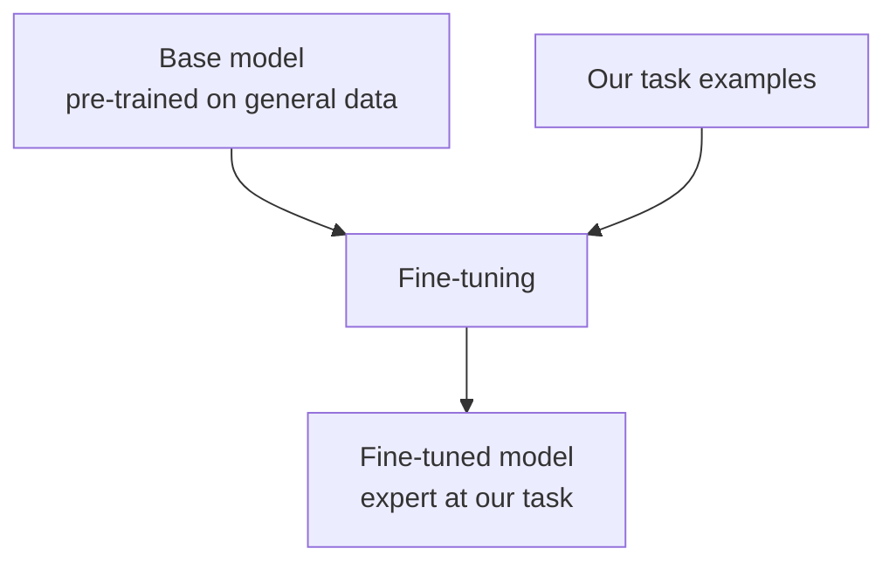
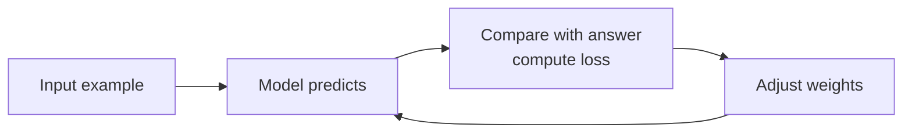
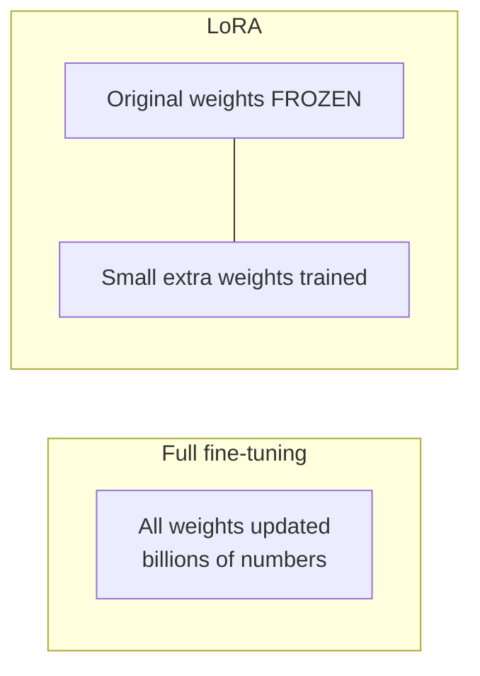

# How does Fine-Tuning work?

> **Step 7: Training, Fine-Tuning, and Alignment** · ⏱️ 15 min read · [Read original](https://outcomeschool.com/blog/how-does-fine-tuning-work)

## TL;DR
Fine-tuning takes an already pre-trained model and trains it a little more on our own task data, nudging its weights to reduce loss so it becomes a specialist, at a tiny fraction of the cost of training from scratch. Full fine-tuning updates all weights; LoRA freezes them and trains small extra ones.

## Key Concepts
- **Fine-tuning** — small, careful adjustments to an existing model using our data (cook who already cooks, now trained only on Italian recipes; other skills may get slightly rusty).
- **Base / pre-trained model** — starting model with good general weights.
- **Weights** — numbers inside the model that hold its "knowledge".
- **Loss** — how wrong the prediction is; always >= 0; 0 = exact.
- **Backpropagation + gradient descent** — figure out which way to nudge each weight, then nudge.
- **Epoch** — one full pass over the dataset.
- **Learning rate** — small step size, avoids over-correcting.

## How It Works

### Why fine-tune
Training from zero needs huge data, expensive computers, weeks to months. Base models already know language, grammar, facts, reasoning, but not our specific style or need (e.g. exact medical style/accuracy). Fine-tuning adapts them cheaply.

### Steps
1. Pick a base model.
2. Prepare dataset: input + correct output pairs (e.g. customer questions + polite answers). Quality is crucial.
3. Feed examples; model predicts.
4. Measure loss against the correct answer.
5. Adjust weights via backprop + gradient descent to reduce loss.
6. Repeat over epochs until loss is small.

### Worked example with one weight
w = 2.0, input 4, target 10. Prediction = 4 x 2.0 = 8.0; error = 10 - 8.0 = 2.0.
Adjustment = learning_rate x error x input = 0.05 x 2.0 x 4 = 0.4 → w = 2.4 → prediction 9.6.
Repeating: 8.00 → 9.60 → 9.92 → 9.98 → 10.00. Real models do this for billions of weights at once.

### Full fine-tuning vs LoRA
- Full: adjust every weight. Learns deeply, but needs lots of memory and powerful machines.
- LoRA (Low-Rank Adaptation): freeze original weights, train a small set of extra weights (sticky notes on a printed book).
- Prefix Tuning is another cheap option: frozen model, small trained prefix steering every attention layer.

| Point | Full Fine-tuning | LoRA |
|---|---|---|
| Changes | All weights | Only small extra weights |
| Memory | Very high | Low |
| Speed | Slow | Fast |
| Cost | High | Low |
Limited machines → LoRA; heavy resources and deep changes → full.

### When to fine-tune
For a specific style, tone, or skill instructions cannot give: brand voice, strict medical/legal format, company-specific vocabulary. Not the first answer: for just supplying facts, put them in the prompt. Fine-tune to change behavior, not feed facts. Famous example: InstructGPT, where fine-tuning on human-written answers turned GPT-3 into an assistant.

## Diagrams

### Fine-tuning overview

### Training loop

### Full fine-tuning vs LoRA

## Trade-offs & Pitfalls
- Old skills may get slightly rusty after specialising.
- Do not fine-tune just to add facts; prompting is often enough.
- Bad or inconsistent data produces a bad model; mixed signals confuse it.
- Always test on unseen examples to check it learned rather than memorized (see LLM Evaluation).

## Key Takeaways
- Fine-tuning = pre-trained model + our examples + small weight updates driven by loss.
- Loop: predict, measure loss, backprop/gradient descent, repeat over epochs.
- Much cheaper than training from scratch.
- Full fine-tuning is heavy; LoRA freezes the base and trains small extras, cutting memory, time, and cost.
- Tips: quality over quantity, keep examples consistent, start with LoRA if resource-limited, evaluate on unseen data.
- Use it to change behavior (style, tone, format), not to inject facts.
