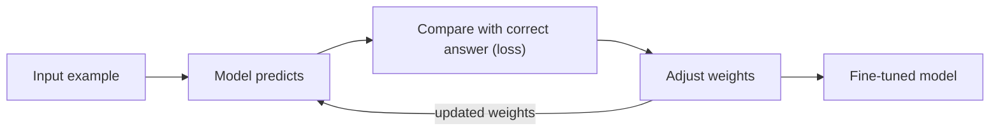

# How does Fine-Tuning work?

> **Step 7: Training, Fine-Tuning, and Alignment** · ⏱️ 15 min read · [Read original](https://outcomeschool.com/blog/how-does-fine-tuning-work)

## TL;DR
Fine-tuning takes an already pre-trained model and trains it a little more on our own task data so it becomes a specialist. It is far cheaper than training from scratch and is best used to change behavior (style, tone, format), not just to supply facts.

## Key Concepts
- **Base / pre-trained model** — the model that already learned from huge general data.
- **Weights** — the numbers inside the model that hold its "knowledge"; fine-tuning nudges them.
- **Loss** — a non-negative number for how wrong a prediction is; zero means exactly right.
- **Backpropagation + gradient descent** — figure out which way to nudge each weight, then nudge it.
- **Epoch** — one full pass over the training data.
- **Learning rate** — small step size so we do not over-correct.
- **Full fine-tuning vs LoRA** — update every weight vs freeze the original and train small extra weights.

## How It Works
### Steps
1. Pick a base model.
2. Prepare a dataset of inputs and correct outputs (quality matters most).
3. Feed examples; the model predicts.
4. Measure the mistake (loss).
5. Adjust weights via backprop plus gradient descent.
6. Repeat over many epochs until loss is small.

### Tiny worked example
One weight `w = 2.0`, input 4, target 10. Prediction `4*2.0 = 8`, error 2. With learning rate 0.05, adjustment `0.05 * 2 * 4 = 0.4`, so `w = 2.4` and prediction becomes 9.6. Repeating gives 8.00, 9.60, 9.92, 9.98, 10.00. A real model does this for billions of weights at once.

### Full fine-tuning vs LoRA
| Point | Full Fine-tuning | LoRA |
|---|---|---|
| Changes | All weights | Only small extra weights (original frozen) |
| Memory | Very high | Low |
| Speed | Slow | Fast |
| Cost | High | Low |

Analogy: LoRA is sticky notes on a printed book instead of reprinting it. Prefix Tuning is another cheap option that trains a small prefix steering attention layers.

### When to fine-tune
Use it for a specific style, brand voice, strict format (medical/legal), or company jargon. If you only need the model to read some facts, put them in the prompt. Example: InstructGPT's first step was fine-tuning GPT-3 on human-written answers.

### Tips
- Small clean data beats large messy data.
- Keep examples consistent (a polite tone means all examples polite).
- Start with LoRA when machines are limited.
- Test on unseen examples to check learning vs memorizing.
- Note: some old skills can get rusty after narrow fine-tuning.

## Diagram

## Key Takeaways
- Fine-tuning = small, careful adjustments to a pre-trained model using task-specific data.
- The loop is predict, measure loss, adjust weights, repeat.
- LoRA is the practical choice on limited hardware; full fine-tuning for deep changes with ample resources.
- Fine-tune for behavior; use prompts for facts.
- Always evaluate on unseen data.
