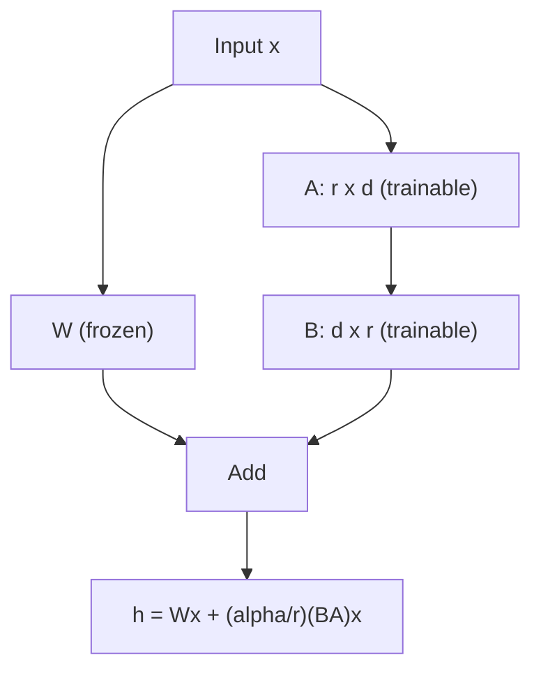
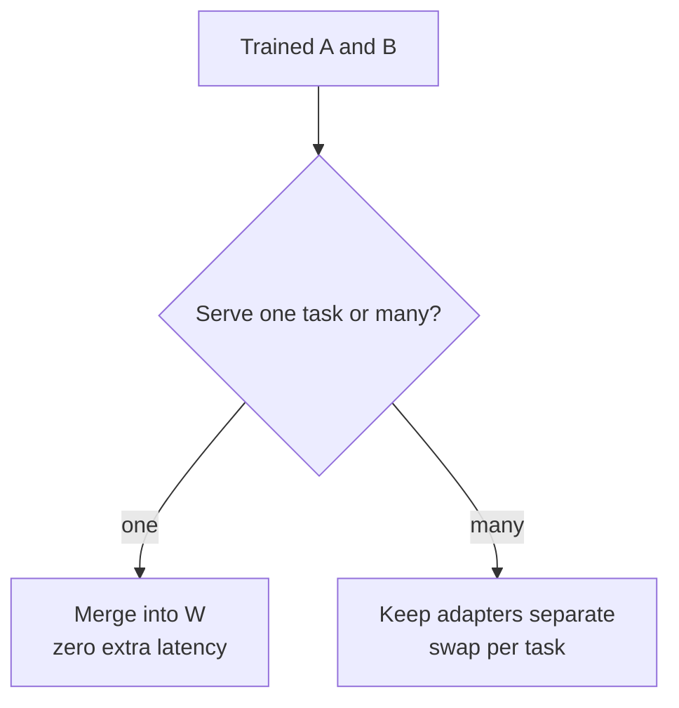

# What is LoRA (Low-Rank Adaptation)?

> **Step 7: Training, Fine-Tuning, and Alignment** · ⏱️ 14 min read · [Read original](https://outcomeschool.com/blog/lora-low-rank-adaptation-of-llms)

## TL;DR
LoRA freezes the pretrained weights and learns a tiny low-rank update $\Delta W = BA$ on the side. This cuts trainable parameters 100x-1000x+, saves memory, compute and storage, and can be merged into the weights after training for zero inference latency.

## Key Concepts
- **LoRA** — Low-Rank + Adaptation; frozen weights + small low-rank update.
- **Low-rank observation** (Microsoft paper) — the fine-tuning update is low-rank; a much smaller matrix than $W$ suffices, because the pretrained model only needs a small nudge along a few directions.
- **Rank $r$** — inner dimension of A and B (4, 8, 16, 32, 64); key hyperparameter.
- **$\alpha$** — scaling factor; update scaled by $\alpha/r$ (common: $\alpha = 2r$).
- **Adapter** — the small trained A and B.
- **QLoRA** — LoRA + 4-bit quantization for very large models on one consumer GPU.

## How It Works

### Why full fine-tuning hurts
7B params means updating 7B numbers: GPU memory for weights + gradients + optimizer states (Adam: 3-4x model size); slow training; storage (10 tasks = 10 full multi-GB copies); hard to share.

### Core math
Full: $W_{new} = W + \Delta W$ (both $d \times d$). LoRA:

$$
\Delta W = BA,\quad A\in\mathbb{R}^{r\times d},\ B\in\mathbb{R}^{d\times r}
$$

Forward pass: $h = Wx + \frac{\alpha}{r}(BA)x$. $W$ frozen; only A, B trained. For rectangular $W$ ($d\times k$): B is $d\times r$, A is $r\times k$ (feed-forward layers are $d\times 4d$; attention projections are square).

### Steps
1. Freeze all original weights.
2. For each target matrix add A (small random Gaussian init) and B (all zeros). So $BA=0$ at start and the model equals the pretrained one.
3. Train only A and B.
4. Forward with $\frac{\alpha}{r}(BA)x$.
5. Keep the tiny A, B as task knowledge.
Rank trade-off: small r = fewer params, faster, less capacity; large r = more capacity, less efficiency. Ranks 8-64 work for most tasks.

### Numeric example
$W$ is 4096 x 4096 = 16,777,216 params. With $r=8$: A = 8x4096 = 32,768; B = 4096x8 = 32,768; total 65,536, about 256x fewer per matrix. For a 7B model, LoRA r=8 trains a few million params, about 1000x+ fewer.

### Where applied
Any linear layer; typically attention projections $W_Q, W_K, W_V, W_O$. The paper found adapting just $W_Q$ and $W_V$ often enough; applying to all four or the feed-forward layers gives better quality at more parameters.

### Merging
$W_{merged} = W + \frac{\alpha}{r}BA$ → single matrix, zero inference latency. Merging is one-way. To serve many tasks from one base model keep adapters unmerged and load on demand (adapter swapping). Unlike Prefix Tuning, which cannot merge, LoRA can.

### Use cases
Fine-tune LLaMA/Mistral/Qwen on a single GPU; task-specific adapters (summarization, code, support); style/domain/persona adaptation; image models like Stable Diffusion (shared small LoRA files); foundation for QLoRA; continual learning without overwriting existing knowledge. Adapters are a few MB vs multi-GB models, so easy to share, swap, version.

## Diagrams

### LoRA forward pass

### Merge or swap

## Trade-offs & Pitfalls
- Rank choice: too small limits capacity, too large loses efficiency.
- Merge is one-way; no adapter swapping after.
- Coverage choice (which matrices) trades quality against parameter count.

## Key Takeaways
- LoRA = frozen W + trainable low-rank $BA$.
- A random, B zero → starts identical to the pretrained model.
- Trainable params drop 100x-1000x+ (4096x4096 matrix at r=8: 256x fewer).
- Merge for zero inference latency; keep separate for adapter swapping.
- Typically on attention $W_Q$, $W_V$ (or all projections / FFN).
- Foundation for QLoRA; adapters are MB-sized and easy to share.
