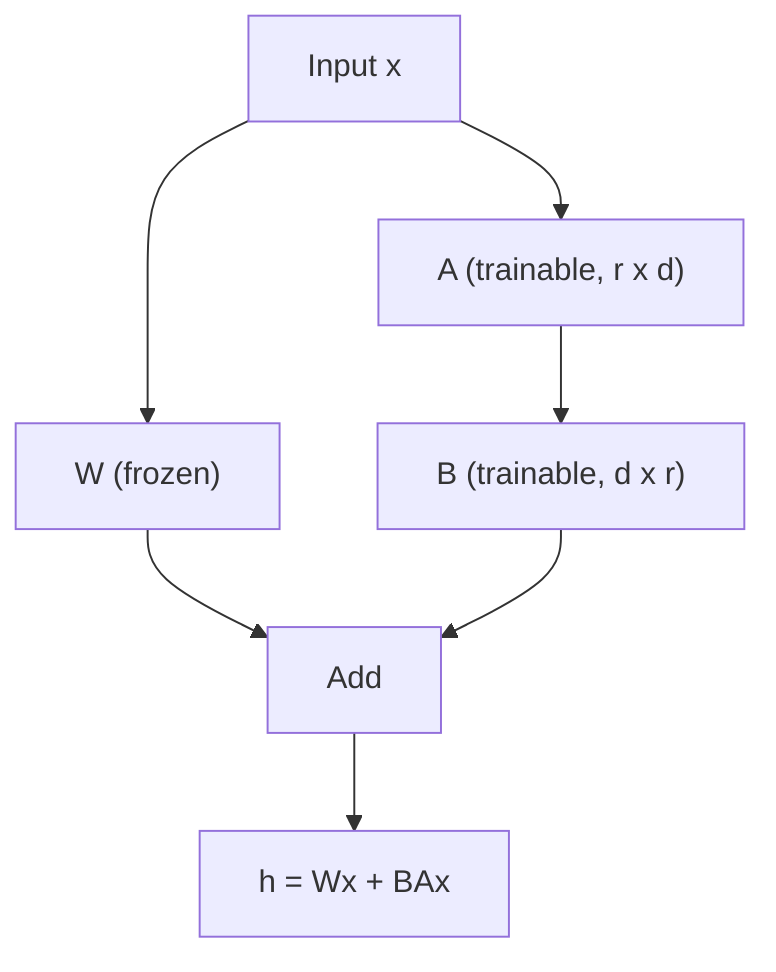

# What is LoRA (Low-Rank Adaptation)?

> **Step 7: Training, Fine-Tuning, and Alignment** · ⏱️ 14 min read · [Read original](https://outcomeschool.com/blog/lora-low-rank-adaptation-of-llms)

## TL;DR
LoRA fine-tunes a large model by freezing its original weights and learning a tiny low-rank update (two small matrices) on the side. This cuts trainable parameters by orders of magnitude, and the update can be merged back for zero inference overhead.

## Key Concepts
- **Low-rank update** — the weight change needed for a new task is small and compact, so it can be factored.
- **Rank r** — small inner dimension (typically 8 to 64); the most important LoRA hyperparameter.
- **A and B** — A is `r x d` (random Gaussian init), B is `d x r` (zero init).
- **alpha / r** — scaling that controls how strongly the update affects output; common choice alpha = 2r.
- **Adapter swapping** — keep adapters unmerged and load a different one per task.
- **QLoRA** — LoRA plus 4-bit quantization.

## How It Works
### Why full fine-tuning hurts
Updating billions of parameters needs weights, gradients, and optimizer states in memory (Adam can need 3 to 4 times model size), is slow, and each task needs a full multi-gigabyte copy.

### The math
Full fine-tuning learns $W_{new} = W + \Delta W$ with both huge. LoRA replaces the update:

$$\Delta W = BA,\quad h = Wx + \frac{\alpha}{r}(BA)x$$

W is frozen; only A and B train. Because B starts at zero, BA = 0 initially so the model starts identical to the pre-trained one. For a non-square `d x k` matrix, B is `d x r` and A is `r x k`.

### Numeric example
A `4096 x 4096` matrix has 16,777,216 parameters. With r = 8: A has 32,768 and B has 32,768, total 65,536, about 256x fewer. For a 7B model, trainable parameters typically drop 1000x or more depending on rank and placement.

### Where applied
Any linear layer, usually attention projections W_Q, W_K, W_V, W_O. The original paper found adapting just W_Q and W_V often suffices; more layers (including feed-forward) buy quality at the cost of more parameters.

### Merging
After training, `W_merged = W + (alpha/r) BA`, so inference has no extra matrices or latency. Merging is one-way; to serve many tasks from one base model keep adapters separate.

### Use cases
Fine-tuning LLaMA/Mistral/Qwen on one GPU, per-task adapters, style/domain adaptation, Stable Diffusion styles, QLoRA, and continual learning (base knowledge is not overwritten). Adapters are often just a few MB, easy to share and version.

## Diagram

## Key Takeaways
- LoRA = frozen weights plus a learned low-rank update $\Delta W = BA$.
- B is zero-initialized, so training starts from the original model's behavior.
- Rank r trades capacity against efficiency; 8 to 64 works for most tasks.
- Merged LoRA adds zero inference latency; unmerged adapters enable task swapping.
- LoRA is the base of QLoRA and a good fit for continual learning.
