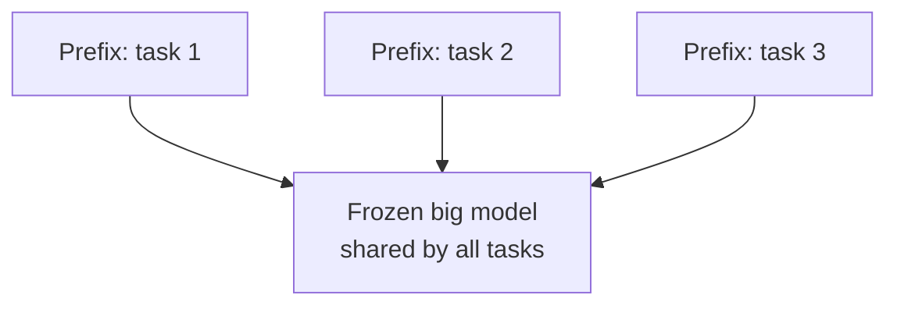
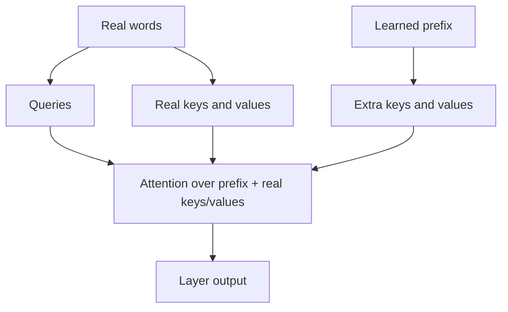
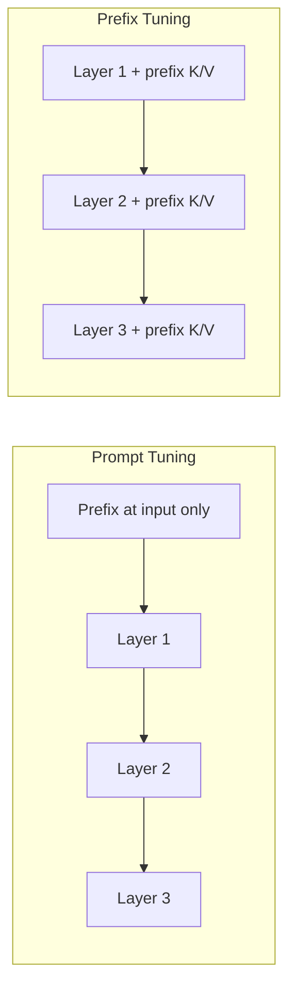

# How does Prefix Tuning work?

> **Step 7: Training, Fine-Tuning, and Alignment** · ⏱️ 25 min read · [Read original](https://outcomeschool.com/blog/how-does-prefix-tuning-work)

## TL;DR
Prefix Tuning freezes the whole LLM and trains only a small block of learnable numbers (the prefix) that supplies extra keys and values to attention in every layer. It trains well under 1% of parameters, stores one tiny prefix per task, and lets one shared model serve many tasks. It is PEFT, but harder to train and costlier at inference than LoRA.

## Key Concepts
- **LLM / parameters (weights)** — giant collection of numbers that knows language.
- **Full fine-tuning** — update every parameter; N tasks = N giant copies.
- **Frozen** — model numbers locked and unchanged.
- **PEFT** — Parameter-Efficient Fine-Tuning: train very few parameters.
- **Prefix** — small block of free learnable numbers, not text and not part of the input.
- **Virtual tokens** — the prefix's extra positions; they map to no real word and never come from text.
- **Embedding** — list of numbers that represents a word; prefix skips words entirely.
- **Query / key / value** — query = what a position looks for; key = label of what it is about; value = information handed over. Queries ask; keys and values answer.
- **Reparameterization** — train a smaller block, pass through a small network to produce prefix K/V, discard network after training.
- **Prompt Tuning** — learnable block added only at the input (Lester et al., 2021).

## How It Works

### Problem
Full fine-tuning needs powerful machines, time, money, and one huge copy per task; it does not scale.

### Steps
1. Freeze the entire LLM.
2. Create a small set of new numbers (the prefix); hand to inner machinery in every layer, not into text.
3. Each layer's attention sees the prefix alongside the real text; it steers output to our task.
4. Train only the prefix on task examples.

Result: one shared frozen model + one tiny prefix per task.

### Where the prefix goes
The prefix only answers: at every layer it adds extra keys and extra values (no queries). Real words still supply all queries and attend over [prefix keys + real keys] and [prefix values + real values]. Each layer has its own separate trained prefix K/V (not passed from layer 1 to 2). Being present at every layer steers the model steadily. One virtual token = a key part and a value part per layer (2 lists, no query).

### Training loop
1. Start with random prefix.
2. Run example through frozen model with prefix K/V at every layer.
3. Compare to correct answer: loss.
4. Adjust only prefix numbers.
5. Repeat.
Direct training is unstable, so the paper uses reparameterization; in `peft` this is `prefix_projection` (off by default). When on, the printed trainable count is much bigger than the saved prefix because the temporary network is counted.

### How small is it
Model: 1.3B params, hidden 2048, 24 layers; 20 virtual tokens at every layer.
- One virtual token, one layer: 2 x 2048 = 4,096
- 20 tokens, one layer: 20 x 4,096 = 81,920
- 24 layers: 81,920 x 24 = 1,966,080 (about 0.15% of 1.3B; 99.85% frozen)

Formula: $\text{trainable} = \text{tokens}\times 2 \times \text{hidden}\times \text{layers}$. (Assumes prefix stores K/V directly, the default; other setups count differently.)

### Code (peft)
```python
model = AutoModelForCausalLM.from_pretrained("gpt2")
config = PrefixTuningConfig(task_type="CAUSAL_LM", num_virtual_tokens=20)
model = get_peft_model(model, config)
model.print_trainable_parameters()
# trainable params: 368,640 || all params: 124,808,448 || trainable%: 0.2954
```
Check: gpt2 has 12 layers, hidden 768: 20 x 2 x 768 x 12 = 368,640.

### Prefix Tuning vs full fine-tuning
| Feature | Full Fine-Tuning | Prefix Tuning |
|---|---|---|
| What changes | Every parameter | Only the prefix |
| Storage per task | Full giant copy | Tiny prefix |
| Training cost | Very high | Very low |
| Best accuracy | Higher | Close, usually slightly behind |
| Switching tasks | Load a new model | Swap the prefix |
| Forgetting risk | Higher | Lower (base intact) |

### Prefix Tuning vs Prompt Tuning
Prompt Tuning adds a learnable block once at the input; it flows through like input and inner layers get nothing extra. Prefix Tuning injects K/V into attention at every layer, so it usually performs better, especially on hard tasks. Same model (2048 hidden, 24 layers): Prompt Tuning trains 20 x 2048 = 40,960 numbers vs 1,966,080 for Prefix Tuning, about 48x fewer. Prompt Tuning: simpler and smaller, good for very large models on easier tasks; Prefix: costs more, steers more strongly.

### Where used
Many tasks on one model (summarize, translate, support replies via three prefixes); limited hardware; quick experiments; per-customer personalization (style/domain).

## Diagrams

### Shared frozen model, one prefix per task


### Attention in one layer


### Prefix vs Prompt Tuning


## Trade-offs & Pitfalls
Advantages: cheap training (no gradients/optimizer state for the frozen billions), tiny storage per task, one model many tasks (swap prefix), lower forgetting, easy deployment. Note: full forward/backward still runs through all layers, so savings are memory and storage, not raw speed.

Limitations:
- Extra keys/values at every layer lengthen attention: more compute and memory; may eat into usable input length (check per setup).
- Longer prefix is not always better: quality rises then falls; tune. Paper: about 10 virtual tokens for table-to-text, about 200 for summarization (harder task, longer prefix).
- Harder to train than LoRA (needs reparameterization); LoRA weights merge back for no extra answer-time cost, so LoRA is the usual first choice. Pick Prefix Tuning when per-layer steering is wanted and the attention cost is acceptable.

## Key Takeaways
- Prefix Tuning = frozen LLM + learned prefix of virtual tokens injected as extra keys/values in every layer's attention.
- Prefix is numbers, not words; it answers but never queries.
- Trains about 0.15-0.3% of parameters; storage per task is tiny.
- Count = tokens x 2 x hidden x layers.
- Beats Prompt Tuning on hard tasks (every layer vs input only) but trains about 48x more numbers in the example.
- Tune prefix length; training can be unstable (reparameterization / `prefix_projection`).
- LoRA is usually easier and mergeable; Prefix Tuning cannot merge.
