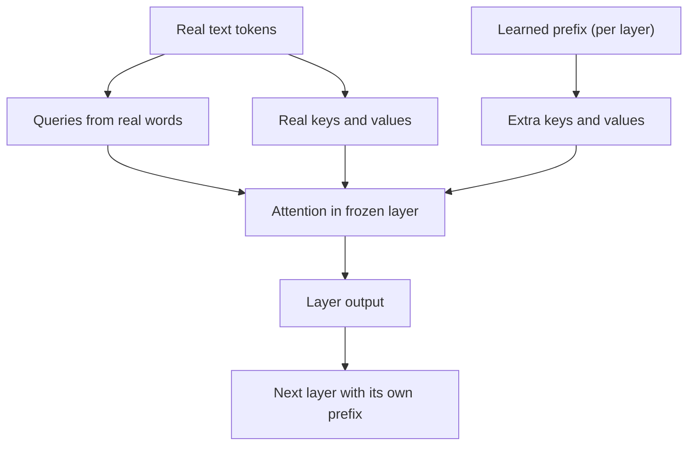

# How does Prefix Tuning work?

> **Step 7: Training, Fine-Tuning, and Alignment** · ⏱️ 25 min read · [Read original](https://outcomeschool.com/blog/how-does-prefix-tuning-work)

## TL;DR
Prefix Tuning freezes the whole LLM and trains only a small block of numbers, the prefix, that supplies extra keys and values to the attention in every layer. One shared frozen model plus one tiny prefix per task saves memory and storage, though LoRA is usually the easier practical choice today.

## Key Concepts
- **PEFT** — Parameter-Efficient Fine-Tuning: gain fine-tuning benefits by training very few parameters.
- **Frozen model** — all original weights locked and shared across tasks.
- **Prefix** — learnable numbers, not real words and not part of the input text.
- **Virtual tokens** — extra attention positions the real words can look at; never come from text.
- **Attention roles** — query asks, key is a label, value is the information; the prefix only supplies keys and values, never queries.
- **Reparameterization** — training trick for stability (`prefix_projection` in peft, off by default): learn a smaller block, pass it through a small network, discard the network afterward.

## How It Works
### Problem
Full fine-tuning updates every parameter and needs a full model copy per task (ten tasks, ten giant copies).

### Mechanism
1. Freeze the model.
2. Create a small set of new numbers (the prefix).
3. At every layer, the prefix adds extra keys and values alongside the real ones; each layer has its own separate prefix block (not passed layer to layer).
4. Train only the prefix: start random, run frozen model, measure loss, adjust only the prefix, repeat.

### Size calculation (1.3B model, hidden 2048, 24 layers, 20 virtual tokens)
Per token per layer: $2 \times 2048 = 4096$ (key + value). Per layer: $20 \times 4096 = 81{,}920$. All layers: $81{,}920 \times 24 = 1{,}966{,}080$, about 0.15% of the model. Check with gpt2 (12 layers, 768 hidden): $20 \times 2 \times 768 \times 12 = 368{,}640$, matching peft's printout (about 0.3%).

```python
config = PrefixTuningConfig(task_type="CAUSAL_LM", num_virtual_tokens=20)
model = get_peft_model(model, config)
```

### Comparisons
| Feature | Full Fine-Tuning | Prefix Tuning |
|---|---|---|
| Changes | Every parameter | Only the prefix |
| Storage per task | Full copy | Tiny prefix |
| Training cost | Very high | Very low |
| Accuracy | Higher | Close, usually slightly behind |
| Switching tasks | Load new model | Swap prefix |
| Forgetting risk | Higher | Lower |

Prompt Tuning adds learnable numbers only at the input (20 x 2048 = 40,960, about 48 times fewer than prefix tuning here); Prefix Tuning injects into attention at every layer, steering harder and often performing better on hard tasks.

### Pros and limitations
- **Pros:** cheap to train, tiny storage, one model for many tasks, low forgetting, easy deployment. Saving is mainly memory and storage, not speed (full forward/backward still runs).
- **Limits:** extra keys/values lengthen attention at every layer; longer prefix is not always better (paper: about 10 virtual tokens for table-to-text, about 200 for summarization); harder to train than LoRA, and LoRA can be merged so nothing extra is carried at inference.

### Uses
Many tasks on one model, limited hardware, quick experiments, per-customer personalization.

## Diagram


## Key Takeaways
- The prefix is a block of learnable key/value numbers, not text, injected into every attention layer.
- The base model stays frozen and shared; each task adds only a tiny prefix.
- Roughly 0.15% to 0.3% of parameters are trained in the examples.
- Prefix Tuning steers every layer; Prompt Tuning only the input.
- LoRA trains more smoothly and merges back, so it is usually the first thing to try.
