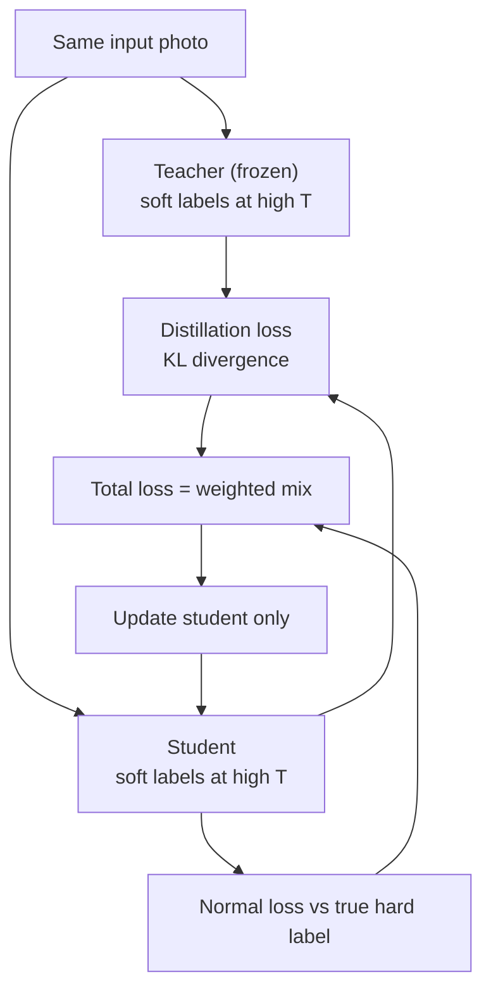
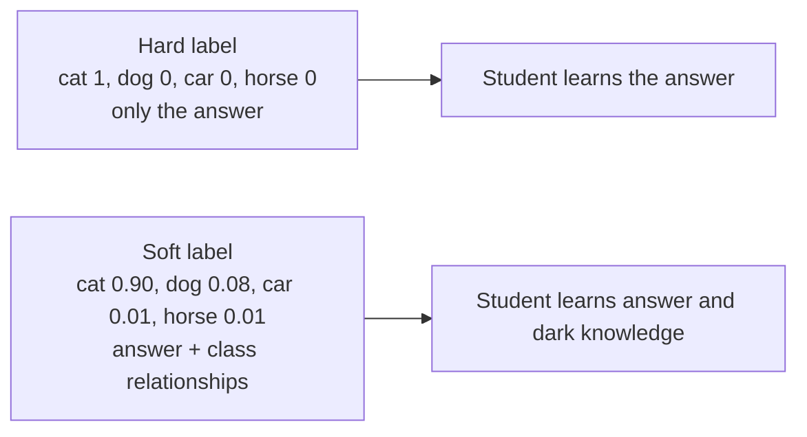
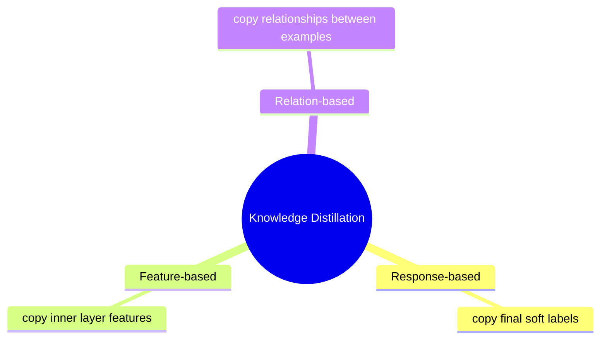

# How does Knowledge Distillation work?

> **Step 7: Training, Fine-Tuning, and Alignment** · ⏱️ 20 min read · [Read original](https://outcomeschool.com/blog/how-does-knowledge-distillation-work)

## TL;DR
Knowledge Distillation trains a small student model to copy a large teacher. The student learns from the teacher's soft labels (full probability distributions, whose dark knowledge reveals class relationships), softened with a high temperature, using a blend of distillation loss and normal loss. The result is a small, fast, cheap model that keeps most of the teacher's accuracy.

## Key Concepts
- **Teacher / student** — big, smart, slow model / small, fast, cheap model. Teacher is already trained and never changes.
- **Latency** — delay between asking and getting an answer.
- **Edge device** — phone, smartwatch, camera, car: little memory and battery.
- **Class** — one possible answer (cat, dog, car, horse).
- **Hard label** — single correct answer (cat = 1, others 0).
- **Soft label** — full probability distribution (cat 0.90, dog 0.08, car 0.01, horse 0.01), summing to 1.
- **Dark knowledge** — what soft labels reveal about class relationships (a cat is a bit like a dog, nothing like a car). Hard labels treat all wrong classes equally.
- **Logits** — raw scores; **softmax** converts them to probabilities.
- **Temperature T** — softmax knob: low T = sharp, high T = soft and spread out.
- **KL divergence** — measure of how different two distributions are; smaller = more similar.

## How It Works

### Why needed
Big models are accurate but need lots of memory, costly hardware, and are slow; AI must run on phones/edge, respond instantly, and be cheap for millions of users. Distillation shrinks the brain while keeping most intelligence.

### Temperature
Cat example: T = 1 → cat 0.95, dog 0.04, car 0.005, horse 0.005. T = 4 → cat 0.70, dog 0.22, car 0.05, horse 0.03. Teachers that are too confident (cat 0.99) hide dark knowledge; high T makes it visible. Use high T only during training; at deployment return to normal T.

### Distillation loss
Student does two things:
1. Match the teacher's soft labels (KL divergence) → distillation loss.
2. Get the true hard label right → normal loss; keeps the student grounded so it does not blindly copy teacher mistakes.

$$
L_{total} = w \cdot L_{distill} + (1-w)\cdot L_{normal}
$$

$w$ is a chosen weight (often larger on the teacher's soft labels, where the extra knowledge is).

### Training walkthrough (animal photos)
1. Start with a trained teacher (unchanged throughout).
2. Fresh small student with random numbers.
3. Take a photo (cat).
4. Teacher at high T: cat 0.70, dog 0.22, car 0.05, horse 0.03.
5. Student at same high T: e.g. cat 0.50, dog 0.30, car 0.15, horse 0.05.
6. Distillation loss via KL (high now).
7. Normal loss vs hard label cat = 1 at normal T.
8. Blend into total loss with weight.
9. Adjust student's numbers (one training step; see gradient descent).
10. Repeat over thousands of photos until the student's soft labels match.

### Types
| Type | Student copies |
|---|---|
| Response-based | Teacher's final output (soft labels); simplest, most popular |
| Feature-based | Teacher's inner features from layers (like copying rough working) |
| Relation-based | Relationships the teacher sees between examples (two photos similar) |

### Real examples
- **DistilBERT** — about 40% smaller, about 60% faster, keeps roughly 97% of BERT's language understanding.
- **Smaller chat models** — trained on a large model's high-quality answers (see SLMs).
- **On-device AI** — offline translation, voice typing, photo sorting; faster, cheaper, private; shipped in GGUF.

### Vs quantization
Distillation trains a separate small student; quantization keeps the same model but stores numbers with fewer bits.

## Diagrams

### Teacher-student training flow

### Hard vs soft labels

### Types of distillation

## Trade-offs & Pitfalls
- Student is smaller and typically slightly less accurate than the teacher (DistilBERT keeps about 97%).
- Without the normal loss the student could copy the teacher's mistakes.
- Too-confident teachers hide dark knowledge; raise T during training only.

## Key Takeaways
- Distillation = small student mimics big teacher; teacher stays fixed.
- Soft labels carry dark knowledge that hard labels discard.
- Higher softmax temperature exposes dark knowledge; revert to normal T at deployment.
- Total loss = w x distillation (KL vs teacher) + (1-w) x normal (vs true label).
- Three types: response, feature, relation based.
- DistilBERT: 40% smaller, 60% faster, 97% of BERT's understanding.
- Distillation is different from quantization (new small model vs fewer bits).
