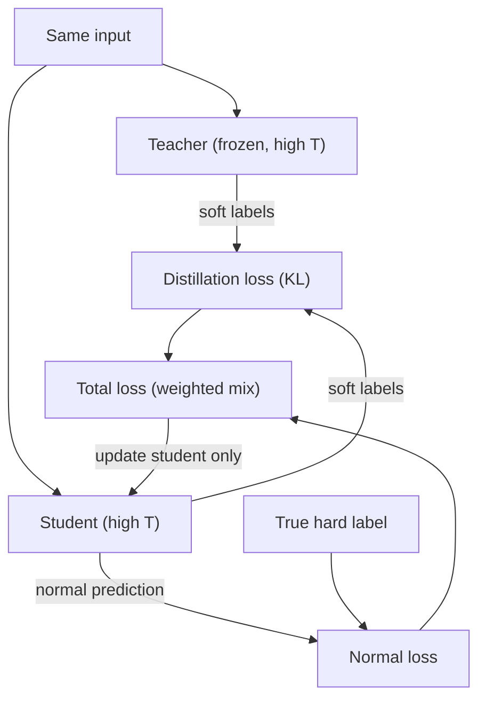

# How does Knowledge Distillation work?

> **Step 7: Training, Fine-Tuning, and Alignment** · ⏱️ 20 min read · [Read original](https://outcomeschool.com/blog/how-does-knowledge-distillation-work)

## TL;DR
Knowledge Distillation trains a small student model to copy a large teacher model, keeping most of its accuracy while being faster, cheaper, and small enough for phones and edge devices. The key is that the student learns from the teacher's full probability outputs (soft labels), not just the single correct answer.

## Key Concepts
- **Teacher / student** — big, accurate, slow model vs small, fast, cheap model that learns from it.
- **Hard label** — only the correct class (cat = 1, rest 0).
- **Soft label** — full probability distribution from the teacher (cat 0.90, dog 0.08, car 0.01, horse 0.01).
- **Dark knowledge** — hidden information in soft labels about how classes relate (a cat is a bit like a dog, nothing like a car).
- **Logits / softmax** — raw scores turned into probabilities that sum to 1.
- **Temperature T** — softmax knob; higher T gives softer, more spread-out probabilities that expose dark knowledge.
- **KL divergence** — measure of difference between two probability distributions.

## How It Works
### Why temperature
A very confident teacher (cat = 0.95) hides the small values. At T = 4 the same prediction becomes cat 0.70, dog 0.22, car 0.05, horse 0.03, so the cat-dog relationship is clear. High T is used only in training; deployed students use normal T.

### Distillation loss
The student does two things at once:
1. Match teacher soft labels (KL divergence) — the distillation loss, which transfers dark knowledge.
2. Match the true hard label — the normal loss, which keeps it grounded and prevents blindly copying teacher mistakes.

$$\text{Total} = w \cdot L_{distill} + (1-w)\cdot L_{normal}$$

### Training walkthrough
1. Start with a trained, frozen teacher.
2. Create a fresh small student.
3. Take a training example.
4. Teacher produces soft labels at high T.
5. Student produces soft labels at the same T.
6. Compute distillation loss (KL).
7. Compute normal loss against the hard label at normal T.
8. Blend into total loss.
9. Update only the student.
10. Repeat over many examples.

### Types
| Type | What the student copies |
|---|---|
| Response-based | Teacher's final output (soft labels); simplest, most popular |
| Feature-based | Inner layer features (internal understanding) |
| Relation-based | Relationships the teacher sees between examples |

### Real examples
- **DistilBERT:** about 40% smaller, 60% faster, keeps roughly 97% of BERT's language understanding.
- Small chat models distilled from larger ones.
- On-device AI (offline translation, voice typing, photo sorting): faster, cheaper, more private.

Distillation vs quantization: distillation trains a separate small model; quantization keeps the same model but stores numbers in fewer bits.

## Diagram

## Key Takeaways
- Soft labels carry dark knowledge that hard labels discard.
- Temperature softens the teacher's output so subtle class relationships become visible.
- Total loss blends teacher-matching and ground-truth losses.
- The teacher is never changed; only the student learns.
- Three flavors: response, feature, and relation-based distillation.
