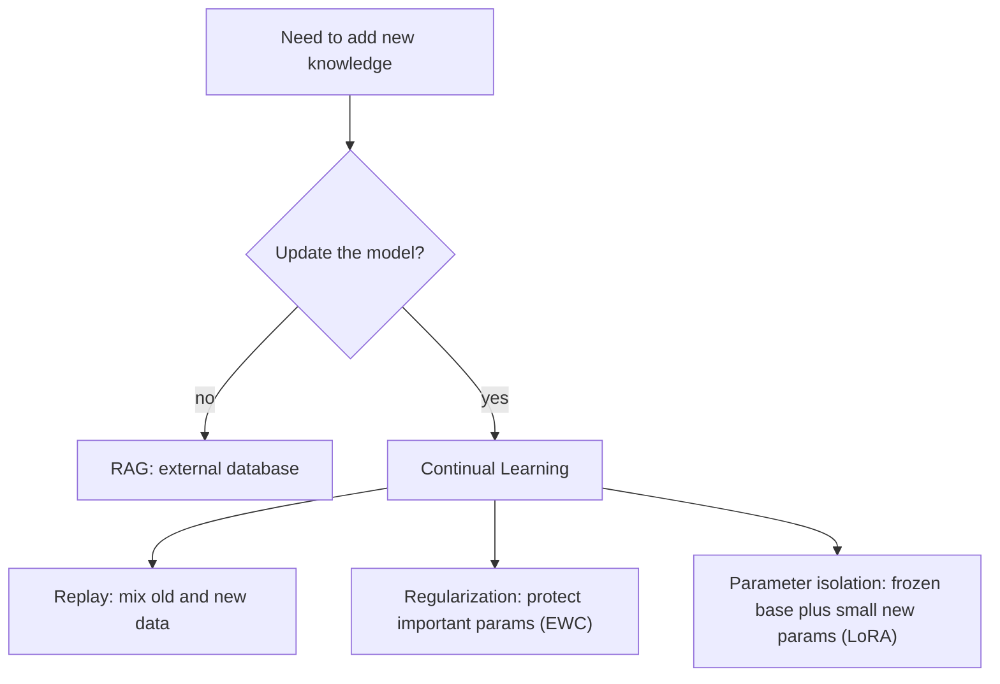

# What is Continual Learning in LLMs? Solving Catastrophic Forgetting

> **Step 7: Training, Fine-Tuning, and Alignment** · ⏱️ 14 min read · [Read original](https://outcomeschool.com/blog/continual-learning-in-llms)

## TL;DR
Continual Learning lets an LLM keep absorbing new knowledge over time without retraining from scratch and without losing what it already knows. The main obstacle is catastrophic forgetting, tackled by replay, regularization, or parameter isolation methods; RAG is a popular alternative that avoids updating the model at all.

## Key Concepts
- **Continual Learning** — keep learning as new data arrives, like a child adding skills without losing old ones.
- **Catastrophic forgetting** — training on new data overwrites parameters, erasing old knowledge (like writing over a whiteboard).
- **Replay-based** — mix old data with new data while training.
- **Regularization-based (EWC)** — protect parameters important to old knowledge.
- **Parameter isolation** — freeze the original parameters, train small new ones (LoRA, Prefix Tuning).
- **Stability vs plasticity** — be stable enough to remember, plastic enough to learn.

## How It Works
### Why it is needed
An LLM trained in 2023 does not know later events. Options: retrain from scratch on old plus new data (very expensive) or teach only the new information with fine-tuning (cheap, but risks forgetting).

### Example of forgetting
An LLM knows Math, History, Science. Training only on Sports makes it good at Sports and it forgets the rest.

### Three approaches
| Approach | Idea | Advantage | Disadvantage |
|---|---|---|---|
| Replay-based | Mix old examples into new training | Simple, works well | Brings back training cost; too much old data approaches full retraining |
| Regularization-based (EWC) | Lock important parameters, let others change | No need to store old data | Hard to identify important parameters; over-protecting blocks learning |
| Parameter isolation (LoRA) | Freeze original, train small new parameters | Old knowledge fully preserved, cheap | Model grows if new parameters are added for every task |

Analogies: revising old chapters before an exam; the brain protecting key memories; adding a chapter to a book.

### Alternative: RAG
Keep the LLM unchanged; store new knowledge in an external (vector) database, retrieve relevant info at question time, and pass it with the question. New info is added instantly by updating the database, but the model does not truly learn it (open-book exam). So RAG is not strictly continual learning, but it avoids forgetting.

### Challenges
Catastrophic forgetting, replay cost, compute cost, evaluation (learned new without forgetting old?), stability vs plasticity, and new-data quality/bias.

### Use cases
Current events, domain adaptation (medicine, law), personalization, fixing mistakes, adding new languages.

## Diagram

## Key Takeaways
- Catastrophic forgetting happens because new training overwrites the parameters storing old knowledge.
- Three fixes: replay, regularization (EWC), parameter isolation (LoRA, Prefix Tuning).
- Each fix has a trade-off: cost, difficulty choosing parameters, or model growth.
- RAG gives new knowledge from outside without touching the model, avoiding forgetting.
- The core tension is stability vs plasticity.
