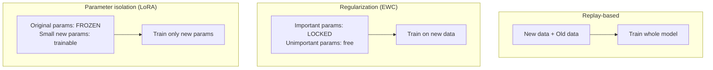
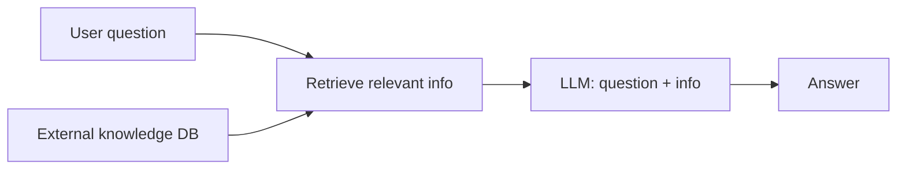

# What is Continual Learning in LLMs? Solving Catastrophic Forgetting

> **Step 7: Training, Fine-Tuning, and Alignment** · ⏱️ 14 min read · [Read original](https://outcomeschool.com/blog/continual-learning-in-llms)

## TL;DR
Continual Learning lets a model keep learning new information over time without forgetting what it already knows. Retraining from scratch is too expensive, but naively fine-tuning on new data causes catastrophic forgetting. Three families of methods (replay, regularization, parameter isolation) address this, and RAG is a popular alternative that avoids the problem by not changing the LLM.

## Key Concepts
- **Continual Learning** — model keeps learning as new data arrives, without losing old knowledge (like a child who learns to read and does not forget how to walk).
- **Catastrophic Forgetting** — training on new data overwrites parameters that stored old knowledge, so the model forgets old skills.
- **Replay-based methods** — mix some old data with new data when training.
- **Regularization-based methods** — protect important parameters from changing much. Example: Elastic Weight Consolidation (EWC).
- **Parameter isolation methods** — freeze original parameters, train a small set of new ones (LoRA, Prefix Tuning).
- **Stability vs Plasticity** — be stable enough to remember, plastic enough to learn.
- **RAG** — keep the LLM unchanged and supply new knowledge from an external store at answer time.

## How It Works

### Why we need it
- The world changes (events, facts, tech, words). An LLM trained in 2023 does not know 2024-2026.
- Option 1: retrain from scratch on old plus new data. Very expensive (time, money, compute).
- Option 2: take the existing LLM and teach only the new info (fine-tuning). Cheap and fast, but suffers catastrophic forgetting. Option 2 is Continual Learning.

### Catastrophic Forgetting
- Example: LLM knows Math, History, Science. Train only on Sports: it learns Sports but forgets the rest.
- Cause: billions of parameters store all knowledge; updating them on new data overwrites old knowledge (whiteboard written over).

### Approach 1: Replay-based
- Mix Math/History/Science examples into the Sports data, then train. Like revising old chapters while studying a new one.
- Pro: simple, works well in practice.
- Con: brings back training cost. Extra data every time. Too much old data approaches the cost of training from scratch.

### Approach 2: Regularization-based
- Tell the model: change unimportant parameters freely, do not change important ones much.
- **EWC** identifies parameters important for old knowledge and protects them during new training.
- Pro: no need to store old data.
- Con: hard to know which parameters matter. Protecting too many stops the model learning new things (balance problem).

### Approach 3: Parameter isolation
- Freeze all original parameters. Add a small set of new parameters and train only those.
- **LoRA**: add small matrices, train only them, original LLM untouched (like adding a chapter to a book).
- **Prefix Tuning**: same family. New parameters are a small prefix supplying extra keys and values in every attention layer, LLM frozen.
- Pro: old knowledge fully preserved, cheap (few trainable parameters).
- Con: adding parameters per new task makes the model grow bigger over time.

| Approach | What is trained | Old knowledge protected by | Main drawback |
|---|---|---|---|
| Replay | Whole model on new + old data | Practising old data | High training cost |
| Regularization (EWC) | Whole model, important params locked | Locking important params | Hard to pick params, stability-plasticity balance |
| Parameter isolation (LoRA) | Only small new params | Freezing original params | Model grows per task |

### Alternative: RAG
- Store new knowledge in an external (usually vector) database. On a question, retrieve relevant info, give it to the LLM with the question, LLM answers. LLM never changes (open-book exam).
- Pro: no retraining, new info added instantly by updating the database.
- Con: the LLM does not truly learn; it just reads when needed. So RAG is not exactly Continual Learning, but it avoids catastrophic forgetting.

### Diagrams

#### Three approaches side by side

#### RAG flow

## Trade-offs & Pitfalls
- Catastrophic forgetting is the biggest problem.
- Cost of replay: repeatedly training on old data adds cost.
- Computing cost: even partial LLM training is expensive.
- Evaluation: hard to verify new learning without old forgetting.
- Stability vs plasticity balance is hard.
- Data quality: mistakes or bias in new data get learned too.

## Real-world use cases
- Keeping up with current events (news, scores, stock prices).
- Domain adaptation (medicine, law).
- Personalization to a user's preferences and style.
- Fixing wrong answers without full retraining.
- Adding new languages without losing old ones.

## FAQ
- Is RAG Continual Learning? → No. LLM unchanged, reads from external DB. Avoids forgetting, instant updates, but no true learning.
- Why not retrain from scratch? → Too costly in time, money, compute.
- Is LoRA good for Continual Learning? → Yes: frozen LLM, few trainable params, old knowledge preserved. Downside: model grows with each task.
- What is EWC? → Regularization method that finds parameters important for old knowledge and protects them while new knowledge uses unimportant ones.

## Key Takeaways
- Continual Learning = keep learning new info without forgetting old.
- Catastrophic forgetting happens because new training overwrites the parameters storing old knowledge.
- Replay mixes in old data (simple, costly); EWC locks important parameters (no stored data, hard to tune); LoRA/prefix tuning freezes the base (safe, model grows).
- Stability vs plasticity is the core trade-off.
- RAG sidesteps forgetting by leaving the LLM unchanged, but the model does not truly learn.
