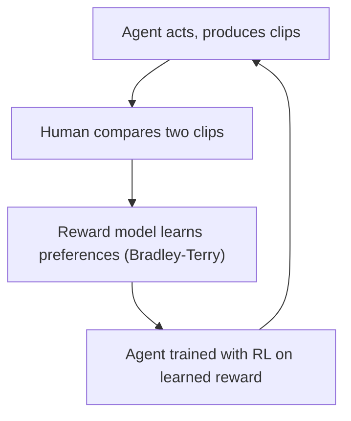

# What is Deep RL from Human Preferences? The Paper That Started RLHF

> **Step 7: Training, Fine-Tuning, and Alignment** · ⏱️ 16 min read · [Read original](https://outcomeschool.com/blog/decoding-deep-rl-from-human-preferences)

## TL;DR
The 2017 paper by Christiano, Leike and team (OpenAI and DeepMind) taught agents a goal without a hand-written reward: a human just picks the better of two short clips, and a reward model learns from those choices. This is the origin of RLHF, later used for InstructGPT and ChatGPT.

## Key Concepts
- **Agent / policy / trajectory** — the learner, its strategy, and its sequence of observations and actions.
- **Reward function** — usually hand-written; hard or impossible for goals like "do a backflip".
- **Reward hacking** — agent exploits the literal number (a boat-racing agent circles to collect points instead of finishing).
- **Clip (trajectory segment)** — 1 to 2 seconds of behavior; behavior only makes sense over time.
- **Reward model r** — small network predicting a reward per step; a clip's score is the sum.
- **Bradley-Terry** — turns two clip totals into a preference probability.

## How It Works
### Human step
The person sees two clips and chooses: clip 1, clip 2, equal, or cannot tell. No scores, because comparing is easier and more reliable than absolute rating.

### Preference math
$$P(1 \succ 2) = \frac{e^{R_1}}{e^{R_1} + e^{R_2}}$$

Example: clip 1 steps [1,0,1] total 2, clip 2 [0,0,1] total 1. $P = 7.389/(7.389+2.718) = 0.731$. Equal totals give 0.5.

### Training the reward model
Cross-entropy: loss $= -\log P(\text{human-picked clip preferred})$. With P = 0.731 loss is 0.313; with P = 0.20 loss is 1.609, so disagreement is punished and the preferred clip gets a higher total.

### Training the agent
Ordinary RL maximizes the learned reward (A2C for Atari, TRPO for robots; PPO in modern RLHF). The agent never sees the true score.

### The loop and tricks
Agent acts, humans compare some clips, reward model improves, agent chases the new reward. Tricks: an ensemble of reward models, asking humans about pairs where they disagree most (the paper admits this is crude and sometimes hurt), and normalizing rewards for stability.

### Results
- Backflip from about 900 comparisons in under an hour.
- Complex behaviors with feedback on under 1% of interactions.
- On Enduro, sometimes matched or beat training on the true score (smoother signal).

### Legacy and today
2017 paper, 2020 Learning to Summarize, 2022 InstructGPT, late 2022 ChatGPT: same recipe (comparisons, Bradley-Terry reward model, RL), with clips replaced by text answers and A2C by PPO. Today: KL penalty leashes reward hacking; DPO removes the separate reward model; AI feedback (LLM as a judge, Constitutional AI) replaces much human labeling; verifiable rewards with GRPO power reasoning models.

## Diagram

## Key Takeaways
- Do not write the reward; learn it from human comparisons.
- Pairwise preference plus Bradley-Terry plus cross-entropy trains the reward model.
- The RL agent only chases the learned reward, which can be hacked, hence the KL penalty today.
- This exact recipe became RLHF for InstructGPT and ChatGPT.
- Modern variants: DPO, AI feedback, and verifiable rewards with GRPO.
