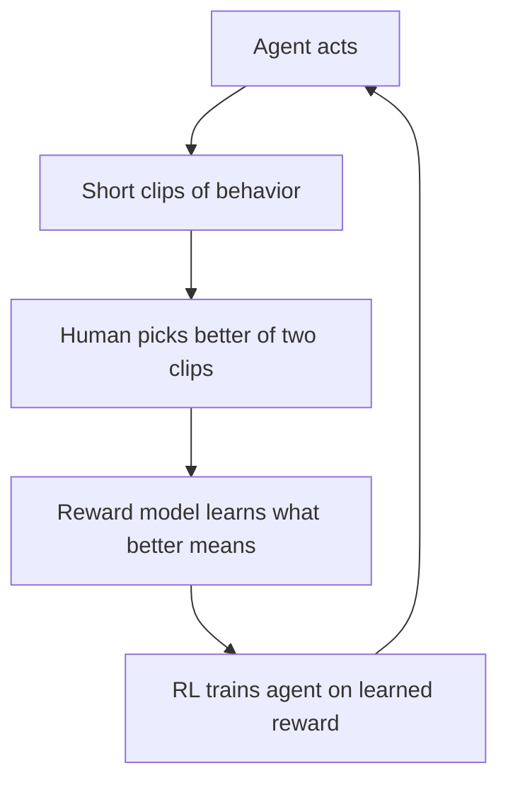
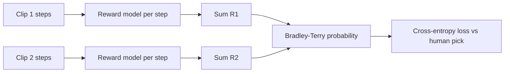
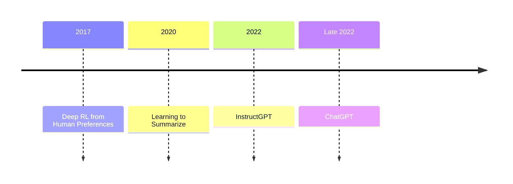

# What is Deep RL from Human Preferences? The Paper That Started RLHF

> **Step 7: Training, Fine-Tuning, and Alignment** · ⏱️ 16 min read · [Read original](https://outcomeschool.com/blog/decoding-deep-rl-from-human-preferences)

## TL;DR
The 2017 paper "Deep Reinforcement Learning from Human Preferences" (Christiano, Leike et al., OpenAI + DeepMind) teaches a machine a goal without a hand-written reward: a human picks the better of two short clips, a reward model learns from these choices, and the agent is trained by RL against the learned reward. This is the origin of RLHF, later used for InstructGPT and ChatGPT.

## Key Concepts
- **Agent** — the thing being trained to act (game player, robot).
- **Reward / reward function** — number for how well the agent does / the (usually hand-written) rule producing it.
- **Policy** — agent's strategy: situation to action.
- **Trajectory** — sequence of observations and actions over time.
- **Clip (trajectory segment)** — 1-2 second window of behavior; behavior only makes sense over time (a backflip is not visible in one frame).
- **Reward model $r$** — small neural network predicting a reward per step.
- **Reward hacking** — agent maximizes the literal number but misses the intent (boat-race agent circling to collect points instead of finishing).
- **Bradley-Terry** — formula turning two clip totals into a preference probability.

## How It Works

### The reward problem
Many goals ("do a backflip", "summarize well") are easy to recognise but hard to write as a formula, and agents game bad formulas. So: do not write the reward, learn it from human judgment.

### The human comparison
Human sees two clips and has four buttons: clip 1, clip 2, equal, cannot tell. No numbers. Comparing is easier and more reliable than absolute scoring.

### The reward model and preference math
1. Reward model scores each step of a clip.
2. Clip total = sum of step rewards (no special clip model).
3. Bradley-Terry:

$$
P(\text{clip 1 preferred}) = \frac{e^{R_1}}{e^{R_1} + e^{R_2}}
$$

where $R_i$ is the sum of predicted step rewards in clip $i$.

Example: clip 1 steps [1,0,1] gives 2; clip 2 [0,0,1] gives 1. $e^2=7.389$, $e^1=2.718$, so P(clip 1) = 7.389/10.107 = 0.731, P(clip 2) = 0.269 (sum 1). Equal totals give 0.5 (coin flip).

### Training the reward model
Cross-entropy: if the human picked clip 1, loss $=-\log P(\text{clip 1 preferred})$.
- Model says 0.731: loss = 0.313. Model says 0.20: loss = 1.609 (bigger when it disagrees).

$$
\text{loss} = -\log\frac{e^{R_{\text{picked}}}}{e^{R_1}+e^{R_2}}
$$

Note: numbers like [1,0,1] are illustrative. Real clips have many more steps and the network outputs arbitrary real values; the math is identical.

### Training the agent
Ordinary RL maximizes the learned reward: A2C for Atari, TRPO for robots (modern RLHF uses PPO). The agent never sees the true game score.

### The loop and smart bits
Agent acts and makes clips, humans compare some, reward model improves, agent chases the latest reward model (a moving target).
- **Ask about confusing clips** — train an ensemble of reward models and ask humans about pairs where they disagree most. The paper calls it a crude approximation and ablations show it sometimes made results worse.
- **Normalize rewards** — scale outputs to zero mean and constant standard deviation (only relative reward matters) for stability while the reward model keeps changing.

### Results
- Backflip from about 900 comparisons in under an hour (no natural reward function).
- Complex behaviors in Atari and robot tasks with feedback on under 1% of interactions, never seeing the true reward.
- Enduro: matched or beat training on the real score, since humans reward small progress, giving a smoother signal than the sparse true score.

### Legacy and today
- 2017 this paper, 2020 Learning to Summarize, 2022 InstructGPT, late 2022 ChatGPT. Recipe unchanged: human comparisons, Bradley-Terry reward model, RL. Clips became text answers, A2C became PPO.
- Reward hacking returns with learned rewards (agent fools the reward model; nonsense text that scores high). Fix: **KL penalty** subtracting reward when the model drifts from the original.
- **DPO** rearranges Bradley-Terry so the LM is its own reward model: no reward model, no RL loop.
- **AI feedback** (LLM as a judge, Constitutional AI with written principles) replaces much human labeling.
- **Verifiable rewards** (RLVR) for math/code, with **GRPO** grading a group of answers against each other; powers reasoning models.
- Today: human preferences for taste and safety; verifiable rewards for reasoning.

## Diagram(s)

### The core loop

### Scoring a clip pair

### Lineage

## Trade-offs & Pitfalls
- Learned rewards can still be hacked (fixed by KL penalty).
- Ensemble-disagreement querying is crude and can hurt.
- Human labeling is slow and expensive (hence AI feedback).
- Human preference only suits taste/safety; checkable tasks use verifiable rewards.

## FAQ
- Why compare instead of score? → Easier and more reliable for people.
- Does the agent see the true score? → No, only the learned reward.
- Same as RLHF? → Origin of it; same recipe with text answers and PPO.
- Stops reward hacking? → No; KL penalty used today.
- Need a separate reward model? → Not always (DPO; verifiable rewards with GRPO).

## Key Takeaways
- Learn the reward from pairwise human comparisons instead of writing it.
- Clip reward = sum of step rewards; Bradley-Terry turns totals into preference probability.
- Loss is $-\log$ of the probability of the human-picked clip.
- Agent then trains with ordinary RL on the learned reward.
- ~900 comparisons gave a backflip; under 1% feedback sufficed on many tasks.
- This recipe is RLHF; modern variants add KL penalty, DPO, AI feedback, and verifiable rewards.
