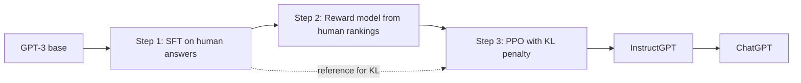

# What is InstructGPT? How GPT-3 Learned to Follow Instructions

> **Step 7: Training, Fine-Tuning, and Alignment** · ⏱️ 17 min read · [Read original](https://outcomeschool.com/blog/decoding-instructgpt)

## TL;DR
InstructGPT (OpenAI, "Training language models to follow instructions with human feedback") takes GPT-3, a next-word predictor, and aligns it to be helpful, honest, and harmless using RLHF. Same architecture, different training; a 1.3B InstructGPT was preferred over the 175B GPT-3, and the recipe led directly to ChatGPT.

## Key Concepts
- **Misalignment** — "predict the next word" is not "do what the user asked" (given "Explain the moon landing to a 6 year old", GPT-3 continues with more similar instructions).
- **Three H's** — Helpful, Honest, Harmless.
- **SFT** — supervised fine-tuning on human-written answers.
- **Reward model** — scores a (prompt, answer) pair with a single number.
- **PPO** — RL algorithm that nudges the model toward higher reward.
- **KL penalty** — leash that stops the model drifting from the SFT model.
- **Alignment tax** — small drop on standard tasks after RL.

## How It Works
### Step 1: SFT
About 40 labelers wrote roughly 13,000 prompt-answer examples; GPT-3 is fine-tuned to imitate them. Not enough alone, since hand-written examples can't cover every prompt.

### Step 2: Reward model
Comparing is easier than writing. The model generates 4 to 9 answers per prompt; labelers rank them. A ranking of $K$ answers gives $\binom{K}{2}$ pairs (4 gives 6, 9 gives 36). A 6B reward model is trained with:

$$\text{loss} = -\log\sigma(r_w - r_l)$$

Gap 1.0 gives sigmoid 0.731 and loss 0.313; gap 3.0 gives 0.953 and loss 0.048; a tie gives 0.5 and loss 0.693. Loss is averaged across all pairs. The idea comes from the 2017 Deep RL from Human Preferences paper.

### Step 3: PPO with KL leash
Loop: prompt, answer, reward model scores, nudge model, repeat. Without a leash the model reward-hacks with nonsense, so:

$$\text{final reward} = r_{RM} - \beta \cdot \text{drift from SFT}$$

Example: score 5.0, beta 0.2: drift 3 gives 4.4, drift 10 gives 3.0.

### Alignment tax and PPO-ptx
RL can hurt tasks like trivia or translation. Mixing in some original next-word pretraining objective (PPO-ptx) recovers most of it without hurting instruction following.

### Results
- 1.3B InstructGPT preferred over 175B GPT-3 (about 135 times larger).
- 175B InstructGPT preferred over 175B GPT-3 about 85% of the time.
- Hallucination on closed tasks 21% vs 41%; about 25% fewer toxic outputs when asked to be respectful.
- Alignment cost about 1.6% of GPT-3's pretraining compute.

### Today
DPO skips the reward model and RL loop; AI feedback (LLM as a judge, Constitutional AI) replaces human ranking; verifiable rewards with GRPO power reasoning models. Core idea remains: base model, a signal for "good", and a leash.

## Diagram

## Key Takeaways
- Alignment, not size, makes a model useful: a smaller aligned model beat a 135x larger raw one.
- The RLHF recipe is SFT, then reward model from rankings, then PPO.
- Ranking gives many training pairs from little human effort.
- The KL penalty prevents reward hacking and drift.
- Mixing in pretraining data (PPO-ptx) mitigates the alignment tax.
