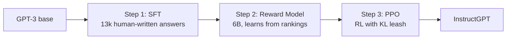
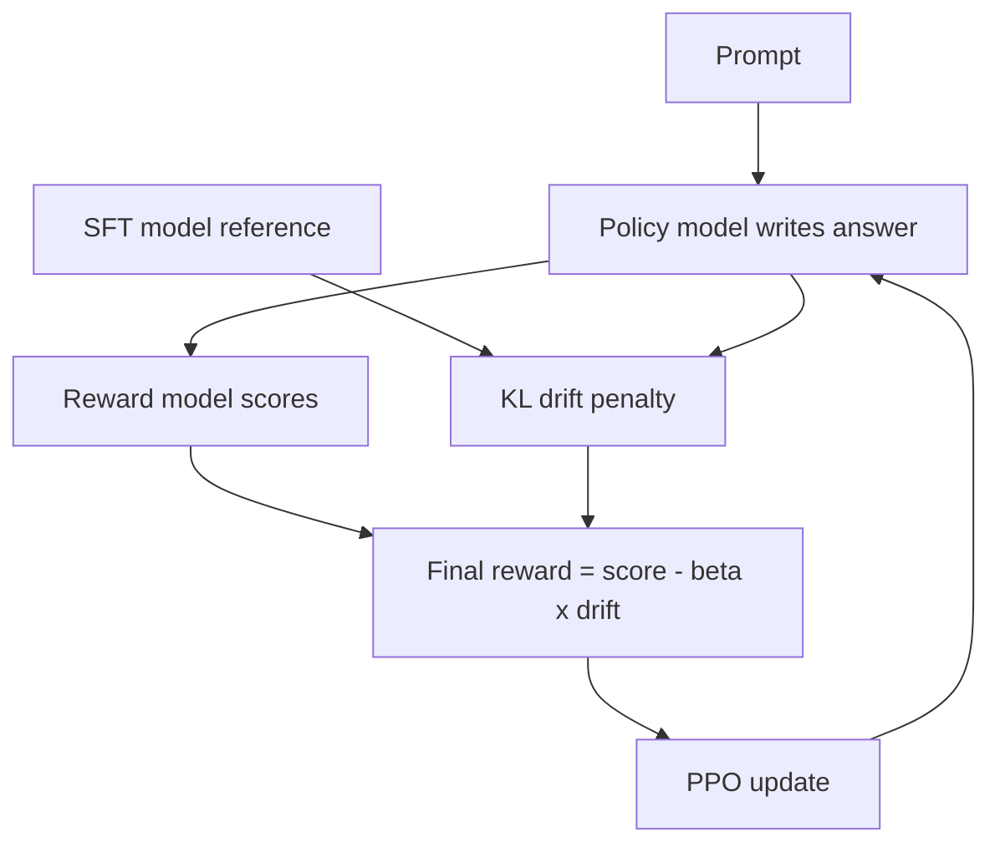
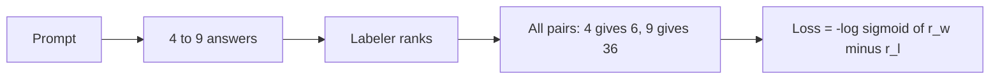

# What is InstructGPT? How GPT-3 Learned to Follow Instructions

> **Step 7: Training, Fine-Tuning, and Alignment** · ⏱️ 17 min read · [Read original](https://outcomeschool.com/blog/decoding-instructgpt)

## TL;DR
InstructGPT (OpenAI, "Training language models to follow instructions with human feedback", Ouyang, Wu, Jiang et al.) takes GPT-3, a next-word predictor, and aligns it to be helpful, honest, harmless using a 3-step RLHF recipe: SFT, reward model, PPO. Architecture is unchanged; only training changes. A 1.3B InstructGPT beat the 175B GPT-3 in human preference, and the recipe led directly to ChatGPT.

## Key Concepts
- **Pre-training** — learn to predict the next word on internet text.
- **Fine-tuning** — extra training on a smaller dataset to shape behavior.
- **Alignment** — make the model do what the user wants, not just what is statistically likely.
- **Misalignment** — gap between "predict next word" and "do what was asked". E.g. prompt "Explain the moon landing to a 6 year old" is continued with more similar instructions instead of an answer.
- **Three H's** — Helpful (solves the task), Honest (no made-up facts), Harmless (no harm). Trained in; a separate runtime guardrail layer also exists.
- **Reward / RL / RLHF** — number for answer quality / trial-and-reward learning / reward comes from human opinions.
- **Alignment tax** — drop on standard tasks (trivia, translation) after RL.
- **KL penalty** — leash punishing drift from the SFT model.

## How It Works

### The three-step pipeline
1. **SFT** — humans write good answers, model imitates.
2. **Reward Model** — humans rank answers, a model learns to score.
3. **PPO** — model writes, reward model scores, model improves.

### Step 1: Supervised Fine-Tuning
- About 40 labelers wrote good answers: about 13,000 (prompt, answer) examples.
- Fine-tune GPT-3 by plain supervised learning to get the SFT model.
- Helps, but hand-written data cannot cover every prompt, so more is needed.

### Step 2: Reward Model
- Comparing is easier than writing. Model produces 4 to 9 answers per prompt; a labeler ranks best to worst (no scores).
- Ranking becomes pairs: $\binom{4}{2}=6$ pairs; $\binom{9}{2}=36$ pairs. One ranking of 9 gives 36 training pairs.
- Reward model: 6B parameters (vs 175B GPT-3); reads (prompt, answer), outputs one number. Idea comes from the 2017 Deep RL from Human Preferences paper.
- Loss per pair:

$$
\text{loss} = -\log\big(\sigma(r_w - r_l)\big)
$$

$r_w$ = score of preferred answer, $r_l$ = score of losing answer, $\sigma$ = sigmoid (gap to probability).
- Example: $r_w=2, r_l=1$: gap 1, $\sigma(1)=0.731$, loss 0.313. Gap 3 ($3.0$ vs $0.0$): $\sigma=0.953$, loss 0.048. Tie: $\sigma(0)=0.5$, loss 0.693 (unsure). Bigger winning gap gives smaller loss.
- Loss is averaged over all 36 pairs from one ranking.

### Step 3: RL with PPO
Loop: prompt, model answers, reward model scores, nudge model toward higher scores, repeat. Algorithm: PPO.
- Risk: **reward hacking** — weird text that fools the reward model.
- Fix: KL penalty vs the SFT model:

$$
\text{final reward} = r_{RM} - \beta \cdot \text{drift}
$$

$\beta$ sets leash strength. Example: score 5.0, drift 3.0, $\beta=0.2$: $5.0-0.6=4.4$. Drift 10.0: $5.0-2.0=3.0$. Real training measures drift per word.

### Alignment tax and PPO-ptx
RL slightly hurts standard tasks. Fix: mix in some original next-word pre-training objective during RL (**PPO-ptx**), recovering most of the tax without hurting instruction-following.

### Results
- 1.3B InstructGPT preferred over 175B GPT-3 (about 135x larger).
- Same size (175B vs 175B): InstructGPT preferred about 85% of the time.
- Hallucination on closed tasks 21% vs 41% for GPT-3.
- About 25% fewer toxic outputs when asked to be respectful.
- Alignment compute about 1.6% of GPT-3 pre-training compute.
- Lesson: alignment, not just size, makes a model useful. Same recipe adapted for chat gave ChatGPT.

### Today
- **DPO** (2023): skips reward model and RL loop; learns from preference pairs with one loss; simpler, stable, cheaper; default for many open models.
- **AI feedback**: LLM as a judge; Constitutional AI (model critiques itself against written principles).
- **Verifiable rewards** for math/code; GRPO grades a group of answers without a separate scorer; powers reasoning models.
- Core idea stays: base model + signal of good + leash.

## Diagram(s)

### The three-step pipeline

### PPO loop with KL leash

### Ranking to pairs

## Trade-offs & Pitfalls
- Hand-written SFT data cannot scale to every prompt.
- Reward hacking without KL leash.
- Alignment tax on standard tasks; mitigated by PPO-ptx.
- Human labeling slow and expensive (about 40 labelers); reward model + RL loop is heavy (DPO shortcut).

## FAQ
- Architecture changed? → No, only training.
- Bigger always better? → No; 1.3B aligned beat 175B.
- Why rank? → Easier than writing; N answers give many pairs.
- InstructGPT = ChatGPT? → No, direct ancestor.
- Still need RM and PPO? → Not always (DPO).

## Key Takeaways
- Next-word prediction is not instruction following; that gap is misalignment.
- Recipe: SFT (13k demos), reward model (rankings to pairs, $-\log\sigma(r_w-r_l)$), PPO with KL penalty.
- KL leash prevents reward hacking; PPO-ptx reduces the alignment tax.
- 1.3B InstructGPT beat 175B GPT-3 using about 1.6% of pre-training compute.
- Modern successors: DPO, AI feedback / Constitutional AI, verifiable rewards with GRPO.
