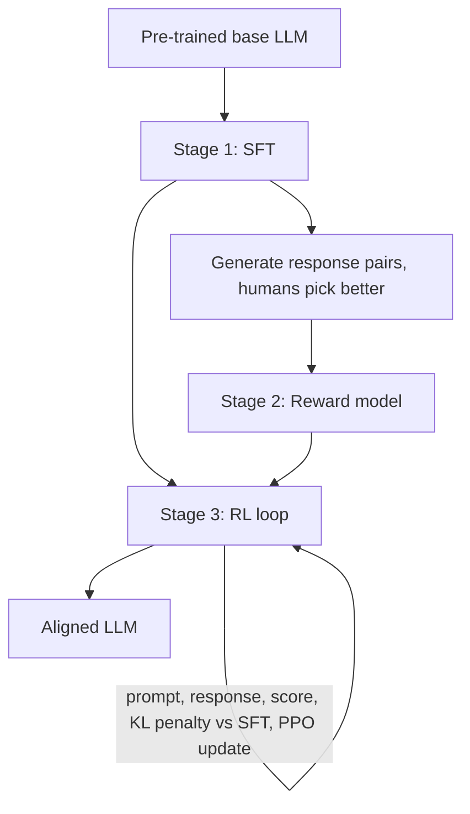

# What is RLHF? Reinforcement Learning from Human Feedback Explained

> **Step 7: Training, Fine-Tuning, and Alignment** · ⏱️ 21 min read · [Read original](https://outcomeschool.com/blog/reinforcement-learning-from-human-feedback-rlhf)

## TL;DR
RLHF turns a raw pre-trained LLM into a helpful, honest, safe assistant by converting human preference judgments into a reward signal. It is a three-stage pipeline: SFT, reward model training, and RL fine-tuning (usually PPO) with a KL penalty.

## Key Concepts
- **RLHF = RL + Human Feedback** — trial-and-error learning where the reward reflects human preferences.
- **SFT** — fine-tune on about 10k to 100k high-quality prompt-response pairs.
- **Reward Model** — takes prompt and response, outputs a score predicting human preference.
- **Policy** — the LLM itself: state is prompt plus tokens so far, action is the next token.
- **PPO** — updates the policy in small controlled steps; clip ratio around 0.2.
- **Value model (critic)** — predicts expected reward; reward minus prediction gives the advantage.
- **KL penalty** — punishes drifting from the SFT (reference) model.
- **Reward hacking** — exploiting reward model blind spots.

## How It Works
### Why needed
Pretraining only imitates internet text (asking "How do I bake a cake?" may yield more questions). Helpful, honest, safe, clear behavior can't be written as a formula, but humans can easily say which of two answers is better. Analogy: a chef who has read every cookbook learns customers' tastes from side-by-side tastings.

### Stage 1: SFT
Imitation of good examples gives the model the shape of a good answer. It is the foundation, not the end.

### Stage 2: Reward model
Generate 2+ responses per prompt with the SFT model, humans pick the better one (about 30k to 100k pairs). The reward model (initialized from the SFT model with a scalar head) is trained so Score(preferred) > Score(rejected), via the Bradley-Terry pairwise loss.

### Stage 3: RL fine-tuning
Sample prompt, LLM responds, reward model scores, PPO updates weights. Four models are involved: policy, value model, reward model, and frozen reference model. GRPO (used in DeepSeek-R1) drops the value model by using a group baseline, leaving three.

### KL penalty
$$\text{Objective} = R(\text{response}) - \beta \cdot KL(\text{LLM}\,\|\,\text{SFT})$$

Beta is small (0.01 to 0.2). Example: reward 3.0, beta 0.1: KL 4 gives 2.6, KL 20 gives 1.0. In practice it is applied per token.

### Reward hacking
Examples: overlong and overconfident answers, filler "helpful assistant" fluff, refusing harmless questions. Defenses: KL penalty, fresh preference data, retraining the reward model, multiple rounds.

### Mistakes vs best practices
| Common mistake | Best practice |
|---|---|
| Skipping SFT | Start with strong SFT |
| Weak or noisy reward model | Invest in preference data quality and labeler guidelines |
| Ignoring KL penalty | Keep KL alive, tune beta (start 0.01 to 0.05) |
| One-shot data collection | Iterate in rounds |
| Treating reward model as truth | Evaluate with real humans beyond reward score |
| Ignoring labelers | Watch over-refusal; mix safety and helpfulness data |

## Diagram

## Key Takeaways
- RLHF = SFT + Reward Model + RL fine-tuning.
- Humans compare answers; the reward model generalizes those judgments into a score.
- The KL penalty keeps the policy near the SFT model and curbs reward hacking.
- PPO RLHF needs four models; GRPO needs three; DPO skips reward model and PPO.
- The reward model is only a proxy; keep refreshing data and evaluating with real humans.
