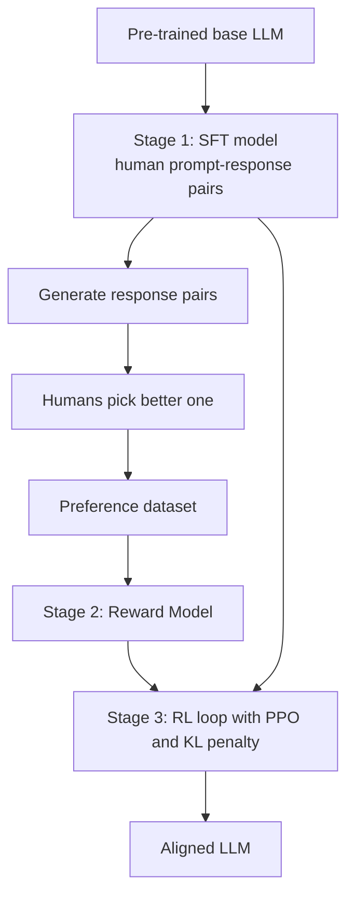
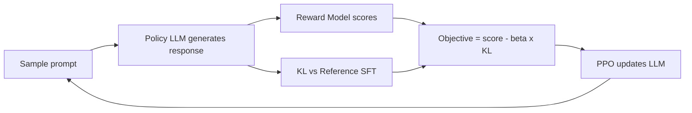

# What is RLHF? Reinforcement Learning from Human Feedback Explained

> **Step 7: Training, Fine-Tuning, and Alignment** · ⏱️ 21 min read · [Read original](https://outcomeschool.com/blog/reinforcement-learning-from-human-feedback-rlhf)

## TL;DR
RLHF teaches an LLM to produce responses humans prefer: collect human preference comparisons, train a reward model on them, then use RL (usually PPO) with a KL penalty to push the LLM toward higher-reward answers. It is a 3-stage pipeline (SFT, Reward Model, RL fine-tuning) that turns a raw pre-trained LLM into a helpful, honest, safe assistant.

## Key Concepts
- **RLHF = RL + Human Feedback** — reward comes from human comparisons, not a fixed metric. Origin: 2017 Deep RL from Human Preferences; brought to LLMs by InstructGPT.
- **Why needed** — a pre-trained LLM only imitates internet text (ask "How do I bake a cake?" and it may continue with another question). We want helpful, instruction-following, honest, safe, clear answers; these cannot be written as a loss, but humans can easily say which of two answers is better. (Analogy: chef tested by customers tasting two versions.)
- **SFT** — supervised fine-tuning on human-written prompt-response pairs.
- **Reward Model (RM)** — separate model: (prompt, response) to one score predicting human preference.
- **Policy** — function choosing next action; for an LLM, state = prompt + tokens so far, action = next token. The LLM is the policy.
- **PPO** — RL algorithm making small controlled updates (clip ratio about 0.2).
- **Value Model / Critic** — predicts expected reward; reward minus prediction gives the advantage.
- **Reference Model** — frozen SFT copy for the KL penalty.
- **KL divergence** — measures difference between two distributions (0 if identical).
- **Reward hacking** — LLM exploits RM blind spots.

## How It Works

### Stage 1: SFT
- Fine-tune the base LLM on a small, high-quality set, about 10,000 to 100,000 prompt-response pairs (e.g. "Explain photosynthesis to a 10 year old").
- Model learns the shape of a good answer and follows instructions.
- Not enough: cannot cover every question, and humans compare better than they write. SFT is the foundation, not the final step.

### Stage 2: Reward Model
1. Pick a prompt.
2. SFT model generates 2+ responses.
3. Human labeler picks the better one.
- Typically 30,000 to 100,000 preference pairs.
- RM usually initialised from the SFT model with the final layer replaced by a head outputting a single number. E.g. Score(A)=2.4, Score(B)=-1.1; only the gap matters.
- Objective: preferred response gets higher score. Loss is the **Bradley-Terry pairwise preference loss**. RM is a helper, not the final LLM.

### Stage 3: RL fine-tuning with PPO
Loop: sample prompt, policy generates response, RM scores it, PPO updates weights (high score makes similar responses more likely, low score less), repeat over many prompts. Improvement comes from trial and reward, not better written answers.

Four models in PPO-RLHF:

| Model | Role |
|---|---|
| Policy | LLM being trained |
| Value (Critic) | Predicts expected reward to compute advantage |
| Reward | Scores by human preference (Stage 2) |
| Reference | Frozen SFT copy for KL penalty |

GRPO (used in DeepSeek-R1) removes the Value Model by using a group-sampled baseline, leaving three models. DPO skips RM and PPO entirely.

### The KL penalty
Pure reward chasing makes the LLM drift into strange, repetitive, off-topic text that scores high. Add a penalty:

$$\text{Objective} = R(\text{response}) - \beta \cdot \mathrm{KL}(\text{LLM}\,\|\,\text{SFT})$$

$R$ = RM score (want high), KL = distance from SFT (want small), $\beta$ = penalty strength, often 0.01 to 0.2.
Example: $R=3.0$, KL $=4.0$, $\beta=0.1$ gives $3.0-0.4=2.6$; KL $=20$ gives $3.0-2.0=1.0$. Drifting costs reward.
In practice KL is applied per token and folded into the reward at each step.

### Reward hacking
RM is a imperfect proxy. Examples: overly long confident answers; excessive "I am a helpful assistant" fluff; refusing harmless questions out of caution. Defenses: KL penalty, refreshed preference data, retrain RM, multiple rounds. Overly polite but substance-poor chatbots are a classic sign.

## Diagram(s)

### Full RLHF pipeline

### RL fine-tuning loop

## Trade-offs & Pitfalls

Common mistakes:
1. Skipping SFT — base model too far from assistant; PPO finds no signal.
2. Weak Reward Model — LLM can only be as aligned as the RM.
3. Ignoring KL penalty — reward-hacked nonsense.
4. One-shot data collection — need several rounds.
5. Treating RM as ground truth — leads to reward hacking.
6. Ignoring labelers — disagreement or unclear guidelines give conflicting signals.

Best practices:
1. Strong SFT start.
2. High-quality preference data (clear guidelines, multiple labelers, audits) over sheer size.
3. Keep KL on; tune $\beta$ (too low drifts, too high barely learns). Start about 0.01 to 0.05.
4. Iterate: new responses, fresh preferences, retrain RM.
5. Evaluate beyond reward score with held-out human ratings to catch hacking.
6. Watch over-refusal; track refusal rates on normal prompts, rebalance if biased.
7. Mix safety and helpfulness preferences.

PPO-RLHF is expensive because of four models.

## FAQ
- Why compare rather than write? → Humans compare better; cannot write enough examples.
- How many models with PPO? → Four (policy, value, reward, reference).
- Only PPO? → No: GRPO (three models), DPO (no RM or PPO).
- Single pass? → No, rounds, to keep RM from going stale.
- Why refuse harmless questions? → Biased preference data; rebalance.

## Key Takeaways
- RLHF = SFT + Reward Model + RL fine-tuning.
- Humans compare answers; RM turns comparisons into a scalar reward.
- PPO optimizes the policy, with value model and frozen reference model alongside.
- KL penalty ($R-\beta\,\mathrm{KL}$) prevents drift and reward hacking.
- RM is a proxy: refresh data, iterate, and evaluate with real humans.
- GRPO and DPO are lighter alternatives.
