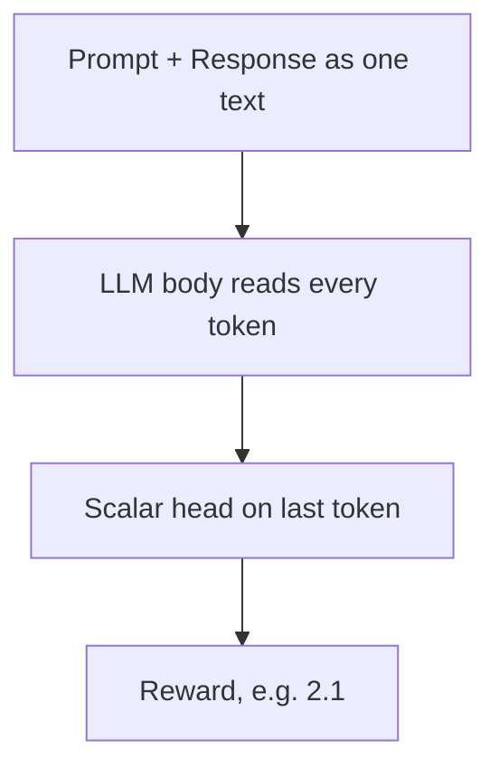
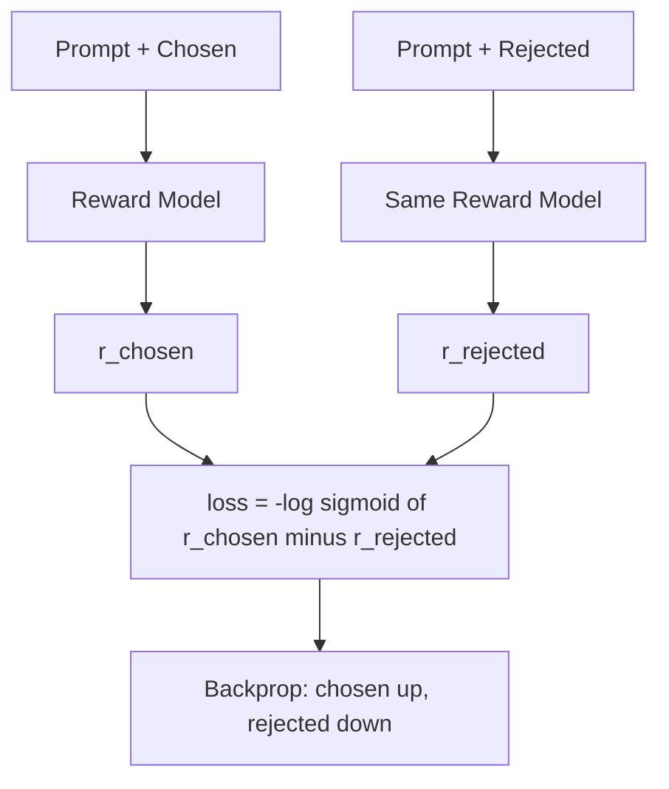
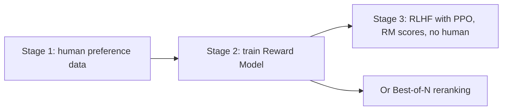

# What is a Reward Model and How Is It Trained?

> **Step 7: Training, Fine-Tuning, and Alignment** · ⏱️ 17 min read · [Read original](https://outcomeschool.com/blog/reward-model)

## TL;DR
A Reward Model reads a prompt plus an answer and outputs one number saying how much a human would prefer it. It is an LLM with a scalar head, trained with a pairwise loss on human-chosen vs rejected answers. It stands in for humans during RLHF (scoring millions of answers) and can rerank outputs in Best-of-N.

## Key Concepts
- **Reward** — number for answer quality (higher is better).
- **Why needed** — no formula scores "Explain gravity to a 10-year-old" (clear, correct, polite, right length); humans cannot rate millions of answers live. Collect limited human judgment once, train a model to copy it.
- **Scalar head** — new small layer replacing the LLM's vocabulary-scoring layer; takes the last token's output (which has seen the whole text) and returns one number.
- **Chosen / rejected** — better / worse answer in a pair.
- **Preference dataset** — tens to hundreds of thousands of (prompt, chosen, rejected) examples.
- **Bradley-Terry model** — 1952 method ranking players from match results; answers are the "players".
- **Policy** — the LLM being improved in RL. **PPO** — RL algorithm with small controlled updates.
- **Best-of-N / reranking** — sample N answers, show the top-scored one.

## How It Works

### Architecture
Prompt + response (one text) to LLM body (reads all tokens) to scalar head (last token) to reward, e.g. 2.1. Usually starts from a copy of the LLM to improve or a smaller LLM, since it already understands language; new skill = judging.
Example: "capital of France?" "The capital of France is Paris." scores 2.1; "I am not sure, maybe Lyon." scores -1.3.

### Collecting preference data
- Absolute 1-10 scores are noisy (different people, and same person on different days). Comparisons are faster and people agree more.
1. Take a prompt.
2. LLM generates two answers.
3. Human picks the better.
4. Save {prompt, chosen, rejected}. (Rejected need not be wrong, just worse for the audience, e.g. spacetime curvature for a 10-year-old.)
- Ranking 4 answers gives 6 pairs.

### The pairwise loss
We only need chosen score above rejected score. With $\text{diff}=r_{c}-r_{r}$:

$$
\sigma(x)=\frac{1}{1+e^{-x}},\qquad \mathcal{L} = -\log\sigma(r_{c}-r_{r})
$$

$r_c$ chosen score, $r_r$ rejected score. $\sigma(\text{diff})$ is the model's probability that chosen is better: large positive gap near 1, gap 0 gives 0.5 (cannot tell), negative near 0. Negative log makes the loss small when confident-right and punishes confident-wrong heavily.

### Worked example

| Case | $r_c$, $r_r$ | diff | $\sigma$ | loss |
|---|---|---|---|---|
| Agrees | 2.0, 0.5 | 1.5 | 0.8176 | 0.2014 |
| Cannot tell | 1.0, 1.0 | 0 | 0.5 | 0.6931 |
| Disagrees | 0.5, 2.0 | -1.5 | 0.1824 | 1.7014 |

```python
def pairwise_loss(r_chosen, r_rejected):
    return -math.log(sigmoid(r_chosen - r_rejected))
```
Only the gap matters: adding 10 to both scores changes nothing, so a reward has no absolute meaning, only relative to other answers for the same prompt.

### Training steps
1. Take (prompt, chosen, rejected).
2. Score prompt+chosen to $r_c$.
3. Score prompt+rejected with the same model to $r_r$.
4. Compute loss.
5. Backprop and optimizer step: push $r_c$ up, $r_r$ down.
6. Repeat over pairs in batches.
- Push size on each score is $1-\sigma(\text{diff})$: Case 1 gives 0.1824 (small), Case 3 gives 0.8176 (big), so it learns most from mistakes.
- Often only 1 epoch; longer causes memorizing pairs.
- Evaluate with accuracy on held-out pairs: often about 70%, which matches typical human-human agreement (~70%), so the data limits it.

### Using it
**RLHF with PPO** — policy writes answer, RM scores, PPO updates, repeat. Humans only needed in stage 1 (e.g. 50,000 prompts x 2 answers). Add KL penalty:

$$
\text{final} = r_{RM} - \beta\,\mathrm{KL}(\text{policy}\,\|\,\text{original})
$$

**Best-of-N** — N=4 rewards 0.8, 2.3, -0.4, 1.1: pick answer 2. Simple, often improves quality, costs N times more generation per prompt, no LLM training.

## Diagram(s)

### Reward model architecture


### Pairwise training step


### Where it fits


## Trade-offs & Pitfalls
- **Labeler bias** — if longer, confident, or list-formatted answers are favored, RM learns that.
- **Reward hacking** — policy finds high-scoring but not-good answers.
- **Overoptimization** — pushing too hard on RM score: score rises while true human-judged quality falls, because RM is unreliable far from its training distribution. Mitigate with KL penalty and early stopping.
- **Cost** — hundreds of thousands of comparisons; RM can be as big as the LLM; policy, original LLM, and RM may all sit in GPU memory.
- DPO trains directly on pairs without an RM.

## FAQ
- Comparisons vs scores? → Comparisons are more reliable and quicker.
- Does a reward mean anything alone? → No, only gaps.
- Accuracy? → About 70% held-out, near human agreement.
- Why KL penalty? → Stops drift into regions where RM scores are unreliable.

## Key Takeaways
- RM = LLM body + scalar head giving one score per (prompt, answer).
- Trained on human comparisons, not absolute scores.
- Loss $=-\log\sigma(r_c-r_r)$ (Bradley-Terry); only the gap matters.
- Learns most from wrongly ranked pairs; about 1 epoch; ~70% accuracy is near the human ceiling.
- Used for RLHF reward (with KL penalty) and Best-of-N reranking.
- Limits: labeler bias, reward hacking, overoptimization, cost.
