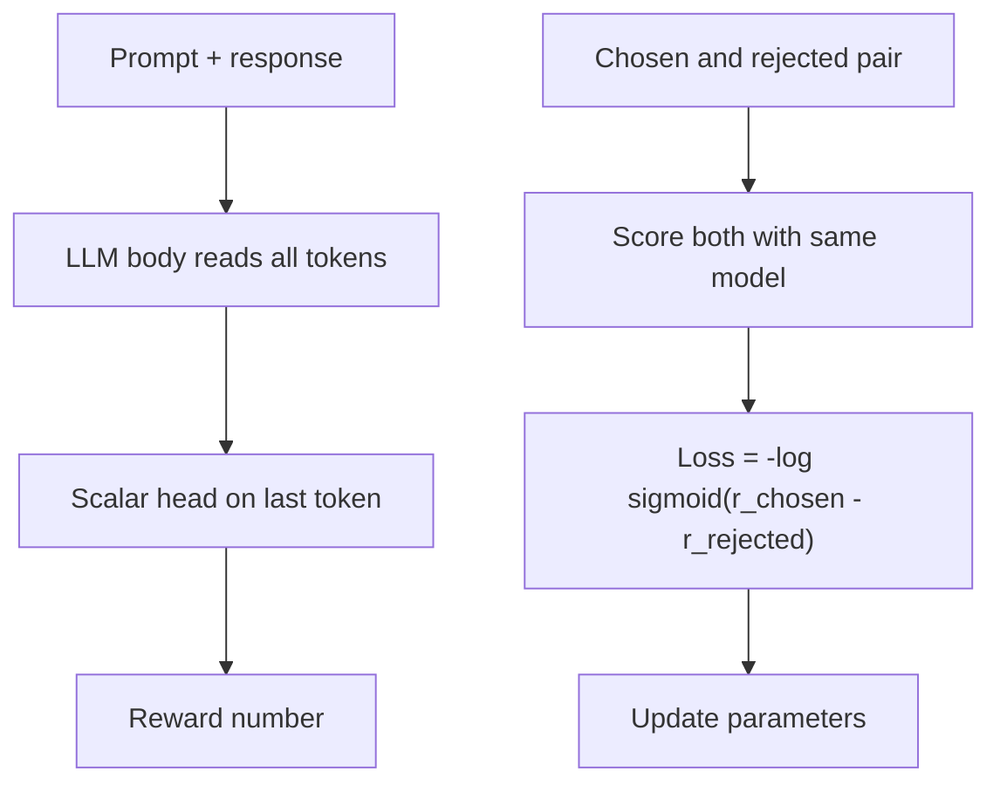

# What is a Reward Model and How Is It Trained?

> **Step 7: Training, Fine-Tuning, and Alignment** · ⏱️ 17 min read · [Read original](https://outcomeschool.com/blog/reward-model)

## TL;DR
A Reward Model reads a prompt and an answer and returns one number estimating how much a human would prefer it. It is trained on pairs of chosen vs rejected answers using a pairwise loss, and then scores millions of answers in RLHF or Best-of-N without a human in the loop.

## Key Concepts
- **Reward model** — an LLM whose final vocabulary layer is replaced by a **scalar head** that outputs one number (read at the last token, which has seen the whole text).
- **Preference dataset** — prompts with a chosen and a rejected response, from tens to hundreds of thousands of examples.
- **Pairwise loss (Bradley-Terry)** — only the score gap matters.
- **Best-of-N / reranking** — generate N answers, show the highest-scored one.
- **Overoptimization** — pushing the policy too hard on the reward model's score makes true quality fall.

## How It Works
### Why needed
RL needs a reward, but "good answer" has no formula and humans cannot rate millions of live generations. So collect human judgment once and train a model to copy it.

### Data collection
Humans score inconsistently (a 7 vs a 5, even for the same person on different days), but comparing two answers is faster and gets more agreement. Steps: take a prompt, generate two answers, a human picks the better, save as chosen/rejected. Ranking 4 answers yields 6 pairs.

### Pairwise loss
$$\text{loss} = -\log\sigma(r_{chosen} - r_{rejected})$$

| Case | Scores | Gap | Loss |
|---|---|---|---|
| Agrees | 2.0 vs 0.5 | 1.5 | 0.2014 |
| Cannot tell | 1.0 vs 1.0 | 0 | 0.6931 |
| Disagrees | 0.5 vs 2.0 | -1.5 | 1.7014 |

Adding a constant to both scores changes nothing, so a reward has no meaning alone, only relative to other answers for the same prompt.

### Training
1. Take a pair.
2. Score "prompt + chosen".
3. Score "prompt + rejected" with the same model.
4. Compute the loss.
5. Backprop, update to push chosen up and rejected down (push size is $1-\sigma(\text{diff})$, so it learns most from mistakes).
6. Repeat in batches; often just 1 epoch to avoid memorizing.

Held-out accuracy is often only about 70%, similar to human labeler agreement.

### Usage
- **RLHF with PPO:** policy writes, reward model scores, PPO updates. Humans needed only in data collection. Final reward = score minus beta times KL from the original LLM.
- **Best-of-N:** pick the top of N samples; no extra training but N times the generation cost.

### Limitations
Labeler bias (longer, confident, listy answers), reward hacking, overoptimization (mitigate with KL penalty and early stopping), and high cost (policy, original LLM, and reward model all in GPU memory). DPO trains directly on pairs without a reward model.

## Diagram

## Key Takeaways
- A reward model is an LLM with a scalar head trained to mimic human preference.
- Train on comparisons, not absolute scores; only the score gap matters.
- Humans are needed once for data; after that the model scores answers at scale.
- Used for RLHF rewards and Best-of-N reranking.
- It is a proxy: biased, hackable, and unreliable far from its training distribution.
